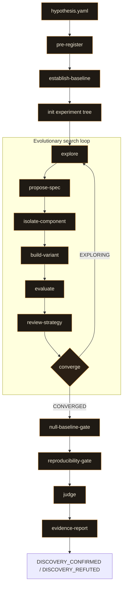

# auto-discover

A Claude Code plugin for evolutionary ML architecture discovery. Give it a hypothesis and a compute budget. It searches, gates, and judges, autonomously.

> **Status:** 0.2.0 · MIT licensed · part of the trio with [model_trainer](https://github.com/Hook12aaa/model-trainer) and [auto-researcher](https://github.com/Hook12aaa/auto-researcher).

---

## Background

[model_trainer](https://github.com/Hook12aaa/model-trainer) was the starting point: a teaching tool for supervised ML, human-gated at every step, showing people that building a model is an experiment, not a one-shot. [auto_model_trainer](https://github.com/Hook12aaa/auto-model-trainer) took the human out. Same rigour, no gates. Kaggle-competitive, fully autonomous, convergence enforced structurally so the search ends when the math says it ends.

auto-discover is not the next step in that line. It is a different question entirely.

We build on frameworks with strong foundations: ReLU, regression, matrix multiplication. They work. But they are not always the right mathematics for the problem. Sound does not converge linearly. Graph structures do not decompose into rows and columns. When the data has structure that does not fit the standard toolkit, is there a better basis, and can you find it without knowing what paper already describes it?

Can you reconstruct and prove a mathematical result from first principles, without retrieving it from what you already know?

The harness enforces this structurally. Every architecture traces through a forced problem reframing: restated twice, derived from an analogy, never from a recalled pattern. Convergence measures whether the search space is exhausted, not whether one loss curve looks nice. Two confirmed discoveries across two domains so far.

---

## Results

Two experiments, two domains, two architectures the harness discovered from first principles.

| Experiment | Winner | Accuracy | Params | What it found |
|---|---|---|---|---|
| Modular arithmetic (mod p, 9 primes) | `harmonic_phase_correlator_v2` | 100% | 160 | The convolution theorem on finite cyclic groups, implemented as a neural network |
| Graph distinguishability (1-WL pairs) | `niche_partitioned_aggregator` | 100% | 16,769 (slim) | Guild aggregation: sum, max, and std partitioned across embedding dimensions |

Both passed the full gate sequence: null-baseline (3 controls), reproducibility (5 seeds), and an independent judge that never saw the architecture. Both emitted `DISCOVERY_CONFIRMED`.

The modular arithmetic winner has two learned components (a frequency table and channel weights) and reaches 100% accuracy in 100 epochs from random init. The architecture *is* the convolution theorem: addition in Z/pZ as pointwise multiplication of Fourier characters.

The graph winner independently discovered multi-aggregation related to but distinct from the known GIN architecture (which uses pure sum). The harness arrived at it through an ecology framing (niche partitioning from community ecology), not through graph theory literature.

---

## Quickstart

```
/auto-discover hypothesis.yaml
```

One command. The hypothesis file is the only input:

```yaml
thesis: >
  There exists a message-passing neural network that can distinguish all pairs
  of non-isomorphic graphs the 1-WL test can distinguish, using fewer parameters
  than a standard GCN with mean aggregation.
null_hypothesis: >
  A standard 3-layer GCN with mean aggregation, same data, same budget.
success_criteria:
  - "100% accuracy on curated 1-WL-distinguishable pairs"
failure_criteria:
  - "Gradient norms exceed 50 for 3 consecutive checkpoints"
pre_registered_metrics:
  primary: classification_accuracy_wl_pairs
  secondary: [compute_to_threshold_ratio, param_efficiency_params_per_accuracy_point]
  forbidden: [raw_loss_comparison_without_normalization]
seeds: [42, 137, 256, 512, 1024]
training_budget:
  max_compute_flops: 1e14
  max_epochs: 5000
  max_wall_clock_minutes: 60
genome_constraints:
  max_parameters: 100000
variance_tolerance: 0.10
```

Everything between the hypothesis and the terminal verdict is autonomous.

---

## The pipeline



The loop runs many times. Each round, `explore` dispatches research subagents with different problem framings (algebraic, geometric, information-theoretic, signal processing) and each derives an architecture from first principles. `converge` reads the experiment tree and returns `EXPLORING` (loop again) or `CONVERGED` (exit with the leading candidate). Only then do the end gates fire: once, on one candidate, irreversibly.

| Skill | What it is really doing |
|---|---|
| `pre-register` | Validating the hypothesis, rejecting phenomenon-named metrics, locking everything behind a SHA-256 hash |
| `establish-baseline` | Training the null hypothesis with hyperparameters derived from data characteristics, not literature defaults |
| `explore` | Spawning research subagents on different analogy domains, enforcing anti-retrieval gates, dispatching `propose-spec` per thesis |
| `propose-spec` | Translating one research thesis into a typed genome spec, checking composition-topology divergence against every prior spec |
| `isolate-component` | Running 3 isolation gates on novel components (gradient flow, output range, toy convergence) before they enter a full architecture |
| `build-variant` | Building and training one spec in an isolated git worktree with adaptive early stopping |
| `evaluate` | Scoring against pre-registered metrics. Training dynamics are a diagnostic field, not the verdict |
| `review-strategy` | Pareto dominance, parameter efficiency, stale-pathway detection. Decides whether this spec advances the search |
| `converge` | Two-tier search-level convergence: within-class exhaustion + cross-class coverage. A single strong candidate satisfies none of this |
| `null-baseline-gate` | 3 null comparisons (shuffled-label, constant-output, baseline) on pre-registered metrics only |
| `reproducibility-gate` | Re-runs across the declared seed set, checks variance against tolerance |
| `judge` | Independent agent that sees only the metrics manifest, hypothesis, and gate results. Never the genome spec |
| `evidence-report` | Writes structured evidence JSON and emits one terminal verdict |

---

## The anti-retrieval discipline

The deepest failure mode in AI-assisted research is not hallucination. It is retrieval. Claude retrieving a known experimental setup is more dangerous than inventing one, because the retrieved setup passes surface-level review.

The harness enforces four principles pipeline-wide:

1. **Restate before you act.** Every research subagent restates the problem in two fundamentally different ways before proposing anything. The restatement is about what the computation requires, not what architecture might supply it.
2. **Derive, don't retrieve.** Every composed artifact traces to a derivation from the problem structure. Hyperparameters derive from gradient scale analysis and parameter-to-sample ratios, not from "the papers use weight decay 1.0."
3. **Name the analogy.** When adapting a method from a related problem, state which problem and why the transfer holds.
4. **Look back.** After every round, ask what the result tells you about the *frame*, not just the model.

HARD-GATEs enforce this structurally: no spec derived from a named architecture pattern in Claude's training data, no spec proposed before the problem has been restated, no spec sharing its composition topology with a prior spec in the tree.

---

## Convergence is search-level

A model that reaches 99% accuracy and stays there has grounded convergence: the representation is structurally sound. A model that reaches 99% then drops to 12% has consensus convergence: it found an attractor without structural backing. Both look identical in a loss curve.

The plugin applies this distinction to the search, not the run. `converge` checks two tiers: **within-class exhaustion** (has each spec class been refined until it stopped improving?) and **cross-class coverage** (have enough different classes been explored, and has the Pareto front stabilised?). A single strong candidate satisfies none of these conditions. A stable front from one class is consensus wearing a search's clothing.

---

## Design principles

1. **Execute, don't eyeball.** Every numerical check is a composed script that runs and returns JSON. Nobody reads a loss curve and calls it done.
2. **Structural distrust.** The proposer, the builder, and the judge are never the same agent. `judge` sees only numbers and gates, never the architecture.
3. **Pre-registration is immutable.** Thesis, metrics, seeds, and budget are locked behind SHA-256 before any experiment runs. Nothing downstream loosens a threshold after seeing results.
4. **A system that retrieves its answer cannot discover it.** Every genome spec traces through forced problem reframing. Recall is evidence of *not* having derived it.
5. **Convergence is search-level.** Training dynamics are a diagnostic. The search's coverage is the stopping signal.
6. **Composed, not shipped.** The plugin ships Markdown only. No scripts, no Python engine, no bundled library. Every verification script is written and executed by Claude in whatever language the experiment repo uses.

---

## Installing

### With `--plugin-dir` (recommended)

```bash
claude --plugin-dir "/path/to/auto-discover"
```

This loads the plugin for the session. The `SessionStart` hook bootstraps automatically and injects `using-auto-discover`.

### From a local clone

```bash
git clone https://github.com/Hook12aaa/auto-discover.git
claude --plugin-dir ./auto-discover
```

---

## Prerequisites

| Requirement | Why |
|---|---|
| **A git repository** | Each variant builds in its own isolated worktree. The experiment tree lives alongside the code. |
| **Python in `PATH`** | Spec-class exhaustion, Pareto dominance, null comparisons, and variance calculations run through composed scripts. |
| **A `hypothesis.yaml`** | The thesis, null hypothesis, criteria, metrics, seeds, and budget. The only input. |

No custom runtime, no bundled ML engine, no daemon. The plugin is Markdown and YAML. Claude Code is the runtime.

---

## Repository layout

```
.
├── .claude-plugin/        # plugin manifest
├── bin/
│   ├── check-skill-anatomy.sh
│   └── check-verdict-vocab.sh
├── commands/
│   └── auto-discover.md   # /auto-discover slash command
├── hooks/                 # SessionStart bootstrap
├── skills/
│   ├── auto-discover/         # orchestrator
│   ├── build-variant/         # worktree-isolated training
│   ├── converge/              # two-tier search convergence
│   ├── establish-baseline/    # null hypothesis training
│   ├── evaluate/              # metric scoring
│   ├── evidence-report/       # terminal verdict + evidence JSON
│   ├── explore/               # anti-retrieval research subagents
│   ├── isolate-component/     # 3 isolation gates
│   ├── judge/                 # independent scoring agent
│   ├── null-baseline-gate/    # 3 null comparisons
│   ├── pre-register/          # hypothesis validation + SHA-256
│   ├── propose-spec/          # thesis → genome spec
│   ├── reproducibility-gate/  # multi-seed variance check
│   ├── review-strategy/       # Pareto + efficiency + stale detection
│   └── using-auto-discover/   # session bootstrap
├── experiments/           # archived experiment results
├── CLAUDE.md
└── README.md
```

---

## Licence

MIT. Use it, fork it, build on it. Attribution is welcome but not required.
