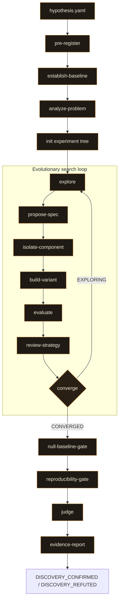

# auto-discover

A Claude Code plugin for evolutionary ML architecture discovery. Give it a hypothesis and a compute budget. It searches, gates, and judges, autonomously.

> **Status:** 0.3.0 · MIT licensed · part of the trio with [model_trainer](https://github.com/Hook12aaa/model-trainer) and [auto-researcher](https://github.com/Hook12aaa/auto-researcher).

---

## Background

[model_trainer](https://github.com/Hook12aaa/model-trainer) was the starting point: a teaching tool for supervised ML, human-gated at every step, showing people that building a model is an experiment, not a one-shot. [auto_model_trainer](https://github.com/Hook12aaa/auto-model-trainer) took the human out. Same rigour, no gates. Kaggle-competitive, fully autonomous, convergence enforced structurally so the search ends when the math says it ends.

auto-discover is not the next step in that line. It is a different question entirely.

We build on frameworks with strong foundations: ReLU, regression, matrix multiplication. They work. But they are not always the right mathematics for the problem. Sound does not converge linearly. Graph structures do not decompose into rows and columns. When the data has structure that does not fit the standard toolkit, is there a better basis, and can you find it without knowing what paper already describes it?

---

## Results

Two experiments, two domains, two architectures the harness discovered from structural analysis of the problems.

| Experiment | Winner | Accuracy | Params | What it found |
|---|---|---|---|---|
| Modular arithmetic (mod p, 9 primes) | `harmonic_phase_correlator_v2` | 100% | 160 | The convolution theorem on finite cyclic groups, implemented as a neural network |
| Graph distinguishability (1-WL pairs) | `niche_partitioned_aggregator` | 100% | 16,769 (slim) | Guild aggregation: sum, max, and std partitioned across embedding dimensions |

Both passed the full gate sequence: null-baseline (3 controls), reproducibility (5 seeds), and an independent judge that never saw the architecture. Both emitted `DISCOVERY_CONFIRMED`.

The modular arithmetic winner has two learned components (a frequency table and channel weights) and reaches 100% accuracy in 100 epochs from random init. The architecture *is* the convolution theorem: addition in Z/pZ as pointwise multiplication of Fourier characters.

The graph winner independently discovered multi-aggregation related to but distinct from the known GIN architecture (which uses pure sum). The harness arrived at it through structural analysis of 1-WL expressiveness bounds, not through graph theory literature.

---

## Quickstart

```
/auto-discover hypothesis.yaml
```

One command. The hypothesis file is the only input:

```yaml
thesis: >
  There exists a message-passing neural network that can distinguish all pairs
  of non-isomorphic graphs the 1-WL test can distinguish, using fewer parameters
  than a standard GCN with mean aggregation.
null_hypothesis: >
  A standard 3-layer GCN with mean aggregation, same data, same budget.
success_criteria:
  - "100% accuracy on curated 1-WL-distinguishable pairs"
failure_criteria:
  - "Gradient norms exceed 50 for 3 consecutive checkpoints"
pre_registered_metrics:
  primary: classification_accuracy_wl_pairs
  secondary: [compute_to_threshold_ratio, param_efficiency_params_per_accuracy_point]
  forbidden: [raw_loss_comparison_without_normalization]
seeds: [42, 137, 256, 512, 1024]
training_budget:
  max_compute_flops: 1e14
  max_epochs: 5000
  max_wall_clock_minutes: 60
genome_constraints:
  max_parameters: 100000
variance_tolerance: 0.10
```

Everything between the hypothesis and the terminal verdict is autonomous.

---

## The pipeline



### How it works

The orchestrator dispatches each stage as an independent agent with its own worktree. Compute-heavy stages (baseline training, architecture building, isolation gates, reproducibility) run in isolated agents so the orchestrator's context stays lean. The orchestrator reads JSON results, aggregates the experiment tree, and dispatches the next stage.

Each skill is a **contract**: typed inputs, typed outputs, a verdict, and a set of reference docs to consult. The domain knowledge — what to analyze, what components exist, what thresholds to use — lives in colocated `references/` directories as decision tables and catalogs, not in the skill's prose. Adding a new problem domain means adding sections to reference docs, not rewriting skills.

| Skill | What it does |
|---|---|
| `pre-register` | Validates the hypothesis, rejects phenomenon-named metrics, locks behind SHA-256 |
| `establish-baseline` | Trains the null hypothesis with derived hyperparameters. Dispatched as Agent with worktree |
| `analyze-problem` | Structural analysis of the task: symmetries, invariances, information bounds, baseline failure mode. Produces research directions. Dispatched as Agent with worktree |
| `explore` | Reads problem analysis signals, investigates structural directions, produces genome specs with divergence enforcement. Dispatched as Agent with worktree |
| `propose-spec` | Translates a research proposal into a typed genome spec, checking composition-topology divergence |
| `isolate-component` | 3 isolation gates (gradient flow, output range, toy convergence) before full training. Dispatched per-spec in parallel |
| `build-variant` | Builds and trains one spec in an isolated worktree with chance-level early kill and patience-based stopping. Dispatched per-spec, streamed |
| `evaluate` | Scores against pre-registered metrics with forensic validation. Training dynamics are a diagnostic, not the verdict |
| `review-strategy` | Pareto dominance, parameter efficiency, stale-pathway detection |
| `converge` | Two-tier search-level convergence: within-class exhaustion + cross-class coverage. Runs inline in the orchestrator |
| `null-baseline-gate` | 3 null comparisons (shuffled-label, constant-output, baseline) on pre-registered metrics only |
| `reproducibility-gate` | Re-runs across the declared seed set, checks variance against tolerance |
| `judge` | Independent agent that sees only the metrics manifest, hypothesis, and gate results |
| `evidence-report` | Writes structured evidence JSON and emits one terminal verdict |

---

## Architecture: contract-first, library-last

v2 replaced the methodology-teaching skill style with a contract-first architecture inspired by [auto_model_trainer](https://github.com/Hook12aaa/auto-model-trainer).

**The problem:** v1's skills prescribed *how to think* — Polya's four-step method, assigned analogy domains, mandatory reframing steps. This baked the methodology into the skills, making them domain-specific and brittle. The anti-retrieval gates prevented Claude from retrieving known *architectures*, but the skills themselves retrieved a known *creative methodology*.

**The fix:** Skills define contracts (inputs → outputs → verdicts). Domain knowledge lives in colocated reference docs as decision tables and catalogs. The orchestrator dispatches agents with explicit worktree isolation, keeping its own context lean.

```
skills/
  analyze-problem/
    SKILL.md                           # contract: reads hypothesis + baseline, writes problem-analysis.json
    references/
      problem-analysis-schema.md       # formal JSON schema
      domain-detection.md              # signal → domain type decision table
      analysis-catalog.md              # per-domain structural checks (§ Mathematical, § Graph, § Sequence, ...)
  explore/
    SKILL.md                           # contract: reads analysis + tree, writes genome specs
    references/
      proposal-schema.md               # formal JSON schema
      component-vocabulary.md          # per-domain operation catalogs
      divergence-rules.md              # fingerprint computation, collision detection
  auto-discover/
    SKILL.md                           # orchestrator contract
    references/
      experiment-tree-schema.md        # formal JSON schema
      dispatch-contract.md             # per-stage: Agent tool, isolation, model, inline context, verify on return
      pipeline-overview.md             # stage diagram
  ...
```

### Adding a new domain

Adding a new problem domain (e.g., time-series, vision) requires reference doc sections, not skill rewrites:

1. Add a row to `analyze-problem/references/domain-detection.md`
2. Add a section to `analyze-problem/references/analysis-catalog.md`
3. Add a section to `explore/references/component-vocabulary.md`
4. Add a section to `build-variant/references/training-conventions.md`
5. Add a section to `isolate-component/references/threshold-calibration.md`
6. Add a section to `establish-baseline/references/baseline-conventions.md`

### Dispatch model

The orchestrator uses two verbs:

| Verb | Mechanism | When |
|---|---|---|
| **Invoke** | `Skill()` — runs inline | Fast stages needing orchestrator context (pre-register, converge, evidence-report) |
| **Dispatch** | `Agent(isolation: "worktree")` — fresh agent | Any stage that composes or runs code (baseline, analyze, explore, build, isolate, evaluate, null-gate, repro-gate, judge) |

The orchestrator never runs Bash for code composition or training. All code execution happens in dispatched agents. Only JSON summaries return to the orchestrator.

---

## Convergence is search-level

`converge` checks two tiers: **within-class exhaustion** (has each spec class been refined until it stopped improving?) and **cross-class coverage** (have enough different classes been explored, and has the Pareto front stabilised?). A single strong candidate satisfies none of these conditions.

---

## Design principles

1. **Analyze, then assemble.** The problem analysis identifies what the task's mathematical structure requires. Explore reads those signals and assembles proposals from structural evidence, not recalled patterns.
2. **Contract-first, library-last.** Skills define typed contracts. Domain knowledge lives in colocated reference docs.
3. **Execute, don't eyeball.** Every numerical check is a composed script that runs and returns JSON.
4. **Structural distrust.** The proposer, the builder, and the judge are never the same agent.
5. **Pre-registration is immutable.** Thesis, metrics, seeds, and budget are locked behind SHA-256 before any experiment runs.
6. **Convergence is search-level.** Training dynamics are a diagnostic. The search's coverage is the stopping signal.
7. **Composed, not shipped.** The plugin ships Markdown only. No scripts, no Python engine. Every verification script is written and executed by Claude in the experiment repo's language.

---

## Installing

### With `--plugin-dir` (recommended)

```bash
claude --plugin-dir "/path/to/auto-discover"
```

This loads the plugin for the session. The `SessionStart` hook bootstraps automatically.

### From a local clone

```bash
git clone https://github.com/Hook12aaa/auto-discover.git
claude --plugin-dir ./auto-discover
```

---

## Prerequisites

| Requirement | Why |
|---|---|
| **A git repository** | Each variant builds in its own isolated worktree. The experiment tree lives alongside the code. |
| **Python in `PATH`** | Spec-class exhaustion, Pareto dominance, null comparisons, and variance calculations run through composed scripts. |
| **A `hypothesis.yaml`** | The thesis, null hypothesis, criteria, metrics, seeds, and budget. The only input. |

No custom runtime, no bundled ML engine, no daemon. The plugin is Markdown and YAML. Claude Code is the runtime.

---

## Repository layout

```
.
├── .claude-plugin/        # plugin manifest
├── bin/
│   ├── check-skill-anatomy.sh
│   └── check-verdict-vocab.sh
├── commands/
│   └── auto-discover.md   # /auto-discover slash command
├── hooks/                 # SessionStart bootstrap
├── skills/
│   ├── analyze-problem/       # structural analysis + research directions
│   │   └── references/        # problem-analysis-schema, domain-detection, analysis-catalog
│   ├── auto-discover/         # orchestrator
│   │   └── references/        # experiment-tree-schema, dispatch-contract, pipeline-overview
│   ├── build-variant/         # worktree-isolated training
│   │   └── references/        # training-conventions, early-stopping-rules
│   ├── converge/              # two-tier search convergence
│   │   └── references/        # convergence-conditions
│   ├── establish-baseline/    # null hypothesis training
│   │   └── references/        # baseline-conventions
│   ├── evaluate/              # metric scoring + forensics
│   │   └── references/        # training-diagnostics, metric-extraction
│   ├── evidence-report/       # terminal verdict + evidence JSON
│   │   └── references/        # evidence-schema, verdict-rules
│   ├── explore/               # structural direction investigation
│   │   └── references/        # proposal-schema, component-vocabulary, divergence-rules
│   ├── isolate-component/     # 3 isolation gates
│   │   └── references/        # isolation-gates, threshold-calibration
│   ├── judge/                 # independent scoring agent
│   │   └── references/        # scoring-rubric
│   ├── null-baseline-gate/    # 3 null comparisons
│   │   └── references/        # null-comparisons
│   ├── pre-register/          # hypothesis validation + SHA-256
│   │   └── references/        # validation-rules
│   ├── propose-spec/          # proposal → genome spec
│   │   └── references/        # genome-spec-schema, translation-rules
│   ├── reproducibility-gate/  # multi-seed variance check
│   │   └── references/        # variance-rules
│   ├── review-strategy/       # Pareto + efficiency + stale detection
│   │   └── references/        # pareto-computation, efficiency-thresholds
│   └── using-auto-discover/   # session bootstrap
├── experiments/           # archived experiment results
├── research.md            # methodology research notes
├── CLAUDE.md
└── README.md
```

---

## Licence

MIT. Use it, fork it, build on it. Attribution is welcome but not required.
