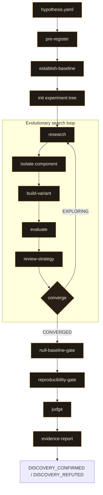

# auto-discover

A Claude Code plugin for evolutionary ML architecture discovery. Give it a hypothesis and a compute budget. It searches, gates, and judges, autonomously.

> **Status:** 0.4.0 · MIT licensed · part of the trio with [model_trainer](https://github.com/Hook12aaa/model-trainer) and [auto-researcher](https://github.com/Hook12aaa/auto-researcher).

---

## Why I built this

Here's the thing about working with LLMs on code: if you ask Claude to build you an API endpoint, it's great. REST patterns, auth middleware, database queries — that stuff is massively represented in the training data. The model has seen thousands of examples and it composes from them fluently.

But what happens when you ask it to do something that isn't well-represented? Not "build me a thing like the things you've seen" but "figure out something that takes combining ideas in a way nobody wrote down for you." That's a different problem. And it's the one I've been stuck on.

I wanted to know if an isolated Claude session — no human steering, no hints — could take a problem with real mathematical structure and find an architecture that works. Not retrieve one. Find one. The distinction matters because language models are token predictors by training. They're very good at producing things that look like things they've seen before. Getting them to go against that — to express something in a knowledge area that isn't dominated by well-trodden patterns — that's what this project has been about.

It's taken multiple iterations to get the approach right, and each one taught me something about the difference between discovery and retrieval.

The first version taught the agent Polya's problem-solving heuristics. Understand, plan, execute, reflect. It worked — found a 160-parameter architecture with 100% accuracy on modular arithmetic. But I was prescribing the methodology. The discovery might have been real, or the structured thinking might have just been a cleaner path to something the model already knew.

The second version replaced methodology with domain catalogs — tables of mathematical properties, component vocabularies. That was worse. 17,000 parameters, failed reproducibility. The search could only find what I'd thought to list in the catalogs. If I didn't name it, it couldn't find it.

So I stripped everything out. Ran a raw research session — no catalogs, no methodology, just "probe the problem." It found a 124-parameter architecture. That was the moment. Probing beats prescribing when the problem has structure the prescriptions don't cover.

The current version (v0.4) builds on that. It prescribes process — probe, search, prototype, learn from failure, try something different — but never prescribes content or methodology. What to look for emerges from the problem itself. The agent ran four rounds of iterative failure-driven research on modular arithmetic and found the pure algebraic solution. Zero parameters. The architecture *is* the theorem.

| Version | Approach | Params | What happened |
|---|---|---|---|
| v0.1 | Prescribe methodology | 160 | Polya's heuristics guided a discovery — or a retrieval |
| v0.2 | Prescribe content | 17,311 | Catalogs constrained the search. Failed reproducibility |
| v0.3 | Prescribe nothing | 124 | Raw probing found better than catalogs |
| v0.4 | Prescribe process | 0 | Iterative failure found the exact algebraic solution |

The less I told the agent what to find, the better it found things.

I want to be honest: modular arithmetic has an exact analytical solution, and Claude's training data covers the relevant group theory. I can't fully separate discovery from recall on this problem. The next step is a domain where the answer isn't in the training data and a zero-parameter shortcut doesn't exist. That's where this either proves itself or doesn't.

If you're thinking about trying it, the idea is simple: write a hypothesis, point the plugin at it, and let it run.

---

## Quickstart

```
/auto-discover hypothesis.yaml
```

One command. The hypothesis file is the only input:

```yaml
thesis: >
  There exists a message-passing neural network that can distinguish all pairs
  of non-isomorphic graphs the 1-WL test can distinguish, using fewer parameters
  than a standard GCN with mean aggregation.
null_hypothesis: >
  A standard 3-layer GCN with mean aggregation, same data, same budget.
success_criteria:
  - "100% accuracy on curated 1-WL-distinguishable pairs"
failure_criteria:
  - "Gradient norms exceed 50 for 3 consecutive checkpoints"
pre_registered_metrics:
  primary: classification_accuracy_wl_pairs
  secondary: [compute_to_threshold_ratio, param_efficiency_params_per_accuracy_point]
  forbidden: [raw_loss_comparison_without_normalization]
seeds: [42, 137, 256, 512, 1024]
training_budget:
  max_compute_flops: 1e14
  max_epochs: 5000
  max_wall_clock_minutes: 60
genome_constraints:
  max_parameters: 100000
variance_tolerance: 0.10
```

Everything between the hypothesis and the terminal verdict is autonomous.

---

## The pipeline



The orchestrator dispatches each stage as an independent agent with its own git worktree. Compute-heavy work runs in isolated agents so the orchestrator stays lean. Only JSON summaries return.

The `research` skill is the core of v0.4. It probes the problem with short scripts, web-searches based on what the probes find, prototypes candidate architectures, and learns from the prototypes before emitting genome specs. Every spec traces to a logged finding. No catalogs, no checklists — what to look for comes from the problem.

Convergence is search-level, not training-run-level. The `converge` skill checks whether the search space has been covered — within-class exhaustion and cross-class coverage — not whether a single model's loss curve plateaued.

After convergence, the leading candidate submits to null-baseline comparisons, reproducibility checks across the declared seed set, and an independent judge that never saw the architecture. The proposer, the builder, and the judge are never the same agent.

---

## Design principles

1. **Research, don't prescribe.** The search space emerges from probing and web research, not from catalogs or methodologies.
2. **Contract-gated.** Skills define typed contracts; verdicts come from executed checks.
3. **Execute, don't eyeball.** Every numerical check is a composed script that runs and returns JSON.
4. **Structural distrust.** The proposer, the builder, and the judge are never the same agent.
5. **Pre-registration is immutable.** Thesis, metrics, seeds, and budget are locked behind SHA-256 before any experiment runs.
6. **Composed, not shipped.** The plugin ships Markdown only. No scripts, no Python engine. Every verification script is written and executed by Claude in the experiment repo's language.

---

## Installing

```bash
claude --plugin-dir "/path/to/auto-discover"
```

Or from a clone:

```bash
git clone https://github.com/Hook12aaa/auto-discover.git
claude --plugin-dir ./auto-discover
```

The `SessionStart` hook bootstraps automatically. You need a git repository, Python on `PATH`, and a `hypothesis.yaml`. No custom runtime, no daemon. Markdown and YAML. Claude Code is the runtime.

---

## Licence

MIT. Use it, fork it, build on it.
