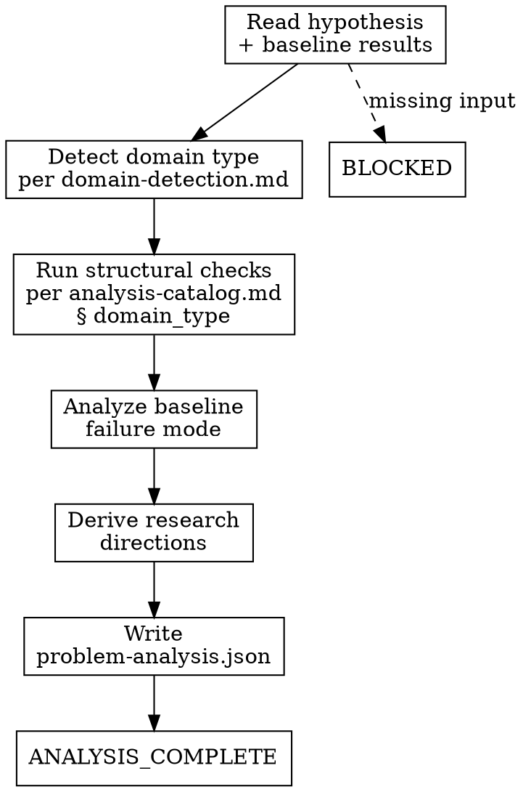

<!-- design-region-clean-of-hard-gates -->

# Analyze Problem

## Contract

- **Reads**: `.auto-discover/hypothesis.yaml`, `.auto-discover/baselines/baseline_metrics.json`
- **Writes**: `.auto-discover/problem-analysis.json` (schema: `references/problem-analysis-schema.md`)
- **References**: `references/domain-detection.md`, `references/analysis-catalog.md`, `references/problem-analysis-schema.md`
- **Verdicts**: ANALYSIS_COMPLETE, BLOCKED

<HARD-GATE>
Do NOT begin without both `.auto-discover/hypothesis.sha256` and `.auto-discover/baselines/baseline_metrics.json` on disk. STOP and report the missing file.
</HARD-GATE>

<HARD-GATE>
Do NOT produce a research direction without tracing it to a verified structural property. STOP and remove any direction that lacks a `source_property` reference.
</HARD-GATE>

<HARD-GATE>
Do NOT write a research direction if it names an architecture or paper. STOP and restate the implication in terms of what the problem requires.
</HARD-GATE>

## Anti-Pattern

**"I know what architectures work for this kind of problem."** The analysis asks what the task's structure requires of any solution, not what solutions exist. Architecture implications emerge from structural properties, not from a catalog of known approaches.

## Core Principle

Analyze the problem's structure, not the solution landscape.

## Process Flow



## Checklist

1. Read the locked hypothesis and baseline results
2. Detect the domain type
3. Run structural checks for the detected domain
4. Analyze the baseline failure mode
5. Derive research directions from checked properties
6. Write `.auto-discover/problem-analysis.json`
7. Emit verdict

## Step Details

### 1. Read the locked hypothesis and baseline results

Read `.auto-discover/hypothesis.yaml` for the thesis, null hypothesis, genome constraints, and problem description. Populate the `task` fields (`input_type`, `output_type`, `mapping`, `instance_structure`) from the hypothesis description. Read `.auto-discover/baselines/baseline_metrics.json` for the baseline's metric values, training trajectory, and final performance.

### 2. Detect the domain type

Read `references/domain-detection.md`. Scan the hypothesis `thesis`, `null_hypothesis`, and `success_criteria` for the keywords in the Signal column. Record every matching domain. One match: that domain is `domain_type`. Multiple matches: apply the Multi-Domain Hypotheses resolution table. No match: emit BLOCKED.

### 3. Run structural checks for the detected domain

Read `references/analysis-catalog.md` § {domain_type}. Run each check in the domain's table. For each check, compose and execute a verification script on toy instances where the "How to verify" column prescribes one. Route each check's output to the field named in the catalog's Output field column: checks with `sp:` output produce `structural_properties` entries, the "Baseline failure mode" check produces `baseline_failure_analysis` fields, and "Theoretical constraints" checks produce `theoretical_constraints` entries. Record `verified: true` on `structural_properties` entries only when a script confirmed the property; record `verified: false` with `verification_method: null` otherwise.

### 4. Analyze the baseline failure mode

Read `baseline_metrics.json`. Record the accuracy, failure mode, and structural gap. Name the specific gap the baseline reveals — what structural requirement it fails to meet. Populate the `baseline_failure_analysis` fields per `references/problem-analysis-schema.md`.

### 5. Derive research directions from checked properties

For each verified structural property, state an observation and an architectural implication. Assign priority per `references/problem-analysis-schema.md` § Research Direction Priority Rules. Produce at least 3, at most 8 directions (skill-level policy). Each direction references a `structural_properties[].id` in its `source_property` field.

### 6. Write `.auto-discover/problem-analysis.json`

Write the file matching `references/problem-analysis-schema.md`. Write `domain_type` from step 2's detection result. Set `status` to `DONE` when at least one structural property has `verified: true` and at least 3 research directions exist. Set `status` to `BLOCKED` when no property reaches `verified: true` or when fewer than 3 directions were produced.

### 7. Emit verdict

- **ANALYSIS_COMPLETE** — `status` is `DONE`, at least 3 research directions produced, `problem-analysis.json` written.
- **BLOCKED** — input files missing, no property verified, or fewer than 3 directions produced.

## Gate Functions

- BEFORE running checks: "Do I have both the locked hypothesis and the baseline results on disk?"
- BEFORE recording a property as verified: "Did I compose and run a script that confirmed it, or am I assuming it from the task description?"
- BEFORE writing a research direction: "Does its `source_property` field reference an existing `structural_properties[].id`?"
- BEFORE writing any implication: "Am I describing what the problem requires, or naming an architecture I recall?"
- BEFORE emitting ANALYSIS_COMPLETE: "Does every direction have a `source_property` tracing to a checked property?"

## Rationalization Table

| You think... | Reality |
|---|---|
| "I know this is a group theory problem, so use Fourier representations" | Run the checks in `references/analysis-catalog.md` § Mathematical. Verify group properties on toy instances. Record the representation only after verification confirms it. |
| "Graph problems need message-passing, everyone knows that" | Read `references/analysis-catalog.md` § Graph. Check symmetry requirements and aggregation requirements separately. Name the structural gap, not the architecture family. |
| "The baseline failed because it's too simple" | Read `baseline_metrics.json`. Name the specific structural gap: lossy aggregation, insufficient representation dimension, or violated symmetry. |
| "I can skip the information requirements, they're theoretical" | Run the information bounds check in `references/analysis-catalog.md`. Record the minimum dimension. |
| "These checks are overkill for a simple task" | Run every check in the domain's table. Record `verified: false` for checks that produce no finding. |

## Red Flags

- "This is a well-known problem type, I know what works"
- "The baseline failed because it's not powerful enough"
- "Let me recommend some architectures based on the task"
- "The mathematical structure is obvious, no need to verify"
- "I'll skip the baseline analysis since we already know it failed"

## Key Principles

- Every research direction traces to a checked property, never to recalled knowledge.
- The analysis characterizes the problem's requirements, not the solution landscape.
- Verification scripts on toy instances are the gold standard for structural properties.
- The baseline's failure mode is evidence about the problem, not about the baseline alone.
- Domain detection and structural checks follow decision tables in the reference docs, not prose reasoning.

## The Bottom Line

```bash
#!/usr/bin/env bash
set -euo pipefail
analysis="${1:-.auto-discover}/problem-analysis.json"
if [[ ! -f "$analysis" ]]; then echo "VERDICT: BLOCKED (file missing)"; exit 1; fi
python3 -c "
import json, sys
d = json.load(open(sys.argv[1]))
status = d.get('status', 'BLOCKED')
dirs = len(d.get('research_directions', []))
if status != 'DONE' or dirs < 3:
    print(f'VERDICT: BLOCKED (status={status}, directions={dirs})')
    sys.exit(1)
print(f'VERDICT: ANALYSIS_COMPLETE ({dirs} research directions)')
" "$analysis"
```

## Status Vocabulary

- **ANALYSIS_COMPLETE** -- all checks ran, at least 3 research directions produced, problem-analysis.json written
- **BLOCKED** -- locked hypothesis or baseline missing, no property verified, or fewer than 3 directions produced
