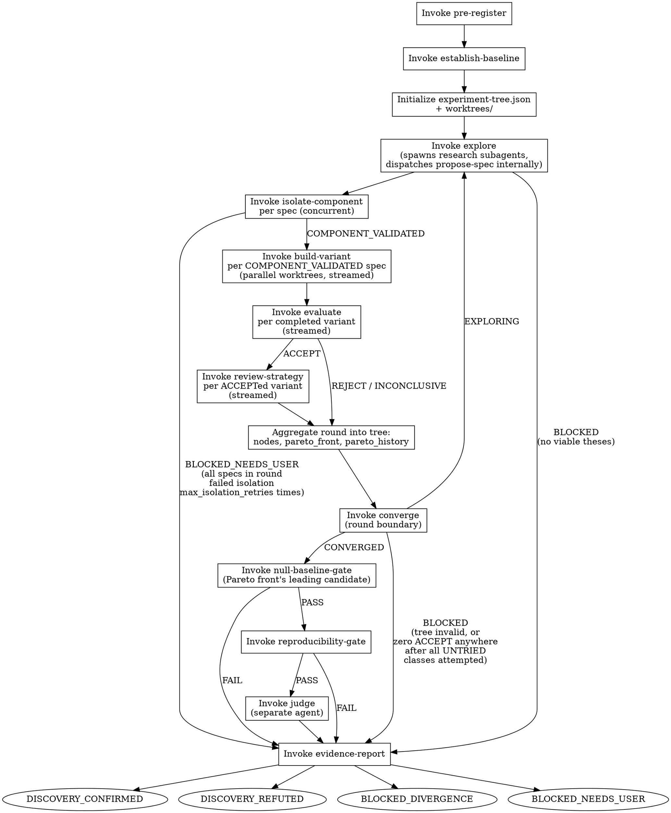

<!-- design-region-clean-of-hard-gates -->

# Auto Discover

<HARD-GATE>
Do NOT begin without a hypothesis.yaml with all required fields. STOP and propagate whatever BLOCKED_NEEDS_USER pre-register emits.
</HARD-GATE>

<HARD-GATE>
Do NOT proceed without routing genome specs through explore. STOP and use Polya's method for every spec.
</HARD-GATE>

<HARD-GATE>
Do NOT proceed if the proposer, builder, or explorer is serving as judge. STOP and dispatch a separate agent.
</HARD-GATE>

<HARD-GATE>
Do NOT run end gates until converge returns CONVERGED. STOP and gate only the single leading candidate.
</HARD-GATE>

<HARD-GATE>
Do NOT declare CONVERGED without the converge skill returning CONVERGED. STOP and invoke converge for the search-level convergence verdict.
</HARD-GATE>

<HARD-GATE>
Do NOT remove or modify the Stop hook registered at initialization. STOP if the hook is missing or altered.
</HARD-GATE>

## Anti-Pattern

**"Let me finish this round's isolation gates before I start building anything, and finish all the building before I evaluate anything."** Waiting for every sibling in a round to clear one stage before advancing any of them to the following stage is a generational barrier, not an evolutionary loop. The moment a spec's isolate-component result returns COMPONENT_VALIDATED, its worktree is ready for build-variant — it does not need its round-mates to catch up first. A population that only advances in lockstep waves searches slower and narrower than one where every branch moves as fast as its own results allow. The first version of this pipeline ran one genome spec linearly to failure and declared DISCOVERY_REFUTED without trying a single variation — that is what a hard generational barrier produces.

## Core Principle

Discovery is the output of a search that has covered its space, not the output of one favorable training run — and a search only covers its space quickly if branches advance independently. The orchestrator manages the experiment tree and streams each spec through isolate-component → build-variant → evaluate → review-strategy as its own results arrive. converge, not a lockstep wave boundary, is the only checkpoint that requires the whole round to have settled — because it is the only step that needs a stable read of the entire tree to judge whether the search space itself is exhausted.

## Process Flow

The evolutionary loop:

```
pre-register → establish-baseline → initialize experiment tree
→ LOOP {
    explore (Polya-method research subagents, dispatches propose-spec internally)
    → isolate-component (per spec, concurrent — not one after another)
    → build-variant (per COMPONENT_VALIDATED spec, parallel worktrees,
                      dispatched the instant its own isolation result arrives)
    → evaluate (per completed variant, dispatched the instant its own build completes)
    → review-strategy (per ACCEPTed variant, dispatched the instant its own eval completes)
    → converge (only checkpoint that waits for the full round to settle)
    → if EXPLORING: loop; if CONVERGED: exit; if BLOCKED: exit to evidence-report
}
→ null-baseline-gate → reproducibility-gate → judge → evidence-report
```



## Checklist

1. Invoke pre-register
2. Invoke establish-baseline
3. Initialize experiment tree (`.auto-discover/experiment-tree.json`)
3b. Compose `.auto-discover/scripts/check_search_convergence.sh` and register it as a command-type Stop hook
4. LOOP: Invoke explore
5. Invoke propose-spec per thesis
6. Invoke isolate-component per spec (parallel)
7. Invoke build-variant per survivor (parallel worktrees)
8. Invoke evaluate per completed variant
9. Invoke review-strategy per ACCEPTed variant
10. Invoke converge — EXPLORING → step 4; CONVERGED → continue
11. Invoke null-baseline-gate on best Pareto-front candidate
12. Invoke reproducibility-gate, then judge
13. Invoke evidence-report, emit terminal verdict

## Step Details

### 1. Pre-Register

Invoke the pre-register skill with the user's hypothesis file. It validates every required field, locks the hypothesis behind a SHA-256, and writes `.auto-discover/hypothesis.yaml` plus `.auto-discover/hypothesis.sha256`. On BLOCKED_NEEDS_USER, propagate it immediately — do not proceed to any later step, and do not invoke evidence-report for a search that never started.

### 2. Establish Baseline

Invoke the establish-baseline skill. It trains the declared null hypothesis under the pre-registered budget and writes the immutable `.auto-discover/baselines/baseline_metrics.json`. On BLOCKED_NEEDS_USER, propagate it immediately. Every later Pareto comparison, efficiency computation, and null-baseline check reads this one record — it is never re-trained or re-estimated mid-search.

### 3. Initialize the Experiment Tree

Create `.auto-discover/worktrees/` and write `.auto-discover/experiment-tree.json` with the structure explore and converge both expect:

```json
{
  "primary_metric_key": "<from hypothesis.pre_registered_metrics.primary>",
  "metric_direction": "<maximize|minimize, from hypothesis>",
  "nodes": {},
  "pareto_front": [],
  "pareto_history": [],
  "class_status": {}
}
```

Each node added later carries: `genome_spec` (or a path to it), the `spec_class` fingerprint (sorted ops + composition strategy), `parent_id` (lineage), the `evaluate` result, the `review-strategy` verdict, and the worktree path. This tree is the search's audit trail — every downstream skill (explore, converge, review-strategy) reads it, and nothing is added to it except through this initialization and the aggregation step below.

As part of this step, also compose `.auto-discover/scripts/check_search_convergence.sh`, a shell script that:

- Reads `.auto-discover/experiment-tree.json`.
- If the tree's top-level `search_status` field is not `"CONVERGED"`: prints `{"decision": "block", "reason": "Search not converged: <class_status summary>"}` to stdout, where `<class_status summary>` is a compact rendering of the tree's `class_status` map (e.g. `cls_a=EXPLORING, cls_b=EXHAUSTED`) read out of the tree the script just parsed — and exits non-zero.
- If `search_status` is `"CONVERGED"` and `evidence.json` exists in the winning worktree (the Pareto front's leading candidate's worktree path): exits 0 silently.
- If `search_status` is `"CONVERGED"` and no `evidence.json` exists yet at that path: prints `{"decision": "block", "reason": "CONVERGED but no evidence report yet"}` and exits non-zero.

### 3b. Register the Convergence Stop Hook

Register `.auto-discover/scripts/check_search_convergence.sh` as a command-type Stop hook. Claude cannot end the turn without the search converging. This is structural enforcement — not a HARD-GATE.

This mirrors model_trainer's Stop hook pattern (`hooks/hooks.json`, `check_convergence.sh` — see model_trainer's README under "The Stop hook enforces autonomy"), adapted for auto-discover's runtime-composed script instead of a shipped one. Because model_trainer ships its script as a plugin file, its hook is registered once at the plugin level; auto-discover composes its script into the experiment's own `.auto-discover/` state at this step, so the hook must be registered per-session, into the experiment repo's `.claude/settings.local.json` (create the file if absent; merge into it if present — never overwrite unrelated hook or permission entries already there):

```json
{
  "hooks": {
    "Stop": [
      {
        "matcher": "",
        "hooks": [
          {
            "type": "command",
            "command": "bash \"${CLAUDE_PROJECT_DIR}/.auto-discover/scripts/check_search_convergence.sh\"",
            "timeout": 30000
          }
        ]
      }
    ]
  }
}
```

Every time Claude tries to end the turn from this point on, the script reads the tree and either lets the stop through or blocks it and sends Claude back into the loop. Because it is a script and not a remembered instruction, it survives context compaction — the search does not forget it is supposed to keep going.

### 4. LOOP START — Invoke Explore

Invoke the explore skill. It reads `.auto-discover/experiment-tree.json` and the locked hypothesis, fingerprints existing specs into classes, spawns research subagents (one per slot, each on a distinct Polya entry point and analogy domain), and enforces the anti-consensus HARD-GATEs. Each subagent runs Polya's four steps and returns a thesis; theses that survive the divergence check are the round's candidates.

Begin a new explore dispatch the instant converge returns EXPLORING (step 10) — do not wait for anything else from the prior round to finish first.

### 5. Propose Spec Per Thesis

explore dispatches the propose-spec skill itself, once per surviving thesis, as part of its own Step 7 — auto-discover does not re-invoke propose-spec independently. This step is where auto-discover collects the results: for every experiment hash explore reports, verify `genome_spec.json` exists at `.auto-discover/experiments/<hash>/`. A thesis whose propose-spec dispatch returned BLOCKED (a translation that did not stay within genome_constraints, or whose composition fingerprint matched a prior spec exactly) is a dropped thesis for this round, not a round-ending failure — proceed with whatever specs survived.

### 6. Isolate Component Per Spec (Concurrent)

For every experiment hash with a `genome_spec.json` from Step 5, dispatch a separate isolate-component invocation. Dispatch all of them together, in the same batch — not one after another waiting for each to return before starting another. isolate-component owns its own retry loop internally (mutate-and-re-propose on FAIL, BLOCKED_NEEDS_USER after the declared max_isolation_retries consecutive failures for that spec's component type); auto-discover only reads the final verdict per spec.

If a given spec's isolate-component invocation ends in BLOCKED_NEEDS_USER, record the failed lineage against its spec class in the tree (so the class is not silently treated as never-attempted) and drop that spec from this round. Only route to evidence-report with BLOCKED_NEEDS_USER (per the Process Flow) if every spec proposed this round failed isolation — the search did not produce a single buildable candidate.

### 7. Build Variant Per Survivor (Parallel Worktrees, Streamed)

For each spec that returns COMPONENT_VALIDATED, immediately pre-create `.auto-discover/worktrees/<hash>/` and dispatch build-variant with the genome spec, the relevant locked-hypothesis fields (thesis is not needed here — training_budget, pre_registered_metrics, and the first seed are), and the worktree path inline. Dispatch as each isolation result arrives; do not batch-wait for the whole round's isolate-component dispatches to finish before starting the specs that already passed. After each build-variant returns, verify `training_metrics.json` and `final_metrics.json` both exist at the worktree path before treating it as complete.

### 8. Evaluate Per Completed Variant (Streamed)

The instant a variant's build-variant dispatch returns DONE or DONE_WITH_CONCERNS, dispatch evaluate for that variant with the worktree path and the locked hypothesis's `pre_registered_metrics` inline — do not wait for sibling variants still building. Verify `EVALUATION.json` exists with a verdict of ACCEPT, REJECT, or INCONCLUSIVE before treating the variant as evaluated. REJECT and INCONCLUSIVE variants still become tree nodes (Step 9 aggregation) but do not proceed to review-strategy.

### 9. Review Strategy Per ACCEPTed Variant (Streamed)

The instant a variant's evaluate dispatch returns ACCEPT, gather the inline context review-strategy requires — `evaluation_result` from EVALUATION.json, `variant_params` and `baseline_params` (from final_metrics.json and the locked baseline), `spec_class_status` (this spec's fingerprint's status immediately before this node existed), `experiment_history` (prior nodes in the same class), the current `pareto_front`, and `complexity_thresholds` (hypothesis-declared or default) — and dispatch review-strategy. Do not wait for sibling variants still evaluating.

After every variant in the round has reached a terminal per-node state (reviewed, REJECTed, INCONCLUSIVE, or isolation-BLOCKED), aggregate: add every node to `experiment-tree.json`, apply each REVIEW.json's `pareto` block (`front_updated`, `points_removed`) to `pareto_front`, and append the resulting front to `pareto_history`. This aggregation is the one point in the round where auto-discover, not any dispatched skill, writes to the shared tree file — it is what keeps the tree consistent for converge to read afterward.

### 10. Converge — the Round Boundary

Invoke the converge skill only after every spec proposed this round has reached a terminal state and the tree has been aggregated. This is the one legitimate synchronization point in the loop: converge needs a stable, fully-aggregated tree to compute Tier 1 (within-class exhaustion) and Tier 2 (cross-class coverage) conditions correctly — computing them against a half-updated tree would produce a wrong verdict, not a faster one.

- **EXPLORING** — return to Step 4 immediately with a new round of explore.
- **CONVERGED** — continue to Step 11. Per the fifth HARD-GATE, this is the only way auto-discover treats the search as done.
- **BLOCKED** — the experiment tree is malformed or missing pareto_front/pareto_history, or (per converge's own HARD-GATE) every attempted class remains EXPLORING with UNTRIED classes never given a chance. If the tree itself is unreadable, or the round produced zero ACCEPT nodes anywhere despite every UNTRIED class having been attempted at least once, route to evidence-report — the search has stalled structurally, not just failed to finish one round.

### 11. Null-Baseline Gate on the Leading Candidate

Identify the Pareto front's leading candidate on the primary metric (converge's own description of what CONVERGED hands off: "the Pareto front's leading candidate"). Treat that candidate's worktree, `.auto-discover/worktrees/<best-hash>/`, as the experiment directory for every end gate below — it already holds `training_metrics.json` and `final_metrics.json`, which null-baseline-gate needs for budget-parity and metric comparisons. Invoke null-baseline-gate with that path. On FAIL, proceed straight to evidence-report — per the fourth HARD-GATE, there is no retry at this stage; a candidate that cannot beat null controls after the search converged is refuted, not re-trained.

### 12. Reproducibility Gate, Then Judge

Invoke reproducibility-gate on the same worktree path. On FAIL, proceed to evidence-report. On PASS, invoke judge as a separate agent — never the agent that proposed the spec, built the variant, or reviewed its strategy. Hand judge exactly the bounded inputs its own skill declares (metrics manifest, hypothesis file, gate results) and withhold the genome spec, per judge's own HARD-GATEs. Both gates run exactly once, on this one candidate — never on any other node in the tree.

### 13. Evidence Report and Terminal Verdict

Invoke evidence-report with the leading candidate's worktree path (or, for a round that ended in BLOCKED before a candidate existed, whatever partial tree state is available). evidence-report applies its own mechanical rules and writes the terminal verdict. Read that verdict and emit exactly one of:

- **DISCOVERY_CONFIRMED** — converge returned CONVERGED, and null-baseline-gate, reproducibility-gate, and judge all confirmed the leading candidate.
- **DISCOVERY_REFUTED** — converge returned CONVERGED, but null-baseline-gate FAILED, reproducibility-gate FAILED, or judge refuted.
- **BLOCKED_DIVERGENCE** — converge itself returned BLOCKED because the tree cannot be assessed, or the search made a full pass through every UNTRIED class without a single ACCEPT anywhere in the tree — training is failing structurally across the space, not in one run.
- **BLOCKED_NEEDS_USER** — pre-register or establish-baseline returned BLOCKED_NEEDS_USER, explore returned BLOCKED (no viable theses survived), or every spec in a round failed isolate-component the declared max_isolation_retries times.

## Gate Functions

- BEFORE beginning: "Does a pre-registered hypothesis exist with a hash that round-trips?"
- BEFORE holding any spec back at a stage: "Is this spec waiting for its own upstream result, or am I batching it behind round-mates?"
- BEFORE invoking converge: "Has every spec proposed this round reached a terminal per-node state, and has the tree been aggregated — pareto_front updated, pareto_history appended?"
- BEFORE declaring CONVERGED: "Did converge itself return CONVERGED, or am I inferring it from a candidate that looks done?"
- BEFORE dispatching an end gate: "Is this the single leading candidate from a CONVERGED front, not one variant among several still in the tree?"
- BEFORE dispatching judge: "Is this agent instance distinct from whichever proposed the spec, built the variant, or reviewed its strategy?"
- BEFORE emitting the terminal verdict: "Did evidence-report write it, or am I deciding it myself from the gate results?"

## Rationalization Table

| You think... | Reality |
|---|---|
| "I'll wait for all N specs to clear isolation before building any of them" | Dispatch build-variant for each spec the moment its own isolate-component result returns COMPONENT_VALIDATED. Waiting for siblings is a generational barrier — exactly what turned the first auto-discover run into one linear attempt instead of a search. |
| "This candidate's metrics look great, let's call it CONVERGED and move to the gates" | Run converge and read its actual verdict. One good candidate satisfies none of converge's Tier 2 conditions on its own. |
| "The proposer already sounds confident about this spec, skip isolate-component" | Run every spec through all three isolation gates regardless of how well-reasoned its thesis was. Confidence in a thesis is not evidence about gradient flow. |
| "I already trained and reviewed this candidate, I can judge it myself" | Dispatch judge as a separate agent. Structural distrust means no agent both produces and approves its own work, no matter how the run looked. |
| "One variant beat the baseline, run the end gates on it now and see" | Run end gates exactly once, on the single leading candidate, only after converge returns CONVERGED. Running them mid-search wastes the gates' evidentiary value on an unvetted candidate. |
| "Let's finish this wave before starting the following stage" | Run each spec through its own stages independently. Only converge is a legitimate wave boundary — everything upstream must flow, not batch. |

## Red Flags

- "Let's finish this wave before starting the following stage"
- "This candidate looks converged, let's move on"
- "The thesis was strong, skip isolation"
- "I already know if this candidate works, I can judge it"
- "Let's gate this variant now while it's promising"
- "One good candidate is basically a converged search"
- "Explore came up empty this round, let's just call it done"

## Key Principles

- Every genome spec traces through explore's Polya-method subagents; there is no direct proposer path.
- Each spec streams through isolate-component → build-variant → evaluate → review-strategy independently; only converge requires the round to have fully settled.
- The experiment tree is the sole audit trail — auto-discover aggregates into it once per round, after every node has reached a terminal state.
- CONVERGED is converge's verdict alone, never auto-discover's inference.
- End gates run exactly once, on exactly one candidate: the Pareto front's leading candidate after CONVERGED.
- The judge is always a separate agent from the proposer, builder, and reviewer.
- evidence-report is the sole place the terminal verdict is written; auto-discover reads it, never decides it independently.

## The Bottom Line

```bash
#!/usr/bin/env bash
set -euo pipefail
state_dir="${1:-.auto-discover}"
hash_file="${state_dir}/hypothesis.sha256"
if [[ ! -f "$hash_file" ]]; then
  echo "VERDICT: BLOCKED_NEEDS_USER"
  exit 1
fi
tree_file="${state_dir}/experiment-tree.json"
if [[ ! -f "$tree_file" ]]; then
  echo "VERDICT: BLOCKED_NEEDS_USER"
  exit 1
fi
latest_evidence=$(find "${state_dir}/worktrees" -name "evidence.json" -type f 2>/dev/null | sort | tail -1)
if [[ -z "$latest_evidence" ]]; then
  echo "VERDICT: BLOCKED_NEEDS_USER"
  exit 1
fi
verdict=$(python3 -c "import json,sys; d=json.load(open(sys.argv[1])); print(d.get('terminal_verdict','BLOCKED_NEEDS_USER'))" "$latest_evidence")
echo "VERDICT: ${verdict}"
```

## Status Vocabulary

- **DISCOVERY_CONFIRMED** -- converge returned CONVERGED and the leading candidate survived null-baseline-gate, reproducibility-gate, and judge
- **DISCOVERY_REFUTED** -- converge returned CONVERGED but the leading candidate failed an end gate
- **BLOCKED_DIVERGENCE** -- converge cannot assess the tree, or the search made a full pass through every UNTRIED class without producing a single ACCEPT
- **BLOCKED_NEEDS_USER** -- pre-registration failed, baseline establishment failed, explore found no viable thesis, or a round's specs all failed isolation the declared max_isolation_retries times
