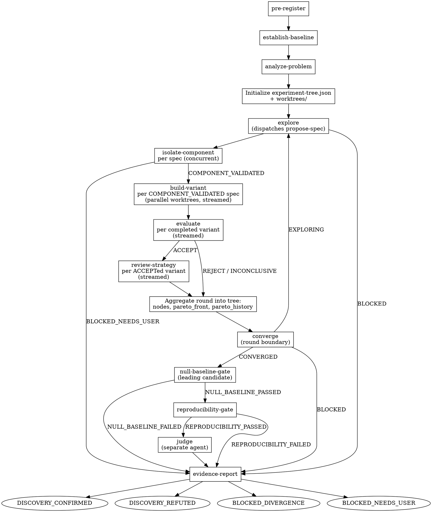

# Pipeline Overview

## Stage Summary

| Stage | Skill | Dispatched by | Verdicts |
|---|---|---|---|
| Lock hypothesis | pre-register | auto-discover | HYPOTHESIS_LOCKED, BLOCKED_NEEDS_USER |
| Baseline | establish-baseline | auto-discover | BASELINE_LOCKED, BLOCKED_NEEDS_USER |
| Problem analysis | analyze-problem | auto-discover | DONE, BLOCKED |
| Direction exploration | explore | auto-discover | EXPLORING, BLOCKED |
| Spec translation | propose-spec | explore | SPEC_EMITTED, BLOCKED |
| Component isolation | isolate-component | auto-discover | COMPONENT_VALIDATED, BLOCKED_NEEDS_USER |
| Build and train | build-variant | auto-discover | DONE, DONE_WITH_CONCERNS, BLOCKED |
| Scoring | evaluate | auto-discover | ACCEPT, REJECT, INCONCLUSIVE |
| Strategic review | review-strategy | auto-discover | KEEP, DISCARD, KEEP_WITH_CONCERNS |
| Search convergence | converge | auto-discover | EXPLORING, CONVERGED, BLOCKED |
| Null controls | null-baseline-gate | auto-discover | NULL_BASELINE_PASSED, NULL_BASELINE_FAILED |
| Multi-seed validation | reproducibility-gate | auto-discover | REPRODUCIBILITY_PASSED, REPRODUCIBILITY_FAILED |
| Independent scoring | judge | auto-discover | JUDGE_CONFIRMS, JUDGE_REFUTES |
| Terminal record | evidence-report | auto-discover | DISCOVERY_CONFIRMED, DISCOVERY_REFUTED, BLOCKED_DIVERGENCE, BLOCKED_NEEDS_USER |

## Synchronization Points

| Point | Rule |
|---|---|
| Between isolate-component, build-variant, evaluate, review-strategy | None. Each spec advances the instant its own upstream result returns. |
| Before converge | Every spec proposed this round has reached a terminal state and the round is aggregated into experiment-tree.json. |
| Before null-baseline-gate | converge returned CONVERGED. Exactly one candidate enters the end gates: the Pareto front's leading candidate. |

## Loop Exits

| Exit | Trigger | Next stage |
|---|---|---|
| CONVERGED | converge returned CONVERGED | null-baseline-gate |
| BLOCKED (search) | converge returned BLOCKED | evidence-report |
| BLOCKED (explore) | explore found no viable research thesis | evidence-report |
| BLOCKED (isolation) | every spec in a round failed isolate-component max_isolation_retries consecutive times | evidence-report |
