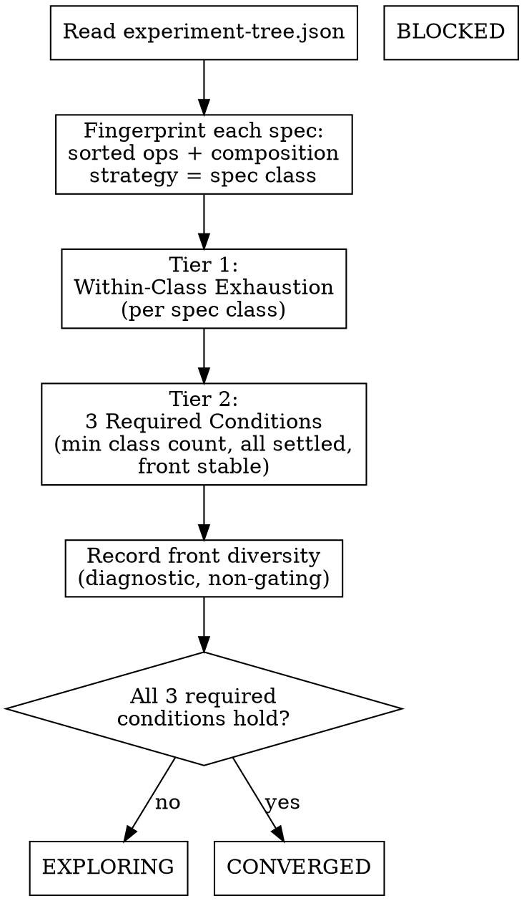

<!-- design-region-clean-of-hard-gates -->

# Converge

<HARD-GATE>
Do NOT declare CONVERGED without all three required Tier 2 conditions passing via executed scripts. STOP and return EXPLORING.
</HARD-GATE>

<HARD-GATE>
Do NOT declare CONVERGED if any spec class remains EXPLORING with UNTRIED classes unattempted. STOP and attempt every UNTRIED class first.
</HARD-GATE>

<HARD-GATE>
Do NOT assess convergence without search-space-level conditions. STOP and check Tier 1 and Tier 2, not training-run signals.
</HARD-GATE>

## Anti-Pattern

**"The best candidate has good metrics, the search is done."** One good result is not an exhausted search space. Have all spec classes been explored? Has the Pareto front stopped moving? CONVERGED requires every required Tier 2 condition to hold at once — a single promising candidate satisfies none of them by itself. A front concentrated in one spec class is not an excuse to skip the other checks either: verify minimum class count, settlement, and stability the same way regardless of how the front looks, then record diversity as a diagnostic — never let "it's just single-class dominance" substitute for the conditions that actually gate CONVERGED.

## Core Principle

Convergence is the mechanical output of search-space coverage checks, not a judgment about any single candidate's quality.

## Process Flow



## Checklist

1. Read and validate `.auto-discover/experiment-tree.json`.
2. Fingerprint every spec in the tree and classify each spec class.
3. Run Tier 1: check each class against the three within-class exhaustion conditions.
4. Run Tier 2: check the three required cross-class conditions and record front diversity as a non-gating diagnostic.
5. Emit EXPLORING (any required Tier 2 condition unmet), CONVERGED (all three required conditions hold), or BLOCKED (tree missing or malformed).

## Step Details

### 1. Read the Experiment Tree

Read `.auto-discover/experiment-tree.json`. Verify it parses as valid JSON with a `nodes` object, a `pareto_front` array, and a `pareto_history` array (prior front snapshots, needed for the stability check in Tier 2). If the file is missing or malformed, emit BLOCKED at once — a search cannot be assessed for convergence without a tree to read.

### 2. Fingerprint and Classify

For each spec in the tree, extract the sorted set of ops used and the composition strategy — the fingerprint = (sorted_ops_tuple, composition_strategy, layer_arrangement). Each distinct fingerprint is a distinct spec class, identical to how explore discovers classes. A class with no spec yet is not in the tree at all and cannot be assessed here; converge only classifies classes that have at least one node.

### 3. Tier 1 — Within-Class Exhaustion

For each spec class present in the tree, check the three conditions in order. Any one firing settles the class:
- **Diminishing returns**: less than the declared diminishing_returns_threshold in relative improvement over recent rounds within the class AND the class has reached depth >= the declared min_exhaustion_depth.
- **Depth ceiling**: the class has been refined to depth >= the declared min_exhaustion_depth with no remaining untried variants at shallower depths.
- **Pareto domination**: another class strictly dominates this one on both the primary metric and parameter count AND this class's depth >= 1.

A class that hit any condition is EXHAUSTED. A class with active nodes that has hit none of the three remains EXPLORING. A class named in genome_constraints' allowed_ops space but with zero nodes in the tree remains UNTRIED.

### 4. Tier 2 — Cross-Class Coverage

Three conditions are REQUIRED and must hold simultaneously for the global status to become CONVERGED:
- **Minimum class count**: the number of explored classes (EXHAUSTED or EXPLORING) meets or exceeds the hypothesis-declared minimum, or — if the hypothesis declares none — a default derived from the reachable class space.
- **All classes settled**: no class has status EXPLORING. Every class that has been attempted is EXHAUSTED, and every class that has not been attempted is UNTRIED — and per the second HARD-GATE, UNTRIED classes block CONVERGED just as EXPLORING ones do, until explore has given each one at least one attempt.
- **Pareto front stability**: the front recorded in pareto_history has been identical for the last search_config.pareto_stability_window consecutive iterations.

Front diversity is RECORDED, not required:
- **Front diversity (diagnostic)**: count the distinct spec classes represented in the current pareto_front. Record the count alongside the verdict. When the count falls below the declared min_front_diversity, record the diagnostic; when the count is exactly one, record it specifically as `front_diversity: "single_class_dominance"`. This never blocks CONVERGED. Once the three required conditions above hold — every class settled, every settled class EXHAUSTED, the front stable for the declared window — a front concentrated in one class means that class structurally dominates every other reachable class, not that the search stopped short. Downstream consumers (review-strategy, evidence-report) read this diagnostic to understand why the front looks the way it does; it does not change their own gating logic.

### 5. Emit the Verdict

- **EXPLORING** — at least one required Tier 2 condition is unmet. Name which one(s) failed and, for "all classes settled," name which classes are still EXPLORING or still UNTRIED.
- **CONVERGED** — all three required Tier 2 conditions hold. Include the front diversity diagnostic in the emitted verdict regardless of its value. The evolutionary loop exits; auto-discover takes the Pareto front's leading candidate into the end gates.
- **BLOCKED** — the experiment tree is missing, malformed, or missing pareto_front / pareto_history.

## Gate Functions

- BEFORE assessing convergence: "Am I reading .auto-discover/experiment-tree.json and computing every condition from it, not from an impression of how the search has gone?"
- BEFORE declaring a class EXHAUSTED: "Did one of the three named Tier 1 conditions actually fire, with a computed number behind it?"
- BEFORE declaring CONVERGED: "Have all three required Tier 2 conditions passed in this run, and have I recorded the front diversity diagnostic regardless of its value?"
- BEFORE declaring "all classes settled": "Has every UNTRIED class been given at least one attempt, per the HARD-GATE?"
- BEFORE emitting EXPLORING: "Have I named the specific unmet condition(s), not just 'not converged yet'?"

## Rationalization Table

| You think... | Reality |
|---|---|
| "The best candidate's metrics look great, we're done" | One candidate's quality is not a Tier 2 condition. Check minimum class count, settlement, and front stability — all three required conditions. |
| "We've tried enough classes at this point" | Check the explored count against the declared minimum or the default derived from the reachable class space. "Enough" is a number, not a feeling. |
| "The front hasn't changed in a while" | Check pareto_history for exactly the declared pareto_stability_window identical consecutive snapshots. "A while" is not the declared window until it's counted. |
| "All the classes we tried are exhausted, so we're converged" | Run every UNTRIED class before declaring settlement. UNTRIED classes block convergence exactly like EXPLORING ones. |
| "The front has only one class, that can't be converged" | When all classes are EXHAUSTED and the front is stable, single-class dominance is a result, not a failure. Record it and emit CONVERGED. |
| "The loss curves all look grokked, this feels converged" | Read the search space, never a loss curve. Training-run signals belong to evaluate, not converge. |

## Red Flags

- "The best result looks converged"
- "We've explored enough"
- "The front is stable"
- "All the classes we tried are exhausted" (without checking for UNTRIED ones)
- "The training dynamics all look grounded, so the search is done"

## Key Principles

- Tier 1 is per-class; any one of three conditions settles a class as EXHAUSTED.
- Tier 2 is global; all three required conditions must hold together, or the status stays EXPLORING.
- An UNTRIED class blocks convergence exactly like an EXPLORING one — it has to be attempted, not just exist in the constraint space.
- Front diversity is recorded, not required — once the three required conditions hold, a single-class front is a result of the search, not evidence it stopped early.
- Training-run dynamics (grokking, plateaus, collapse) live in evaluate's diagnostic fields, never in converge's conditions.

## The Bottom Line

```bash
TREE="${1:-.auto-discover/experiment-tree.json}"
STATUS=$(python3 -c "
import json, sys
try:
    tree = json.load(open(sys.argv[1]))
except (FileNotFoundError, json.JSONDecodeError) as e:
    print('FAIL: ' + str(e)); sys.exit()
need = {'nodes', 'pareto_front', 'pareto_history'}
miss = need - set(tree.keys())
if miss:
    print('FAIL: missing fields ' + ', '.join(miss)); sys.exit()
front_classes = {n.get('spec_class') for n in tree['nodes'].values() if n.get('node_hash') in tree['pareto_front']}
print('PASS: nodes=' + str(len(tree['nodes'])) + ', front_classes=' + str(len(front_classes)))
" "$TREE")
echo "VERDICT: $STATUS"
```

## Status Vocabulary

- **EXPLORING** -- at least one required Tier 2 condition is unsatisfied, continue the evolutionary loop
- **CONVERGED** -- all Tier 1 and required Tier 2 conditions passed, exit the loop and dispatch the end gates
- **BLOCKED** -- cannot assess convergence (experiment tree missing, malformed, or missing pareto_front/pareto_history)
