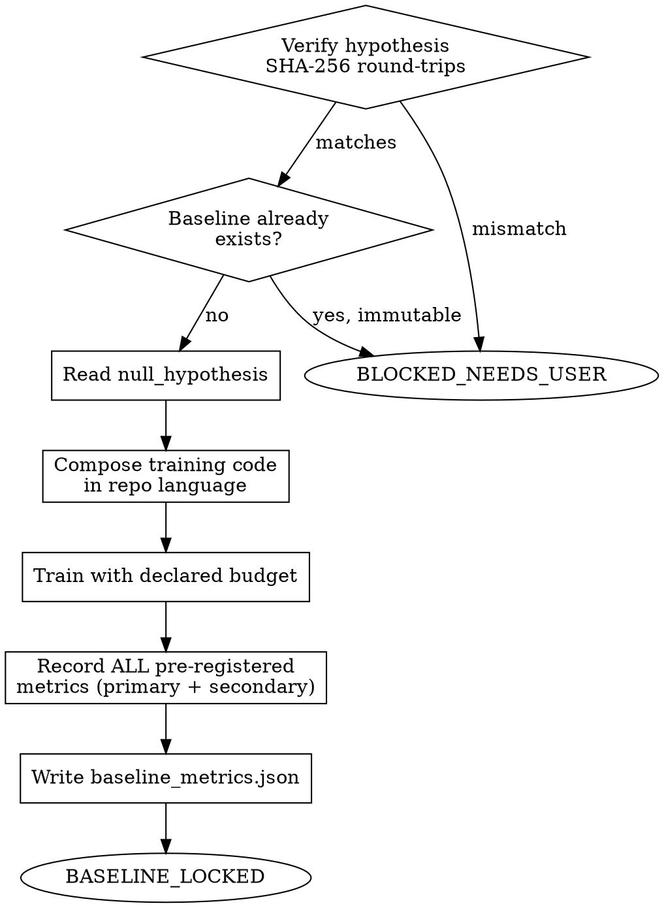

<!-- design-region-clean-of-hard-gates -->

# Establish Baseline

<HARD-GATE>
Do NOT establish a baseline without a locked hypothesis. STOP if the SHA-256 does not round-trip.
</HARD-GATE>

<HARD-GATE>
Do NOT proceed without matching the declared training budget. STOP and verify exact budget parity.
</HARD-GATE>

<HARD-GATE>
Do NOT overwrite an existing baseline. STOP and re-register the hypothesis if the baseline needs to change.
</HARD-GATE>

<HARD-GATE>
Do NOT compose baseline training code without deriving the training setup from data characteristics and architecture capacity. STOP and state the derivation explicitly.
</HARD-GATE>

## Anti-Pattern

**"The baseline is obviously going to underperform, let's just estimate it."** An estimated baseline is not a baseline — it is a number chosen to make the candidate look good. The baseline must be trained, on the same data, under the same budget, and every pre-registered metric recorded from the actual run.

## Core Principle

The baseline is the null hypothesis made concrete. Same data, same budget, same metrics. Immutable once recorded.

## Process Flow



## Checklist

1. Verify hypothesis SHA
2. Read null_hypothesis
3. Derive training hyperparameters from first principles. State the derivation for learning rate (gradient scale probed on a single micro-batch), regularization strength (ratio of trainable parameters to training examples), optimizer choice (loss landscape characteristics across micro-batches), and compute budget (steps converted from the hypothesis-declared compute bound at this architecture's per-step cost). Do not import hyperparameters from papers, benchmarks, or known experimental setups.
4. Compose training code in the user's repo language
5. Train with declared budget
6. Record ALL pre-registered metrics (primary + secondary)
7. Write .auto-discover/baselines/baseline_metrics.json
8. Write the hyperparameter derivation to .auto-discover/baselines/derivation.json alongside the metrics. Record each hyperparameter, its derived value, and the derivation method. This is auditable evidence that the setup was derived, not retrieved.
9. Emit verdict

## Step Details

### 1. Verify Hypothesis SHA

Re-hash `hypothesis.yaml` and compare against `.auto-discover/hypothesis.sha256`. If the file is missing or the hash does not match, emit BLOCKED_NEEDS_USER and stop — an unlocked or tampered hypothesis cannot anchor a baseline.

### 2. Read Null Hypothesis

Read the `null_hypothesis` field from the locked hypothesis. This declares the conventional architecture or approach that stands in for "no novel component" — the thing every later candidate must beat.

### 3. Derive Training Hyperparameters

Before composing any training code, trace each hyperparameter to a measurable property of the data or the architecture — never to what a paper or benchmark uses for this task domain:

- Learning rate: probe the gradient scale on a single micro-batch of the actual training data, then set the learning rate so a single update moves each parameter by 1% of that parameter's current magnitude.
- Regularization strength: compute the ratio of trainable parameters to training examples. A higher ratio demands stronger regularization; a lower ratio tolerates weaker or none.
- Optimizer: default to Adam unless a loss-landscape probe (gradient variance measured across several micro-batches) shows a different optimizer is warranted.
- Compute budget: take the hypothesis-declared compute bound directly and convert it to a step count using this architecture's measured per-step cost.

A hyperparameter that traces back to "what this task's literature uses" is retrieval, not derivation, regardless of whether the resulting number happens to match.

### 4. Compose Training Code

Compose the training code for the null hypothesis architecture in the language and framework already used by the surrounding repository. Use the same data pipeline, the same splits, and the same preprocessing the candidate will later use — divergence here invalidates every downstream comparison.

### 5. Train With Declared Budget

Read `training_budget` (`max_epochs`, `max_wall_clock_minutes`) from the locked hypothesis and train the baseline within exactly those bounds. Do not extend the budget because the baseline "needs more time to converge" — a baseline trained past its declared budget is no longer the same experiment the candidate will be measured against.

### 6. Record All Pre-Registered Metrics

Compute every metric named in `pre_registered_metrics.primary` and `pre_registered_metrics.secondary` from the actual trained baseline — never estimated, never carried over from a prior run. Forbidden metrics are not recorded here; they exist to be excluded from justification, not to be measured.

### 7. Write Baseline Record

Write `.auto-discover/baselines/baseline_metrics.json` containing the metric values, the training budget used, and the null_hypothesis description. If this file already exists, STOP — do not overwrite it. A baseline that needs to change means the hypothesis needs to be re-registered, not that the existing baseline gets silently replaced.

### 8. Write Derivation Record

Write `.auto-discover/baselines/derivation.json` in the same step as the metrics file. For every hyperparameter derived in Step 3, record one entry with fields `hyperparameter`, `value`, `derivation_method`, and `input_measurement` — the measured quantity (the probed gradient scale, the parameter-to-example ratio, the measured per-step cost) that produced the value. A baseline without a matching derivation record is not auditable as anti-retrieval evidence.

### 9. Emit Verdict

Emit BASELINE_LOCKED with the metrics recorded, or BLOCKED_NEEDS_USER with the reason (hash mismatch, existing baseline, or training failure).

## Gate Functions

- BEFORE reading null_hypothesis: "Did the SHA-256 round-trip against the locked hypothesis?"
- BEFORE composing training code: "Is each hyperparameter traceable to a derivation from data/architecture properties, not imported from a known recipe?"
- BEFORE training: "Is the training budget read directly from the hypothesis, not assumed?"
- BEFORE writing baseline_metrics.json: "Does a baseline file already exist at this path?"
- BEFORE emitting BASELINE_LOCKED: "Are both primary and secondary metrics present in the written record?"

## Rationalization Table

| You think... | Reality |
|---|---|
| "The baseline obviously underperforms, I can estimate it" | Run the baseline training on real data. An estimated number is chosen to flatter the candidate. |
| "A few more epochs will make the baseline more fair" | Use the training_budget exactly as declared — extending it breaks budget parity with the candidate. |
| "I'll just update the existing baseline_metrics.json" | Write the baseline once and never overwrite. A changed baseline invalidates every prior comparison. |
| "I only need the primary metric right now" | Write every pre-registered metric now. The judge and evidence-report need the full set later. |
| "Weight decay 1.0 is standard for this task" | Run a parameter-to-sample ratio check and set regularization from the result. If the ratio demands 1.0, that is a derivation. If 1.0 was imported from a paper, that is retrieval. |

## Red Flags

- "The baseline is a formality, I know it'll lose"
- "Let me give the baseline a bit more training time to be fair"
- "I'll just overwrite the old baseline numbers"
- "The secondary metrics can wait"

## Key Principles

- The baseline is trained, never estimated.
- Budget parity with the eventual candidate is non-negotiable.
- The baseline file is write-once; a changed hypothesis requires re-registration, not an edit.
- Every pre-registered metric is recorded, not just the primary one.

## The Bottom Line

```bash
STATUS=$(python3 -c "
import json, os
path = '.auto-discover/baselines/baseline_metrics.json'
if not os.path.exists(path):
    print('FAIL'); exit()
with open(path) as f:
    data = json.load(f)
metrics = data.get('metrics', {})
print('PASS' if metrics else 'FAIL')
")
echo "VERDICT: $STATUS"
```

## Status Vocabulary

- **BASELINE_LOCKED** -- baseline trained under declared budget, all pre-registered metrics recorded
- **BLOCKED_NEEDS_USER** -- hypothesis not locked, baseline already exists, or training failed
