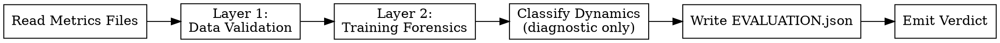

<!-- design-region-clean-of-hard-gates -->

# Evaluate

<HARD-GATE>
Do NOT emit a verdict without extracting ALL pre-registered metrics via executed scripts. STOP and run the extraction scripts first.
</HARD-GATE>

<HARD-GATE>
Do NOT emit a verdict if it is based on training-run accuracy trajectory. STOP and record accuracy trajectory as a diagnostic only.
</HARD-GATE>

<HARD-GATE>
Do NOT compare against the baseline outside null-baseline-gate. STOP and defer that comparison to the final candidate.
</HARD-GATE>

<HARD-GATE>
Do NOT classify training dynamics without restricting to operational trajectory measurements. STOP and record shapes, not phenomenon names.
</HARD-GATE>

## Anti-Pattern

**"The loss plateaued cleanly at a high accuracy, this is clearly a good candidate — ACCEPT."** A clean plateau is a training-run observation, not a verdict. evaluate asks one question: did this run produce usable, valid metrics? Whether the run grokked, plateaued, or collapsed is recorded as a diagnostic field for review-strategy and evidence-report to read later — it does not decide ACCEPT, REJECT, or INCONCLUSIVE here.

## Core Principle

Evaluate scores a single trained candidate: did it produce usable metrics? Training-run dynamics are observations, not the verdict. v1 asked "did this model converge?" and that answer WAS the verdict; evaluate asks "did this model produce metrics?" — the convergence question moves one level up, to converge, where it belongs.

## Process Flow



## Checklist

1. Read training_metrics.json and final_metrics.json from the worktree named in the dispatch prompt.
2. Run Layer 1: Data Validation on the extracted metrics.
3. Run Layer 2: Training Forensics on the full checkpoint series.
4. Classify training dynamics as diagnostic fields — never as the verdict.
5. Write EVALUATION.json with metrics, diagnostics, and layer results.
6. Emit ACCEPT, REJECT, or INCONCLUSIVE.

## Step Details

### 1. Read Metrics Files

The dispatch prompt carries the worktree path and the pre_registered_metrics list (primary, secondary) from the locked hypothesis inline — do not re-read hypothesis.yaml. Read `training_metrics.json` (the full per-checkpoint series) and `final_metrics.json` (the terminal snapshot) from that worktree path.

### 2. Layer 1: Data Validation

Execute a script that checks:
- Every metric named in pre_registered_metrics.primary and .secondary has a corresponding present, numeric value in final_metrics.json.
- No metric value is NaN or Inf.
- final_metrics.json contains trainable_params.

FAIL any check → REJECT. Reason: data validation failure. List every failing check, not just the first.

### 3. Layer 2: Training Forensics

Execute a script that checks the full training_metrics.json series, not just the final checkpoint:
- No checkpoint contains NaN or Inf in any tracked value.
- Gradient norm never exceeds the declared or derived explosion threshold at any checkpoint.
- The run completed — it did not exit mid-series with an incomplete checkpoint count relative to the declared max_epochs or max_wall_clock_minutes.

FAIL any check → REJECT. Reason: training instability or incomplete run. Report which checks failed and at which checkpoint.

### 4. Classify Training Dynamics — the Significance Check

This is where "significance" is checked — not statistical significance against a baseline (that comparison is forbidden here, per the third HARD-GATE, and belongs to null-baseline-gate) but whether this run's terminal reading is a settled, trustworthy measurement or a budget-truncated snapshot still in flux.

After both layers pass, execute a script that classifies the run's trajectory from the training_metrics.json series and records it as diagnostic fields — inputs for review-strategy and evidence-report, never the verdict:
- `accuracy_trajectory`: stable_high / stable_moderate / plateau_low_accuracy / spike_then_drop / budget_exhausted / diverged
- `accuracy_trajectory_shape`: monotonic_rise / plateau / spike_then_drop / no_improvement / oscillating — the curve's shape, without naming why it takes that shape
- `compute_to_threshold`: FLOPs or samples to reach each pre-registered accuracy threshold; `"unreached"` if the run never crossed it — a first-class value, not an error or null
- `train_test_gap_trajectory`: converging / diverging / stable / oscillating
- `peak_accuracy`, `peak_epoch`
- `collapse_detected`: true if the primary metric spiked and then fell back after peaking

If the run's trajectory never stabilized before hitting a budget bound (accuracy_trajectory == budget_exhausted) and no forensics check failed, this is grounds for INCONCLUSIVE, not REJECT — nothing failed, but the terminal snapshot is a budget-limited reading rather than a completed measurement, so it cannot yet be trusted as this candidate's settled result.

### 5. Write EVALUATION.json

Write `<worktree-path>/EVALUATION.json`: the experiment identity (node_hash), the verdict, every pre-registered metric's raw value from final_metrics.json, trainable_params, the diagnostic fields from Step 4, and the pass/fail detail from Layers 1 and 2.

### 6. Emit Verdict

Apply the decision table:

| Layer 1 | Layer 2 | Trajectory | Verdict |
|---|---|---|---|
| PASS | PASS | Stabilized | ACCEPT |
| PASS | PASS | budget_exhausted, unstabilized | INCONCLUSIVE |
| FAIL | -- | -- | REJECT |
| PASS | FAIL | -- | REJECT |

## Gate Functions

- BEFORE reading metrics: "Am I using the worktree path and pre_registered_metrics from the dispatch prompt, not re-parsing hypothesis.yaml?"
- BEFORE Layer 1: "Is a script checking every pre-registered metric for presence and validity, not a scan of the final numbers by eye?"
- BEFORE Layer 2: "Is the forensics check reading every checkpoint in training_metrics.json, not just the last one?"
- BEFORE recording accuracy_trajectory: "Is this field being written as a diagnostic, or is it silently deciding my verdict?"
- BEFORE classifying dynamics: "Am I describing the trajectory shape, or naming a phenomenon?"
- BEFORE emitting ACCEPT: "Did Layer 1 and Layer 2 both pass via executed scripts, with the verdict coming from the decision table, not from how the training looked?"

## Rationalization Table

| You think... | Reality |
|---|---|
| "The metrics are right there in final_metrics.json, I can just read them" | Run the validation script. Manual reading misses NaN/Inf and silently-absent fields that a script catches every time. |
| "The loss curve clearly converged, this is a good result" | accuracy_trajectory is a diagnostic field, not the verdict. Run Layer 1 and Layer 2 and let the decision table decide. |
| "It plateaued and then collapsed, that's obviously a REJECT" | Log collapse as collapse_detected for review-strategy. It does not fail Layer 1 or Layer 2 unless it produced NaN/Inf or an incomplete run. |
| "This clearly grokked — the accuracy spiked at epoch 3000" | Log the trajectory shape: accuracy_trajectory=spike_then_drop with the spike epoch, peak value, and final value recorded. State the shape, not the story. |
| "The candidate is clearly worse than the baseline, REJECT it" | Skip baseline comparison here. That comparison runs once at null-baseline-gate, on the final candidate only. |
| "It ran out of budget without stabilizing, that's a training failure" | Use INCONCLUSIVE, not REJECT. REJECT is for crashes and instability; an unstabilized budget-limited run is INCONCLUSIVE. |

## Red Flags

- "This clearly converged"
- "The training dynamics tell me this is a good candidate"
- "It's worse than the baseline, reject it here"
- "I can eyeball the metrics, no need to run the check"
- "Budget ran out, so it failed"

## Key Principles

- Every metric value comes from an executed validation script, never from reading final_metrics.json by eye.
- Training-run dynamics are diagnostic fields for review-strategy and evidence-report — evaluate does not verdict on them.
- Baseline comparison happens once, at null-baseline-gate, on the final candidate only — never here, per-variant.
- Layer 1 and Layer 2 run in order; a Layer 1 failure short-circuits Layer 2.
- INCONCLUSIVE is reserved for runs that passed both layers but produced a budget-limited, unstabilized reading.

## The Bottom Line

```bash
WORKTREE="$1"  # pass the variant worktree path as argument
STATUS=$(python3 -c "
import json, os, sys
path = os.path.join(sys.argv[1], 'EVALUATION.json')
if not os.path.exists(path):
    print('FAIL: EVALUATION.json not found'); sys.exit()
ev = json.load(open(path))
valid = {'ACCEPT', 'REJECT', 'INCONCLUSIVE'}
if ev.get('verdict') not in valid:
    print('FAIL: invalid verdict ' + repr(ev.get('verdict'))); sys.exit()
need = {'node_hash', 'verdict', 'metrics', 'diagnostics', 'layers'}
miss = need - set(ev.keys())
if miss:
    print('FAIL: missing fields ' + ', '.join(miss)); sys.exit()
print('PASS: verdict=' + ev['verdict'])
" "$WORKTREE")
echo "VERDICT: $STATUS"
```

## Status Vocabulary

- **ACCEPT** -- both layers passed and the primary metric trajectory stabilized
- **REJECT** -- Layer 1 or Layer 2 failed (invalid metrics, training instability, or an incomplete run)
- **INCONCLUSIVE** -- both layers passed but the run hit a budget bound before stabilizing
