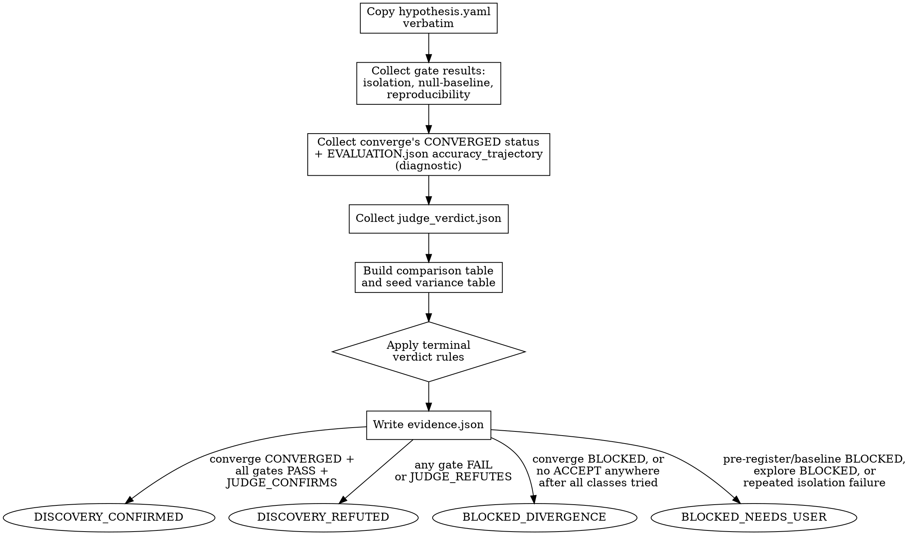

<!-- design-region-clean-of-hard-gates -->

# Evidence Report

<HARD-GATE>
Do NOT declare DISCOVERY_CONFIRMED without all conditions met. STOP and verify converge returned CONVERGED, both gates PASSED, and JUDGE_CONFIRMS.
</HARD-GATE>

<HARD-GATE>
Do NOT proceed without copying the hypothesis verbatim. STOP and embed it unchanged from the pre-registered file.
</HARD-GATE>

<HARD-GATE>
Do NOT emit evidence without structured JSON. STOP and write machine-readable fields, not prose.
</HARD-GATE>

<HARD-GATE>
Do NOT emit evidence without the accuracy_trajectory diagnostic. STOP and include it for the audit trail.
</HARD-GATE>

## Anti-Pattern

**"Everything passed and the story is clear, I'll write it up as a summary."** A prose summary can smooth over a borderline metric, omit a variance table entry, or paraphrase a gate result into something more favorable than it was. The evidence report is the permanent, auditable record — every field must be traceable to a specific file written by a specific gate, not to an agent's recollection of how the run felt.

## Core Principle

The evidence report is the structured record. Every field is computed, every gate result is pass/fail, every comparison is on pre-registered metrics. The terminal verdict follows mechanically from the evidence.

## Process Flow



## Checklist

1. Copy hypothesis.yaml verbatim into the evidence record — no restatement, no paraphrase
2. Collect gate results: isolation gates, null-baseline gate, reproducibility gate — pass/fail each
3. Collect converge's search-level CONVERGED status, and the leading candidate's accuracy_trajectory diagnostic from EVALUATION.json
4. Collect the judge verdict from judge_verdict.json
5. Build the comparison table (candidate vs shuffled-label, constant-output, and pre-registered baseline)
6. Build the seed variance table from reproducibility_result.json
7. Apply the terminal verdict rules mechanically
8. Write evidence.json with every field populated from a source file
9. Emit exactly one terminal verdict

## Step Details

### 1. Copy the Hypothesis Verbatim

Read `.auto-discover/hypothesis.yaml` and embed its full contents into `evidence.json` under a `hypothesis` field, unchanged. Also embed `hypothesis.sha256` so the evidence record can be checked against the locked hash at any later time. Do not summarize or reword any field.

### 2. Collect Gate Results

Isolation gate results live at `.auto-discover/experiments/<hash>/gates/`. Training results live at the worktree path. Both paths are in the dispatch context. Read isolation gate JSON from `.auto-discover/experiments/<hash>/gates/gradient_flow.json`, `gates/output_range.json`, `gates/toy_convergence.json`, using the experiment hash from the dispatch context — never from the worktree path. Read `null_baseline_result.json` and `reproducibility_result.json` from the worktree path. Record each as a pass/fail entry with its own reason string — do not collapse them into a single boolean without preserving which gate produced which result.

### 3. Collect Convergence Signals

Record two distinct fields and do not conflate them. First, the search-level verdict: the leading candidate reached the end gates only because `converge` already returned `CONVERGED` on the fully-aggregated experiment tree — copy that status verbatim, do not re-derive it. Second, the candidate's own training-dynamics diagnostic: read `EVALUATION.json` from the leading candidate's worktree and record its `accuracy_trajectory` field (one of six values from evaluate: stable_high, stable_moderate, plateau_low_accuracy, spike_then_drop, budget_exhausted, diverged). This diagnostic is never omitted, but it is informational — it explains how the candidate trained. It does not gate DISCOVERY_CONFIRMED; only converge's search-level CONVERGED status does.

### 4. Collect Judge Verdict

Read `judge_verdict.json` and record the judge's status (`JUDGE_CONFIRMS` or `JUDGE_REFUTES`), the judge agent identifier, and the primary metric comparison the judge scored against.

### 5. Build Comparison Table

From `null_baseline_result.json`, build a table with one row per comparison: shuffled-label, constant-output, pre-registered baseline. Each row carries the candidate value, the control/baseline value, and the pass/fail outcome.

### 6. Build Seed Variance Table

From `reproducibility_result.json`, copy the `variance_table` field directly — per-metric mean, std, tolerance, and within-tolerance boolean, across every declared seed.

### 7. Apply Terminal Verdict Rules

Apply these rules in order, mechanically:

- **DISCOVERY_CONFIRMED**: converge returned CONVERGED, AND null-baseline-gate PASSED, AND reproducibility-gate PASSED, AND judge status is JUDGE_CONFIRMS. All conditions required — none is sufficient alone. The candidate's accuracy_trajectory diagnostic is recorded but is not itself a condition.
- **BLOCKED_DIVERGENCE**: converge itself returned BLOCKED because the experiment tree was unassessable, or the search made a full pass through every UNTRIED spec class without producing a single ACCEPT anywhere in the tree. This overrides all other checks — a structurally failing search produces no other verdict.
- **DISCOVERY_REFUTED**: converge returned CONVERGED, but null-baseline-gate FAILED, or reproducibility-gate FAILED, or judge status is JUDGE_REFUTES. Name the specific failing gate(s) in the evidence.
- **BLOCKED_NEEDS_USER**: pre-register or establish-baseline returned BLOCKED_NEEDS_USER, explore returned BLOCKED with no viable thesis, or every spec in a round failed isolate-component three consecutive times.

### 8. Write Evidence JSON

Write `evidence.json` to the worktree path: `<worktree-path>/evidence.json`. This is the same worktree path the dispatch context and every training-result read in Step 2 already use — evidence.json lives alongside training_metrics.json, final_metrics.json, and REVIEW.json, not under `.auto-discover/experiments/<hash>/`.

```json
{
  "hypothesis": { "...verbatim contents of hypothesis.yaml..." },
  "hypothesis_sha256": "<hash>",
  "search_convergence": "<CONVERGED|BLOCKED, from converge>",
  "gate_results": {
    "isolation": {"gradient_flow": "PASS", "output_range": "PASS", "toy_convergence": "PASS"},
    "null_baseline": {"status": "NULL_BASELINE_PASSED", "comparison_table": [...]},
    "reproducibility": {"status": "REPRODUCIBILITY_PASSED", "variance_table": [...]}
  },
  "accuracy_trajectory": "<diagnostic from EVALUATION.json: stable_high|stable_moderate|plateau_low_accuracy|spike_then_drop|budget_exhausted|diverged>",
  "judge_verdict": {"status": "<JUDGE_CONFIRMS|JUDGE_REFUTES>", "judge_agent_id": "<id>"},
  "terminal_verdict": "<DISCOVERY_CONFIRMED|DISCOVERY_REFUTED|BLOCKED_DIVERGENCE|BLOCKED_NEEDS_USER>",
  "reason": "<one-line explanation naming the deciding factor>"
}
```

### 9. Emit Terminal Verdict

Return exactly one of the four terminal verdicts, matching `terminal_verdict` in the JSON just written. On `DISCOVERY_REFUTED` with inconclusive evidence (no single clean failing gate, e.g. a marginal miss on the success threshold), offer the user the option to mutate the genome spec and re-enter the pipeline at `propose-spec` — do not decide this automatically.

## Gate Functions

- BEFORE writing the hypothesis field: "Is this copied verbatim, or have I reworded any part of it?"
- BEFORE declaring DISCOVERY_CONFIRMED: "Did converge itself return CONVERGED, do null-baseline-gate and reproducibility-gate both show PASS, AND is judge status exactly JUDGE_CONFIRMS?"
- BEFORE declaring BLOCKED_DIVERGENCE: "Did converge return BLOCKED because the tree was unassessable, or did the search exhaust every UNTRIED class without a single ACCEPT — or is this actually a CONVERGED search whose leading candidate merely failed an end gate, which is DISCOVERY_REFUTED, not BLOCKED_DIVERGENCE?"
- BEFORE writing any field: "Does this value trace back to a specific gate's JSON file, or am I inferring it?"
- BEFORE emitting the verdict: "Did I omit the accuracy_trajectory field anywhere in the record?"

## Rationalization Table

| You think... | Reality |
|---|---|
| "Everything looked good, I'll summarize it in prose" | Write structured JSON. Prose summaries are not machine-readable and invite paraphrase drift. |
| "The hypothesis is long, I'll condense the key points" | Read the hypothesis and write it verbatim into evidence.json. Condensing is where fields silently vanish. |
| "Judge confirmed and most gates passed, that's basically confirmed" | Verify ALL gates PASS, not most. One FAIL routes to DISCOVERY_REFUTED regardless of the judge's verdict. |
| "Convergence was fine, no need to record the exact type" | Include the accuracy_trajectory diagnostic for the audit trail. DISCOVERY_CONFIRMED depends on converge's CONVERGED status, not on this diagnostic. |
| "This is clearly a discovery, I don't need to check every gate individually" | Apply the terminal verdict rules mechanically. Confidence is not a substitute for checking the gate list. |

## Red Flags

- "I'll write this up as a narrative instead of JSON"
- "The hypothesis is verbose, I'll paraphrase the key fields"
- "Most gates passed, that's close enough to CONFIRMED"
- "Convergence was fine, skip recording the exact type"
- "This is obviously a discovery, skip the mechanical check"

## Key Principles

- Every field in evidence.json traces to a specific upstream gate's output file.
- The hypothesis is embedded verbatim, never restated.
- The terminal verdict is derived mechanically from the four rules, never from impression.
- The candidate's accuracy_trajectory diagnostic is always recorded, but DISCOVERY_CONFIRMED depends on converge's search-level CONVERGED status, not on this diagnostic.
- On inconclusive DISCOVERY_REFUTED, offer genome mutation and re-entry — do not auto-decide.

## The Bottom Line

```bash
#!/usr/bin/env bash
set -euo pipefail
worktree_path="${1:?Usage: evidence-report <worktree_path>}"
evidence_file="${worktree_path}/evidence.json"
if [[ ! -f "$evidence_file" ]]; then
  echo "VERDICT: BLOCKED_NEEDS_USER"
  exit 1
fi
verdict=$(python3 -c "import json,sys; print(json.load(open(sys.argv[1]))['terminal_verdict'])" "$evidence_file")
echo "VERDICT: ${verdict}"
```

## Status Vocabulary

- **DISCOVERY_CONFIRMED** -- converge returned CONVERGED, all gates PASSED, and JUDGE_CONFIRMS
- **DISCOVERY_REFUTED** -- converge returned CONVERGED but an end gate FAILED or JUDGE_REFUTES
- **BLOCKED_DIVERGENCE** -- converge returned BLOCKED or no ACCEPT anywhere after all classes attempted
- **BLOCKED_NEEDS_USER** -- pre-register, baseline, explore, or repeated isolation failures blocked the pipeline
