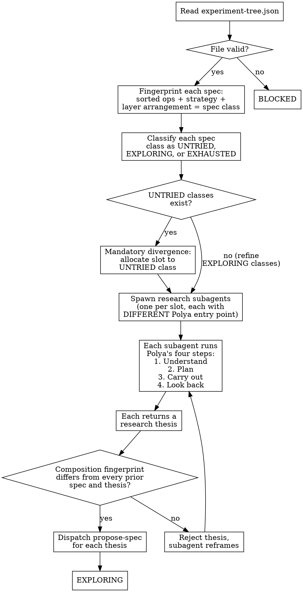

<!-- design-region-clean-of-hard-gates -->

# Explore

<HARD-GATE>
Do NOT propose a genome spec without deriving it from first principles. STOP and reframe using Polya's method.
</HARD-GATE>

<HARD-GATE>
Do NOT devise a plan (Polya Step 2) without first restating the problem in at least two fundamentally different ways (Polya Step 1). STOP and restate.
</HARD-GATE>

<HARD-GATE>
Do NOT propose a spec without identifying a related problem whose method you are adapting. STOP and name the analogy explicitly.
</HARD-GATE>

<HARD-GATE>
Do NOT propose new specs if referencing prior experiments' architecture choices. STOP and reference only their RESULTS.
</HARD-GATE>

<HARD-GATE>
Do NOT propose a spec without verifying its composition fingerprint differs from all prior specs. STOP and enforce structural divergence.
</HARD-GATE>

<HARD-GATE>
Do NOT proceed to a new round without the look-back step. STOP and ask whether this result applies to a different framing.
</HARD-GATE>

<HARD-GATE>
Do NOT propose a hyperparameter-only variant for an EXHAUSTED class if any UNTRIED class exists. STOP and explore the UNTRIED class first.
</HARD-GATE>

## Anti-Pattern

**"I know about cyclic attention mechanisms, let me propose one."** -- Knowing the answer prevents discovering it. Reframe the problem: what computation does modular addition REQUIRE? What are structurally different ways to implement that computation? The spec emerges from the framing, not from retrieval.

## Core Principle

A system that retrieves its answer cannot discover it. Polya's method forces derivation from the problem structure, not recall from training data.

## Process Flow



## Checklist

1. Read and validate `.auto-discover/experiment-tree.json`
2. Classify each spec class (derived from composition fingerprint) as UNTRIED, EXPLORING, or EXHAUSTED
3. Check mandatory divergence: if UNTRIED classes exist, at least one slot goes to an UNTRIED class
4. For each slot, spawn a research subagent with a DIFFERENT Polya entry point
5. Each subagent runs Polya's four steps and returns a research thesis
6. Verify structural divergence: no two theses share the same composition fingerprint with each other or with any prior spec in the tree
7. Dispatch propose-spec for each surviving thesis
8. Emit EXPLORING

## Step Details

### 1. Read and validate the experiment tree

Read `.auto-discover/experiment-tree.json` in full. Verify the file parses as valid JSON with a `nodes` object and a `pareto_front` array. If this is the first round (no tree exists yet), initialize an empty tree with the baseline node only. If the file exists but is malformed, emit BLOCKED.

After loading the tree, read the locked hypothesis from `.auto-discover/hypothesis.yaml` to extract `allowed_ops`, `genome_constraints`, and the problem description. These constrain all downstream spec generation.

### 2. Classify spec classes

A spec class is NOT predefined. It is DISCOVERED by fingerprinting.

**Fingerprint computation:** For each spec in the experiment tree, extract the sorted set of ops used, the composition strategy (sequential, parallel, branching, residual), and the layer arrangement (the ordered sequence of ops per layer/block and the graph topology connecting them -- where skip/residual connections attach, where a bottleneck narrows the path, where branches split and merge). The fingerprint = (sorted_ops_tuple, composition_strategy, layer_arrangement). Each distinct fingerprint defines a distinct spec class.

Classify each discovered class:

| Status | Condition |
|---|---|
| UNTRIED | Class identified as reachable from allowed_ops but no spec with this fingerprint exists in the tree |
| EXPLORING | At least one spec exists with this fingerprint and the class has not hit any exhaustion condition |
| EXHAUSTED | Class hit an exhaustion condition: diminishing returns (improvement below the declared diminishing_returns_threshold over last rounds AND depth >= the declared min_exhaustion_depth), depth ceiling (depth >= the declared min_exhaustion_depth with no untried variants), or Pareto domination by another class |

On the first round, all reachable classes are UNTRIED. The research subagents discover which classes to instantiate through Polya's method -- they are not enumerated upfront.

### 3. Check mandatory divergence

If any class has status UNTRIED, at least one research subagent slot MUST target an UNTRIED class. Cannot refine known territory while unknown territory exists.

If all classes are EXPLORING, refine the most promising class (highest on the Pareto front) and allocate one slot to the least-explored EXPLORING class for coverage.

If all classes are EXHAUSTED, do not spawn subagents. Return control to the orchestrator -- the converge skill determines whether the search is done.

### 4. Spawn research subagents

Each slot in the round spawns a research subagent. Each subagent receives:

- The hypothesis problem description (what is the unknown, what are the data, what are the conditions)
- Prior round RESULTS only: what metrics improved, what collapsed, what variance was observed. Never prior approaches, ops, or composition strategies.
- A UNIQUE Polya Step 2 constraint that forces the subagent into a different analogy domain:
  - One algebraic (group theory, ring theory, abstract algebra)
  - One geometric (topology, symmetry, spatial transformation)
  - One information-theoretic (entropy, channel capacity, coding theory)
  - One from a domain never connected to this problem (fluid dynamics, signal processing, ecology, economics -- the more distant, the better)
- All 7 anti-consensus HARD-GATEs

Each subagent is a separate agent invocation. It cannot see other subagents' work. It produces its thesis independently.

### 5. Each subagent runs Polya's four steps

Each research subagent MUST execute all four steps in order. No step can be skipped.

**Step 1 -- Understand the Problem (Polya):**
- What is the unknown? State it without naming any architecture.
- What are the data? What input structure does the problem provide?
- What are the conditions? What constraints does the hypothesis declare?
- Restate the problem in at least TWO fundamentally different ways. "Fundamentally different" means the restatements use different mathematical frameworks or different physical metaphors. Rephrasing the same idea does not count.

**Step 2 -- Devise a Plan (Polya):**
- Identify a related problem from the subagent's assigned analogy domain whose method you are adapting. Name the analogy explicitly: "This is analogous to [specific problem] because [specific structural similarity]."
- Can you solve a more general problem first? A more specific one?
- Can you use only part of the condition? Can you drop a constraint and see what happens?
- The plan states: what ops are needed, what composition strategy connects them, and why this follows from the analogy.

**Step 3 -- Carry Out the Plan (Polya):**
- Translate the plan into a concrete research thesis. The thesis specifies: ops (from allowed_ops only), composition strategy, and expected behavior.
- Check each component: can you see clearly that this op follows from the plan? If not, go back to Step 2.
- The thesis is NOT a genome spec. It is the research argument that propose-spec will translate into a spec.

**Step 4 -- Look Back (Polya):**
- Can you check the expected result by deriving it a different way?
- Can the METHOD (not the result) apply to a problem you have not considered?
- What did you learn about the problem structure that was not obvious from the original framing?
- Record the look-back for use in future rounds. These observations become the RESULTS that future subagents can reference.

**Thesis format returned by each subagent:**
```
problem_restatements: [two or more restatements]
analogy_domain: [the assigned domain]
analogy: [the specific related problem and why it applies]
plan: [ops, composition, reasoning from the analogy]
expected_outcome: [what metric behavior to expect]
falsification: [how to know this thesis is wrong]
look_back: [observations about the problem structure]
```

### 6. Verify structural divergence

After all subagents return their theses, compute each thesis's composition fingerprint:

- Extract the ops list, the composition strategy, and the layer arrangement each thesis's plan describes.
- The fingerprint = (sorted_ops_tuple, composition_strategy, layer_arrangement) -- the identical definition Step 2 uses to classify spec classes.
- For each pair of theses, compare fingerprints for exact equality.
- For each thesis against every prior spec in the experiment tree, compare fingerprints for exact equality.
- Reject any thesis whose fingerprint exactly matches another thesis in this batch OR any prior spec. Shared ops alone are not a rejection reason -- a small allowed_ops vocabulary makes ops overlap expected; what must differ is the strategy or the arrangement.

If a thesis is rejected, send the subagent back with the rejection reason and the specific fingerprint (ops, strategy, arrangement) it collided with. The subagent re-enters Polya Step 2 with a new analogy. After 3 rejection cycles, drop the slot and proceed with surviving theses.

### 7. Dispatch propose-spec for each surviving thesis

For each thesis that passes the divergence check, invoke the propose-spec skill with:
- The full thesis (restatements, analogy, plan, expected outcome, falsification)
- The hypothesis constraints (allowed_ops, genome_constraints)
- The target spec class (UNTRIED or EXPLORING)

propose-spec translates the thesis into a typed genome spec. The explore skill does not generate specs directly.

### 8. Emit EXPLORING

Update the experiment tree with new pending nodes (specs proposed but not yet built/evaluated). Write the updated tree to `.auto-discover/experiment-tree.json`. Emit EXPLORING.

If no subagents produced viable theses after divergence checks, emit BLOCKED.

## Gate Functions

- BEFORE proposing any spec: "Am I retrieving a known pattern, or deriving from a problem reframing?"
- BEFORE spawning subagents: "Does each subagent have a UNIQUE Polya entry point (different analogy domain)?"
- BEFORE accepting a thesis: "Does its composition fingerprint (ops, strategy, arrangement) differ from every prior spec AND every other thesis in this batch?"
- BEFORE skipping an UNTRIED class: "Have ALL untried classes been allocated at least one slot?"

## Rationalization Table

| You think... | Reality |
|---|---|
| "I know cyclic attention works for modular arithmetic" | Ask what computation modular addition requires. Derive the answer from the problem structure, not from training data. |
| "This analogy is too obscure to be useful" | Use the obscure analogy precisely because your training data has not already explored it. |
| "The prior experiment's approach was close, just tweak it" | Reference its RESULTS, not its approach. Check what METRIC improved and what COLLAPSED. |
| "These two theses share most of their ops, that must be too similar" | Ops overlap alone is not a rejection reason -- a small allowed_ops vocabulary makes it expected. The fingerprint (ops, strategy, arrangement) must match exactly to be a duplicate. |
| "Polya's method is overkill for a simple variant" | Run Polya's method for every variant. Without it, you retrieve instead of discover. |

## Red Flags

- "Let me propose a transformer variant"
- "The standard approach for this is..."
- "Based on what I know about grokking..."
- "This is similar to the last experiment"
- "I'll just adjust the hyperparameters"
- "I already know what architecture works here"
- "This analogy domain is irrelevant to the problem"

## Key Principles

- Retrieve results, not approaches
- Reframe before proposing
- Diverge structurally, not just parametrically
- Every spec traces to a problem framing, not a known pattern
- The obscure analogy is the valuable one

## The Bottom Line

```bash
#!/usr/bin/env bash
set -euo pipefail
tree="${1:-.auto-discover}/experiment-tree.json"
if [[ ! -f "$tree" ]]; then echo "VERDICT: BLOCKED"; exit 1; fi
classes=$(python3 -c "import json,sys;t=json.load(open(sys.argv[1]));cs=t.get('class_status',{});print(len(cs),'classes:',', '.join(f'{k}={v}' for k,v in cs.items()))" "$tree")
echo "VERDICT: EXPLORING ($classes)"
```

## Status Vocabulary

- **EXPLORING** -- research subagents spawned, theses produced, specs dispatched to propose-spec
- **BLOCKED** -- experiment tree missing, malformed, or no viable theses survived divergence checks
