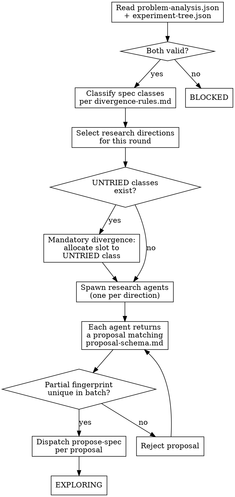

<!-- design-region-clean-of-hard-gates -->

# Explore

## Contract

- **Reads**: `.auto-discover/problem-analysis.json` (schema: `references/../analyze-problem/references/problem-analysis-schema.md`), `.auto-discover/experiment-tree.json` (schema: `references/../auto-discover/references/experiment-tree-schema.md`)
- **Writes**: Updated experiment-tree.json with pending nodes, dispatches propose-spec per proposal
- **References**: `references/proposal-schema.md`, `references/component-vocabulary.md`, `references/divergence-rules.md`
- **Verdicts**: EXPLORING, BLOCKED

<HARD-GATE>
Do NOT produce a proposal without tracing it to a specific research direction in problem-analysis.json. STOP and ground the proposal in a checked structural property.
</HARD-GATE>

<HARD-GATE>
Do NOT emit a proposal if it names a known architecture or borrows a composition strategy from a named pattern. STOP and derive the composition from the structural signal's implications.
</HARD-GATE>

<HARD-GATE>
Do NOT accept a proposal without verifying its partial fingerprint differs from all other proposals in the batch. STOP and enforce divergence per `references/divergence-rules.md`.
</HARD-GATE>

<HARD-GATE>
Do NOT target an EXHAUSTED class if any UNTRIED class exists. STOP and allocate at least one agent slot to an UNTRIED class.
</HARD-GATE>

<HARD-GATE>
Do NOT pass prior experiments' architecture choices to agents without stripping them first. STOP and provide only metric results and failure modes.
</HARD-GATE>

## Anti-Pattern

**"I know what architectures work for this kind of problem, let me propose one."** Proposals trace to research directions, not to training data. Read the directions. Each one names a structural observation and an architectural implication. The proposal is the implication made concrete, not a known approach selected from memory.

## Core Principle

Proposals emerge from structural analysis of the problem, not from knowledge of what architectures exist.

## Process Flow



## Checklist

1. Read and validate `.auto-discover/problem-analysis.json` and `.auto-discover/experiment-tree.json`
2. Classify spec classes per `references/divergence-rules.md`
3. Select research directions for this round
4. Enforce mandatory divergence toward UNTRIED classes
5. Spawn research agents, one per selected direction
6. Collect proposals matching `references/proposal-schema.md`
7. Verify partial-fingerprint divergence per `references/divergence-rules.md`
8. Dispatch propose-spec for each surviving proposal
9. Emit verdict

## Step Details

### 1. Read and validate `.auto-discover/problem-analysis.json` and `.auto-discover/experiment-tree.json`

Read both files in full. Validate `problem-analysis.json` has `research_directions` with at least one entry. Validate `experiment-tree.json` has a `nodes` object and a `class_status` object. If either file is missing or malformed, emit BLOCKED.

### 2. Classify spec classes per `references/divergence-rules.md`

Read `references/divergence-rules.md` § Fingerprint Computation. For each spec in the experiment tree, extract its partial fingerprint: `(sorted_ops_tuple, composition_strategy)`. Each distinct fingerprint defines a distinct class. Classify each class as UNTRIED, EXPLORING, or EXHAUSTED per the existing `class_status` in the tree. Research directions with no matching spec class in the tree are UNTRIED.

### 3. Select research directions for this round

First round: select all high-priority directions, plus at least one medium-priority direction. Later rounds: read the experiment tree's results — metrics, failure modes, review verdicts. Prioritize directions whose structural signals address gaps revealed by prior failures. De-prioritize directions whose structural implications overlap with EXHAUSTED classes. Never read prior architecture choices, ops, or composition strategies.

### 4. Enforce mandatory divergence toward UNTRIED classes

Read `references/divergence-rules.md` § Mandatory Divergence. If UNTRIED classes exist, allocate at least one research agent slot to an UNTRIED class. If all classes are EXPLORING, allocate one slot to the least-explored class. If all classes are EXHAUSTED, do not spawn agents — return control to auto-discover.

### 5. Spawn research agents, one per selected direction

For each selected direction, spawn a research agent. Provide: the direction's full entry from problem-analysis.json, the `task` and `structural_properties` sections, prior round metric results and failure modes only, and `genome_constraints` from the hypothesis. Each agent is a separate invocation that cannot see other agents' work.

### 6. Collect proposals matching `references/proposal-schema.md`

Each agent returns a proposal. Read `references/component-vocabulary.md` § {domain_type}. Verify each proposal's `required_operations` names operations from the vocabulary. Verify each proposal matches `references/proposal-schema.md`: `structural_basis`, `source_direction`, `required_operations`, `composition_strategy`, `expected_behavior`, `falsification` all present and non-empty.

### 7. Verify partial-fingerprint divergence per `references/divergence-rules.md`

Read `references/divergence-rules.md` § Collision Detection. Compute each proposal's partial fingerprint: `(sorted required_operations, composition_strategy)`. Compare each proposal against every other proposal in the batch. Reject any proposal whose partial fingerprint exactly matches another proposal in the batch. Cross-tree collision detection is deferred to propose-spec. After 3 rejection cycles on the same slot, drop that slot.

### 8. Dispatch propose-spec for each surviving proposal

Dispatch propose-spec with: the full proposal, `genome_constraints` from the hypothesis, and the target spec class status.

### 9. Emit verdict

Update the experiment tree with new pending nodes. Write the updated tree. Emit EXPLORING. If no agents produced viable proposals after divergence checks, emit BLOCKED.

## Gate Functions

- BEFORE producing a proposal: "Does it trace to a specific research direction id in problem-analysis.json?"
- BEFORE spawning agents: "Does each agent have a distinct research direction, and does each direction trace to a checked structural property?"
- BEFORE accepting a proposal: "Does its partial fingerprint differ from every other proposal in this batch?"
- BEFORE skipping an UNTRIED class: "Have all UNTRIED classes been allocated at least one slot?"
- BEFORE naming an operation: "Am I naming what the operation does, not what architecture it comes from?"

## Rationalization Table

| You think... | Reality |
|---|---|
| "I know GNNs use message-passing for graph problems" | Read `references/component-vocabulary.md` § Graph. Check which operation type the structural signal implies. Name the operation by what it does. |
| "This direction is too abstract to produce a concrete proposal" | Read the direction's `observation` and `implication`. Check `references/component-vocabulary.md` for operations that match the structural signal. |
| "The prior experiment's approach was close, just vary it" | Read its metric results and failure mode only. Never read its ops or composition. |
| "These two proposals share most of their ops, that must be too similar" | Check the full partial fingerprint per `references/divergence-rules.md`. Reject only on exact partial-fingerprint match. |
| "I already explored this direction last round" | Check whether the class it produced is EXHAUSTED. Refinement is valid for EXPLORING classes. |

## Red Flags

- "Let me propose a transformer/GNN/CNN variant"
- "The standard approach for this is..."
- "Based on what I know about [architecture family]..."
- "This is the same as the last experiment's approach"
- "I'll adjust the hyperparameters"
- "I already know what architecture works here"

## Key Principles

- Every proposal traces to a specific research direction in problem-analysis.json.
- Research agents investigate structural properties, not solution patterns.
- Operations are named by what they do, never by what architecture they come from.
- Agents see prior metric results and failure modes, never prior specs or compositions.
- Divergence is structural — partial fingerprints differ, not just hyperparameters.
- The structural analysis does the creative work; explore assembles from its signals.

## The Bottom Line

```bash
#!/usr/bin/env bash
set -euo pipefail
analysis="${1:-.auto-discover}/problem-analysis.json"
tree="${1:-.auto-discover}/experiment-tree.json"
if [[ ! -f "$analysis" ]]; then echo "VERDICT: BLOCKED (no problem analysis)"; exit 1; fi
if [[ ! -f "$tree" ]]; then echo "VERDICT: BLOCKED (no experiment tree)"; exit 1; fi
directions=$(python3 -c "import json,sys; d=json.load(open(sys.argv[1])); print(len(d.get('research_directions',[])))" "$analysis")
classes=$(python3 -c "import json,sys;t=json.load(open(sys.argv[1]));cs=t.get('class_status',{});print(len(cs),'classes:',', '.join(f'{k}={v}' for k,v in cs.items()))" "$tree")
echo "VERDICT: EXPLORING ($directions directions, $classes)"
```

## Status Vocabulary

- **EXPLORING** -- research agents spawned, proposals produced, specs dispatched to propose-spec
- **BLOCKED** -- problem analysis or experiment tree missing, malformed, or no viable proposals survived divergence checks
