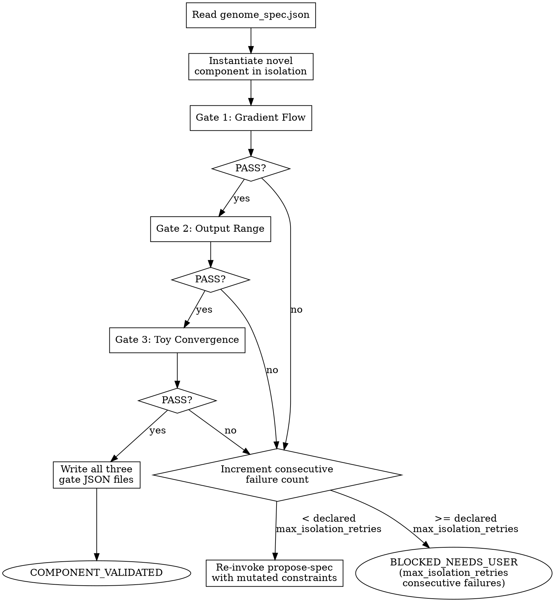

<!-- design-region-clean-of-hard-gates -->

# Isolate Component

<HARD-GATE>
Do NOT compose a full architecture without passing all three isolation gates. STOP and run each gate.
</HARD-GATE>

<HARD-GATE>
Do NOT proceed without running all three isolation gates. STOP and run each gate.
</HARD-GATE>

<HARD-GATE>
Do NOT proceed without reading gate verdicts from executed scripts. STOP and read the JSON verdict.
</HARD-GATE>

## Anti-Pattern

**"The gradients looked fine in the training log, skip the isolation gate."** A gradient that looks fine at the end of a full training run has already been shaped by every other component in the architecture. Isolation exists precisely to see the novel component's behavior before anything else can mask or compensate for a pathology.

## Core Principle

Validate in isolation before composition. Isolation gates catch gradient flow and range issues before they compound into hard-to-diagnose training failures.

## Process Flow



## Checklist

1. Read genome_spec.json for the component under test
2. Run Gate 1: Gradient Flow — instantiate, forward + backward on random input, check gradient norms
3. Run Gate 2: Output Range — forward on random input, check bounds and finiteness
4. Run Gate 3: Toy Convergence — train on a minimal synthetic task for a fixed micro-budget, check loss decrease
5. Write each gate's JSON verdict to the experiment directory
6. On any FAIL, mutate the genome spec and re-invoke propose-spec
7. After the declared max_isolation_retries consecutive failures on the same component type, emit BLOCKED_NEEDS_USER
8. On all-PASS, emit COMPONENT_VALIDATED

## Step Details

### 1. Read Genome Spec

Read `genome_spec.json` from the experiment directory produced by propose-spec. The `novel_component` field names the class and ops to instantiate; the three gates below test that component alone, with no other part of the eventual architecture present.

### 2. Gate 1: Gradient Flow

Instantiate the novel component with the hyperparameters from the spec. Run a forward pass on random input matching the declared input shape, then backpropagate from a scalar loss. Compute the gradient norm at every parameter tensor. PASS if the max gradient norm is below the declared threshold AND the mean gradient norm is below one-tenth of that threshold. A gradient that vanishes or explodes here will do the same — worse, less diagnosably — once other components are stacked around it.

### 3. Gate 2: Output Range

Forward the component on random input again. Check that every output value falls within the declared isolation_output_range, contains no NaN, and contains no Inf. PASS only if all three conditions hold across the full output tensor, not just a sampled subset.

### 4. Gate 3: Toy Convergence

Train the component on a minimal, structured synthetic task — one small enough that a working component shows measurable progress within a micro-budget scaled to the component's parameter count. Record the loss at step 0 and at the final step. PASS if `final_loss / initial_loss` is below the declared isolation_convergence_threshold, i.e. the loss dropped by at least the corresponding percentage. A component that cannot make progress on a toy task in isolation will not somehow start learning once folded into a larger architecture.

### 5. Write Gate JSON Files

Each gate writes its own JSON file to `.auto-discover/experiments/<hash>/gates/`: `gradient_flow.json`, `output_range.json`, `toy_convergence.json`. Each file records the verdict (`PASS` or `FAIL`), the measured values, and the thresholds compared against — the raw numbers, not just the verdict string, so a later audit can re-derive the decision.

### 6. On Failure, Mutate and Re-Propose

If any gate returns FAIL, do not retry the same spec. Invoke propose-spec again with the failure mode fed back as a constraint mutation — e.g. a gradient explosion narrows the relevant hyperparameter range; an output-range failure reveals a different normalization op from `allowed_ops`. The re-proposal is a fresh SPEC_EMITTED cycle, not a patch to the failed spec.

### 7. Track Consecutive Failures

Maintain a consecutive-failure counter scoped to the current component type (the `novel_component.type` field). A PASS on any gate does not reset this counter until all three gates PASS together. When the consecutive failure count reaches the declared max_isolation_retries, STOP mutating and emit BLOCKED_NEEDS_USER — indefinite mutation without user input is how a search silently burns budget on a component class that cannot pass.

### 8. Emit Verdict

Emit COMPONENT_VALIDATED only when all three gate JSON files exist and all three record `PASS`. Otherwise, per Step 6/7, either the pipeline is already re-proposing or it has emitted BLOCKED_NEEDS_USER.

## Gate Functions

- BEFORE Gate 1: "Is the component instantiated alone, with no other architecture component present?"
- BEFORE Gate 2: "Is the check applied to the full output tensor, not a sample?"
- BEFORE Gate 3: "Is the toy task genuinely minimal and structured, not a stand-in for the real dataset?"
- BEFORE re-invoking propose-spec: "Does the mutation address the specific gate that failed, not a generic re-roll?"
- BEFORE emitting COMPONENT_VALIDATED: "Do all three gate JSON files exist with verdict PASS?"
- BEFORE emitting BLOCKED_NEEDS_USER: "Has the consecutive-failure counter actually reached the declared max_isolation_retries for this component type?"

## Rationalization Table

| You think... | Reality |
|---|---|
| "The gradients looked fine in the full training run" | Run the component alone. That run already had other components shaping the gradient. |
| "The output range check is redundant with the loss not being NaN" | A bounded loss can still hide unbounded intermediate activations. Check the component's own outputs directly. |
| "The declared micro-budget isn't enough to judge convergence" | Run the toy task. A working component shows measurable progress fast — if it does not, scale will not fix it. |
| "I can retry the same spec, maybe it was a fluke" | Mutate the constraints and re-invoke propose-spec. Use a fresh spec, not a retry, to advance the search. |
| "Almost at the failure limit, but keep going" | The threshold is exactly the declared max_isolation_retries consecutive failures. STOP and emit BLOCKED_NEEDS_USER at that count, not before or after. |

## Red Flags

- "It'll work fine once it's in the full architecture"
- "The gradients look okay, no need to check"
- "One more retry with the same spec will do it"
- "The toy task doesn't really represent the real problem"
- "Let's just eyeball the loss curve"

## Key Principles

- Every gate runs on the component in isolation, never inside a composed architecture.
- Every gate verdict comes from an executed script producing JSON, never from visual inspection.
- Failure triggers mutation and re-proposal, not a retry of the identical spec.
- Reaching the declared max_isolation_retries consecutive failures on the same component type STOPs the loop and asks the user.
- COMPONENT_VALIDATED requires all three gates, not a majority.

## The Bottom Line

```bash
STATUS=$(python3 -c "
import json, glob, os
dirs = glob.glob('.auto-discover/experiments/*/gates')
if not dirs:
    print('FAIL'); exit()
gate_dir = sorted(dirs)[-1]
required = ['gradient_flow.json', 'output_range.json', 'toy_convergence.json']
verdicts = []
for name in required:
    path = os.path.join(gate_dir, name)
    if not os.path.exists(path):
        print('FAIL'); exit()
    verdicts.append(json.load(open(path)).get('verdict'))
print('PASS' if all(v == 'PASS' for v in verdicts) else 'FAIL')
")
echo "VERDICT: $STATUS"
```

## Status Vocabulary

- **COMPONENT_VALIDATED** -- all three isolation gates produced PASS
- **BLOCKED_NEEDS_USER** -- consecutive full-cycle failures on the same component type reached the declared max_isolation_retries
