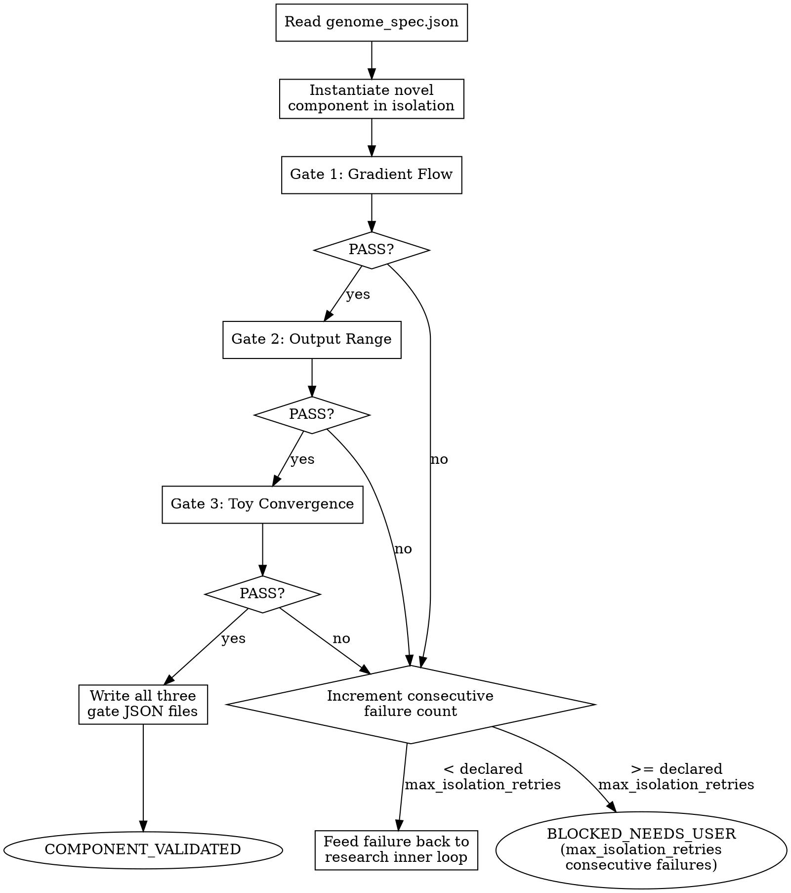

<!-- design-region-clean-of-hard-gates -->

# Isolate Component

## Contract

- **Reads**: `genome_spec.json` from the experiment directory (schema: `research/references/genome-spec-schema.md`)
- **Writes**: `.auto-discover/experiments/<hash>/gates/gradient_flow.json`, `.auto-discover/experiments/<hash>/gates/output_range.json`, `.auto-discover/experiments/<hash>/gates/toy_convergence.json`
- **References**: `references/isolation-gates.md`, `references/threshold-calibration.md`
- **Verdicts**: COMPONENT_VALIDATED, BLOCKED_NEEDS_USER

<HARD-GATE>
Do NOT compose a full architecture without passing all three isolation gates. STOP and run each gate.
</HARD-GATE>

<HARD-GATE>
Do NOT proceed without running all three isolation gates. STOP and run each gate.
</HARD-GATE>

<HARD-GATE>
Do NOT proceed without reading gate verdicts from executed scripts. STOP and read the JSON verdict.
</HARD-GATE>

## Anti-Pattern

**"The gradients looked fine in the training log, skip the isolation gate."** A gradient that looks fine at the end of a full training run has already been shaped by every other component in the architecture. Isolation exists precisely to see the novel component's behavior before anything else can mask or compensate for a pathology.

## Core Principle

Validate in isolation before composition. Isolation gates catch gradient flow and range issues before they compound into hard-to-diagnose training failures.

## Process Flow



## Checklist

1. Read genome_spec.json for the component under test.
2. Run Gate 1: Gradient Flow per `references/isolation-gates.md`.
3. Run Gate 2: Output Range per `references/isolation-gates.md`.
4. Run Gate 3: Toy Convergence per `references/isolation-gates.md`.
5. Write each gate's JSON verdict to the experiment directory.
6. On any FAIL, mutate the genome spec per `references/isolation-gates.md` § Failure Handling and feed the failure back to the research skill's inner loop.
7. After the declared max_isolation_retries consecutive failures on the same component type, emit BLOCKED_NEEDS_USER.
8. On all-PASS, emit COMPONENT_VALIDATED.

## Step Details

### 1. Read Genome Spec

Read `genome_spec.json` from the experiment directory produced by the research skill. The `novel_component` field names the class and ops to instantiate; the three gates below test that component alone, with no other part of the eventual architecture present.

### 2. Gate 1: Gradient Flow

Read `references/isolation-gates.md` for the gradient flow gate procedure and PASS/FAIL conditions. Read `references/threshold-calibration.md` for the `max_norm` threshold. Instantiate the novel component with the hyperparameters from the spec. Execute the gate and write `gradient_flow.json`.

### 3. Gate 2: Output Range

Read `references/isolation-gates.md` for the output range gate procedure and PASS/FAIL conditions. Read `references/threshold-calibration.md` for output bounds. Forward the component on random input. Execute the gate and write `output_range.json`.

### 4. Gate 3: Toy Convergence

Read `references/isolation-gates.md` for the toy convergence gate procedure and PASS/FAIL conditions. Read `references/threshold-calibration.md` for `loss_ratio_threshold` and `max_steps`. Execute the gate and write `toy_convergence.json`.

### 5. Write Gate JSON Files

Read `references/isolation-gates.md` for the output format. Each gate writes its own JSON file to `.auto-discover/experiments/<hash>/gates/` recording the verdict, the measured values, and the thresholds compared against.

### 6. On Failure, Mutate and Re-Propose

Read `references/isolation-gates.md` § Failure Handling for mutation rules per failure mode. Feed the failed gate's mode back to the research skill's inner loop as a constraint mutation. The re-proposal is a fresh SPEC_EMITTED cycle, not a patch to the failed spec.

### 7. Track Consecutive Failures

Maintain a consecutive-failure counter scoped to the current component type (the `novel_component.type` field). A PASS on any gate does not reset this counter until all three gates PASS together. When the consecutive failure count reaches the declared max_isolation_retries, emit BLOCKED_NEEDS_USER.

### 8. Emit Verdict

Emit COMPONENT_VALIDATED only when all three gate JSON files exist and all three record `PASS`. Otherwise, per Step 6/7, either the pipeline is already re-proposing or it has emitted BLOCKED_NEEDS_USER.

## Gate Functions

- BEFORE Gate 1: "Is the component instantiated alone, with no other architecture component present?"
- BEFORE Gate 2: "Is the check applied to the full output tensor, not a sample?"
- BEFORE Gate 3: "Is the toy task minimal and structured, not a stand-in for the real dataset?"
- BEFORE feeding the failure back to the research skill: "Does the mutation address the specific gate that failed, not a generic re-roll?"
- BEFORE emitting COMPONENT_VALIDATED: "Do all three gate JSON files exist with verdict PASS?"
- BEFORE emitting BLOCKED_NEEDS_USER: "Has the consecutive-failure counter reached the declared max_isolation_retries for this component type?"

## Rationalization Table

| You think... | Reality |
|---|---|
| "The gradients looked fine in the full training run" | Run the component alone per `references/isolation-gates.md`. That run already had other components shaping the gradient. |
| "The output range check is redundant with the loss not being NaN" | Check the component's own outputs directly per `references/isolation-gates.md`. A bounded loss can hide unbounded intermediate activations. |
| "The declared micro-budget isn't enough to judge convergence" | Run the toy task per `references/isolation-gates.md`. A working component shows measurable progress fast. |
| "I can retry the same spec, maybe it was a fluke" | Feed the failure back to the research skill's inner loop with mutated constraints per `references/isolation-gates.md` § Failure Handling. Require a fresh spec, not a retry. |
| "Almost at the failure limit, but keep going" | Halt at exactly the declared max_isolation_retries consecutive failures. Emit BLOCKED_NEEDS_USER at that count. |

## Red Flags

- "It'll work fine once it's in the full architecture"
- "The gradients look okay, no need to check"
- "One more retry with the same spec will do it"
- "The toy task doesn't really represent the real problem"
- "Let's just eyeball the loss curve"

## Key Principles

- Every gate runs on the component in isolation, never inside a composed architecture.
- Every gate verdict comes from an executed script producing JSON, never from visual inspection.
- Gate definitions, thresholds, and failure handling rules live in `references/isolation-gates.md` and `references/threshold-calibration.md`.
- Failure triggers mutation and re-proposal, not a retry of the identical spec.
- Reaching the declared max_isolation_retries consecutive failures on the same component type stops the loop and asks the user.
- COMPONENT_VALIDATED requires all three gates, not a majority.

## The Bottom Line

```bash
STATUS=$(python3 -c "
import json, glob, os
dirs = glob.glob('.auto-discover/experiments/*/gates')
if not dirs:
    print('FAIL'); exit()
gate_dir = sorted(dirs)[-1]
required = ['gradient_flow.json', 'output_range.json', 'toy_convergence.json']
verdicts = []
for name in required:
    path = os.path.join(gate_dir, name)
    if not os.path.exists(path):
        print('FAIL'); exit()
    verdicts.append(json.load(open(path)).get('verdict'))
print('PASS' if all(v == 'PASS' for v in verdicts) else 'FAIL')
")
echo "VERDICT: $STATUS"
```

## Status Vocabulary

- **COMPONENT_VALIDATED** -- all three isolation gates produced PASS
- **BLOCKED_NEEDS_USER** -- consecutive full-cycle failures on the same component type reached the declared max_isolation_retries
