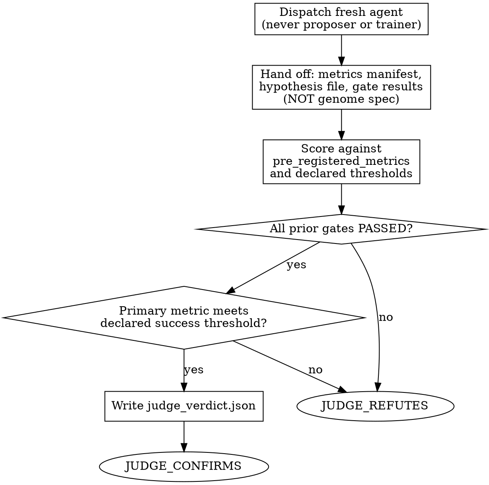

<!-- design-region-clean-of-hard-gates -->

# Judge

## Contract

- **Reads**: `<worktree-path>/final_metrics.json`, `<worktree-path>/reproducibility_result.json`, `.auto-discover/hypothesis.yaml`, `<worktree-path>/null_baseline_result.json`, `.auto-discover/experiments/<hash>/gates/*.json`
- **Writes**: `<worktree-path>/judge_verdict.json` (schema: `references/scoring-rubric.md` § judge_verdict.json Fields)
- **References**: `references/scoring-rubric.md`
- **Verdicts**: JUDGE_CONFIRMS, JUDGE_REFUTES

<HARD-GATE>
Do NOT proceed if the proposer or trainer is serving as judge. STOP and dispatch a separate agent.
</HARD-GATE>

<HARD-GATE>
Do NOT score metrics outside pre_registered_metrics. STOP and use only the pre-registered set.
</HARD-GATE>

<HARD-GATE>
Do NOT proceed without the thresholds locked at pre-registration. STOP and use them unchanged.
</HARD-GATE>

<HARD-GATE>
Do NOT proceed if the genome spec is accessible. STOP and score results only.
</HARD-GATE>

## Anti-Pattern

**"I already trained this candidate and watched every checkpoint, I can score it myself."** The agent that trained the candidate has already formed an opinion about whether it worked — that opinion is exactly what structural distrust exists to route around. An agent scoring its own output, even in good faith, reads ambiguous results charitably. The judge is dispatched fresh, with no memory of the training run, no access to the architecture that produced the numbers, and no stake in the outcome.

## Core Principle

Structural distrust. No agent both produces and approves its own work. The judge is always separate, always constrained to pre-registered metrics.

## Process Flow



## Checklist

1. Dispatch a fresh agent that was not the proposer or the trainer for this candidate
2. Hand off exactly three inputs: metrics manifest, hypothesis file, gate results
3. Withhold the genome spec — the judge never sees architecture
4. Score strictly against pre_registered_metrics and the thresholds locked at pre-registration
5. Verify every prior gate (isolation, null-baseline, reproducibility) shows PASS
6. Verify the primary metric meets the declared success threshold
7. Write judge_verdict.json with the score and reasoning
8. Emit JUDGE_CONFIRMS or JUDGE_REFUTES

## Step Details

### 1. Dispatch a Separate Agent

Dispatch the judge as a distinct agent instance from whichever agent proposed the genome spec (`propose-spec`) or built and trained the candidate (`build-variant`). If the orchestrator cannot verify the dispatched agent is separate, STOP — do not proceed with a self-scored result standing in for judgment.

### 2. Hand Off Bounded Inputs

Give the judge exactly three artifacts: the metrics manifest (the candidate's `final_metrics.json` plus the seed-level `reproducibility_result.json`), the locked `hypothesis.yaml` (including `pre_registered_metrics` and success thresholds), and the gate results (`null_baseline_result.json`, `reproducibility_result.json`, and the isolation gate JSONs). The judge receives no training logs, no architecture diagrams, and no narrative summary written by the trainer — narrative summaries are where the trainer's opinion leaks in.

### 3. Withhold the Genome Spec

Do not hand off `genome_spec.json` or any description of the novel component's structure. The judge scores outcomes against pre-registered criteria; it has no legitimate use for architecture details, and withholding them removes any temptation to reason about "why this works" instead of "does the evidence meet the bar."

### 4. Score Against Pre-Registered Metrics Only

Read `references/scoring-rubric.md` § Criteria for the complete scoring criteria and their weights. Score the primary and secondary metric values from the metrics manifest against the pre-registered thresholds. Read `references/scoring-rubric.md` § Scope Limits for what the judge is and is not permitted to do.

### 5. Verify Prior Gates

Confirm every upstream gate result is `PASS`: isolation (all three), null-baseline (all three comparisons), reproducibility (all seeds, variance within tolerance). If any upstream gate shows `FAIL`, the judge emits `JUDGE_REFUTES` immediately — the judge does not re-litigate a gate that has already failed; it simply confirms the failure propagates.

### 6. Verify Success Threshold

Compare the primary metric's value (using `metric_optimized` if a threshold/calibration step upstream produced one, else the raw value) against the success threshold declared in the hypothesis. This comparison is a direct numeric check, not an impression — "does the number clear the bar," nothing more.

### 7. Write Judge Verdict

Read `references/scoring-rubric.md` § judge_verdict.json Fields for the output schema. Write `judge_verdict.json` to the experiment directory with every field from the schema populated.

### 8. Emit Verdict

Emit `JUDGE_CONFIRMS` only if every prior gate passed AND the primary metric meets its declared threshold. Otherwise emit `JUDGE_REFUTES`, naming the specific failing gate or metric in the reason field.

## Gate Functions

- BEFORE dispatching: "Is this agent instance distinct from the proposer and the trainer?"
- BEFORE handing off inputs: "Does the payload exclude the genome spec and training narrative?"
- BEFORE scoring: "Am I comparing against pre_registered_metrics only, with thresholds exactly as locked at pre-registration?"
- BEFORE emitting JUDGE_CONFIRMS: "Do all upstream gates show PASS AND does the primary metric clear its declared threshold?"
- BEFORE writing the verdict: "Is the reasoning traceable to numbers in the metrics manifest, not to architecture I was not given?"

## Rationalization Table

| You think... | Reality |
|---|---|
| "I trained this, I already know if it worked" | Dispatch a separate agent with no memory of the run. The trainer does not judge its own output. |
| "Seeing the architecture would help me judge fairly" | Read results, not architecture. Withholding the genome spec is deliberate, not an oversight. |
| "This candidate came close to the threshold, that's basically confirming" | Check the number against the exact declared threshold. A near-miss is not passing. |
| "A new metric captures what actually matters here better" | Reject any new metric at judgment time. Read `references/scoring-rubric.md` § Scope Limits. |
| "One upstream gate had a minor issue, the overall result is still strong" | Emit JUDGE_REFUTES for any upstream gate FAIL. Read `references/scoring-rubric.md` § Verdict. |

## Red Flags

- "I already know this candidate worked, skip the separate judge"
- "Let me see the architecture to judge this fairly"
- "It came close enough to the threshold"
- "This other metric tells the real story"
- "One gate failure doesn't outweigh the overall result"

## Key Principles

- The judge is always a different agent than the proposer or the trainer.
- Inputs are bounded to metrics manifest, hypothesis file, and gate results — nothing else.
- The genome spec is never in scope for judgment.
- Thresholds are locked at pre-registration and never renegotiated.
- Any upstream gate failure is a direct route to JUDGE_REFUTES.

## The Bottom Line

```bash
#!/usr/bin/env bash
set -euo pipefail
worktree_path="${1:?Usage: judge <worktree_path>}"
verdict_file="${worktree_path}/judge_verdict.json"
if [[ ! -f "$verdict_file" ]]; then
  echo "VERDICT: JUDGE_REFUTES"
  exit 1
fi
status=$(python3 -c "import json,sys; print(json.load(open(sys.argv[1]))['status'])" "$verdict_file")
echo "VERDICT: ${status}"
```

## Status Vocabulary

- **JUDGE_CONFIRMS** -- all upstream gates PASSED and the primary metric meets its declared threshold
- **JUDGE_REFUTES** -- an upstream gate FAILED or the primary metric does not meet its threshold
