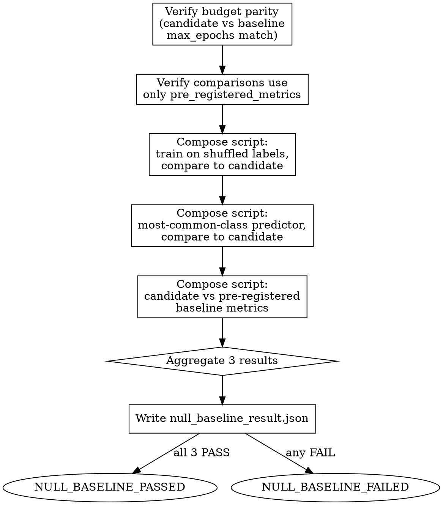

<!-- design-region-clean-of-hard-gates -->

# Null Baseline Gate

## Contract

- **Reads**: `<worktree-path>/training_metrics.json`, `.auto-discover/baselines/baseline_metrics.json`, `.auto-discover/hypothesis.yaml`
- **Writes**: `<worktree-path>/null_baseline_result.json` (schema: `references/null-comparisons.md` § Result Fields)
- **References**: `references/null-comparisons.md`
- **Verdicts**: NULL_BASELINE_PASSED, NULL_BASELINE_FAILED

<HARD-GATE>
Do NOT compare on metrics outside pre_registered_metrics. STOP and use only the pre-registered set.
</HARD-GATE>

<HARD-GATE>
Do NOT run without verifying budget parity. STOP and confirm candidate and baseline used the same max_epochs.
</HARD-GATE>

<HARD-GATE>
Do NOT declare PASSED if any of the three comparisons fails. STOP and record which failed.
</HARD-GATE>

## Anti-Pattern

**"The candidate beat the baseline, skip the shuffled-label check — obviously it's not memorizing."** A candidate that beats the baseline can still be exploiting a leak or memorizing label structure that has nothing to do with the architecture. The shuffled-label and constant-output controls exist precisely to catch what a single favorable comparison cannot: they isolate whether the model is learning the task at all, not whether it merely outscored one other number.

## Core Principle

Null baselines catch what optimism misses: data leaks, memorization, and trivial solutions. Run them every time.

## Process Flow



## Checklist

1. Verify budget parity: candidate and baseline used the same max_epochs
2. Verify all comparisons draw only from pre_registered_metrics
3. Run comparison 1: candidate vs shuffled-label control
4. Run comparison 2: candidate vs constant-output predictor
5. Run comparison 3: candidate vs pre-registered baseline
6. Write null_baseline_result.json with all three results
7. Emit NULL_BASELINE_PASSED only if all three passed, else NULL_BASELINE_FAILED naming the failures

## Step Details

### 1. Verify Budget Parity

Read `training_metrics.json` for both the candidate and the baseline record from `establish-baseline`. Confirm `max_epochs` (or `max_steps`) matches exactly between the two. If they differ, STOP — the comparison is invalid before it starts, because a candidate trained longer than its baseline cannot cleanly attribute a metric gain to the architecture.

### 2. Verify Metric Scope

Read `pre_registered_metrics` from the locked `hypothesis.yaml`. Every comparison in this gate uses only metrics from that list. Do not introduce auxiliary metrics (e.g., training speed, parameter count) as comparison criteria — those are recorded for context but never used to decide PASS/FAIL here.

### 3. Comparison 1: Shuffled-Label Control

Read `references/null-comparisons.md` § Comparisons for the shuffled-label control definition and PASS condition. Compose a script that trains the same candidate architecture on the same data with labels randomly permuted, using the identical budget and hyperparameters as the candidate. PASS if the candidate's primary pre-registered metric exceeds the shuffled-label control's by the margin specified in the reference doc.

### 4. Comparison 2: Constant-Output Predictor

Read `references/null-comparisons.md` § Comparisons for the constant-predictor definition and PASS condition. Compose a script that scores the trivial predictor against the pre-registered metrics. PASS if the candidate exceeds this predictor on the primary metric.

### 5. Comparison 3: Pre-Registered Baseline

Read `references/null-comparisons.md` § Comparisons for the baseline comparison definition and PASS condition. Compose a script that loads the immutable baseline record written by `establish-baseline` and compares it against the candidate's final metrics, using only `pre_registered_metrics`. PASS if the candidate outperforms the baseline on the primary metric by at least the declared success threshold.

### 6. Write Result

Read `references/null-comparisons.md` § Result Fields for the output schema. Write `null_baseline_result.json` to the experiment directory with every field from the schema populated.

### 7. Emit Verdict

Emit `NULL_BASELINE_PASSED` only if all three comparisons passed. Otherwise emit `NULL_BASELINE_FAILED` and name every failing comparison in the reason field — auto-discover routes a failure straight to evidence-report, not to a retry.

## Gate Functions

- BEFORE any comparison: "Did candidate and baseline use the identical max_epochs?"
- BEFORE any comparison: "Is every metric used here in pre_registered_metrics?"
- BEFORE declaring the shuffled-label comparison PASS: "Did I compose and execute the shuffle-and-train script, or assume the result?"
- BEFORE declaring PASSED: "Did all three comparisons pass, not just the baseline comparison?"
- BEFORE writing the result: "Does the JSON name which specific comparison(s) failed, if any?"

## Rationalization Table

| You think... | Reality |
|---|---|
| "It beat the baseline, that's the real test, skip the rest" | Run all three. Beating the baseline alone does not rule out memorization or leakage. |
| "The shuffled-label check is obviously going to pass" | Run the script. Obvious outcomes are exactly where unexamined leaks hide. |
| "The candidate trained a few extra epochs, close enough" | Verify exact budget parity. Re-run with matched budget before comparing. |
| "This other metric shows a bigger win, use that instead" | Reject any metric outside pre_registered_metrics. Read `references/null-comparisons.md` § Preconditions. |
| "Two out of three passed, that's basically a pass" | Require all three to pass. Partial passage is NULL_BASELINE_FAILED with the failing comparison named. |

## Red Flags

- "Skip the shuffled-label control, it obviously can't matter here"
- "The baseline comparison alone tells us what we need"
- "Budget was close enough between the two runs"
- "This unregistered metric shows the real story"
- "Two of three comparisons passing is good enough"

## Key Principles

- Three comparisons, not one. Each catches a distinct failure mode.
- Budget parity is a precondition, not a detail.
- Metric scope is fixed at pre-registration and never expanded here.
- A single failing comparison fails the whole gate.
- Execute every comparison as a script; never eyeball a metric delta.

## The Bottom Line

```bash
#!/usr/bin/env bash
set -euo pipefail
worktree_path="${1:?Usage: null-baseline-gate <worktree_path>}"
result_file="${worktree_path}/null_baseline_result.json"
if [[ ! -f "$result_file" ]]; then
  echo "VERDICT: NULL_BASELINE_FAILED"
  exit 1
fi
status=$(python3 -c "import json,sys; print(json.load(open(sys.argv[1]))['status'])" "$result_file")
echo "VERDICT: ${status}"
```

## Status Vocabulary

- **NULL_BASELINE_PASSED** -- all three comparisons (shuffled-label, constant-output, pre-registered baseline) passed
- **NULL_BASELINE_FAILED** -- one or more comparisons failed, with the failing comparison(s) named
