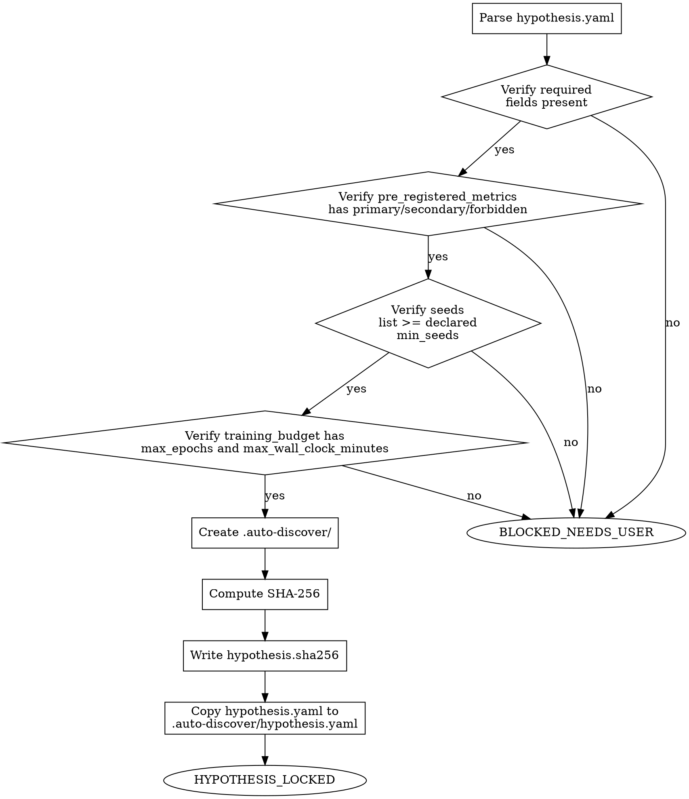

<!-- design-region-clean-of-hard-gates -->

# Pre-Register

<HARD-GATE>
Do NOT proceed without all required fields: thesis, null_hypothesis, success_criteria, failure_criteria, pre_registered_metrics (primary, secondary, forbidden), seeds, training_budget. STOP and emit BLOCKED_NEEDS_USER with the missing fields list.
</HARD-GATE>

<HARD-GATE>
Do NOT proceed if the hypothesis was modified after locking. STOP and treat the SHA-256 as the immutability contract.
</HARD-GATE>

<HARD-GATE>
Do NOT lock a hypothesis if allowed_ops entries name known architecture patterns. STOP and require abstract mathematical op names.
</HARD-GATE>

<HARD-GATE>
Do NOT lock a hypothesis whose success_criteria, failure_criteria, or metric names reference a named phenomenon (grokking, double descent, lottery ticket, neural scaling law, phase transition, memorization-then-generalization). STOP and require operationally-defined criteria that describe measurable outcomes without importing a training-dynamics story.
</HARD-GATE>

<HARD-GATE>
Do NOT lock a hypothesis without at least one compute-normalized budget field (max_compute_flops or max_samples_seen). STOP and require a compute-normalized bound alongside any epoch limit.
</HARD-GATE>

## Anti-Pattern

**"I'll fill in the missing fields myself so we can get started."** A hypothesis with fields inferred after the fact is not pre-registered — it is post-hoc rationalization wearing a pre-registration costume. Missing fields STOP the pipeline; they are never filled in on the hypothesis's behalf.

## Core Principle

Pre-registration is the firewall against post-hoc rationalization. Lock before you run.

## Process Flow



## Checklist

1. Parse YAML
2. Verify required fields
3. Verify pre_registered_metrics has primary/secondary/forbidden
4. Verify seeds list has at least the declared min_seeds entries
5. Verify training_budget has max_epochs and max_wall_clock_minutes
6. Validate allowed_ops vocabulary. Scan each op name against a denylist of known architecture terminology. Reject any op that names a pattern rather than describing a computation. Emit BLOCKED_NEEDS_USER with the offending op names.
7. Scan success_criteria, failure_criteria, and all metric names for phenomenon terminology. Reject any criterion or metric that names a specific training dynamic rather than an operational measurement. `grokking_delay_ratio` fails — it names a phenomenon. `compute_to_threshold_ratio` passes — it names a measurement. Emit BLOCKED_NEEDS_USER listing the offending terms and suggesting operational alternatives.
8. Verify training_budget includes at least one compute-normalized field: max_compute_flops (total floating-point operations) or max_samples_seen (total training examples processed). Epoch counts alone import a frame assumption — different architectures consume different compute per epoch. An epoch-only budget anchors the experiment to a specific architecture's compute profile.
9. Validate search_config fields if present. For each declared field, verify its type and range. For undeclared fields, record that their defaults will be derived at runtime by the consuming skill.
10. Create .auto-discover/
11. Compute SHA-256
12. Write hypothesis.sha256
13. Copy hypothesis.yaml to `.auto-discover/hypothesis.yaml`. Downstream skills read the hypothesis from this canonical path.
14. Emit verdict

## Step Details

### 1. Parse YAML

Read the hypothesis file and parse it as YAML. If the file does not exist or fails to parse, emit BLOCKED_NEEDS_USER with the parse error and stop.

### 2. Verify Required Fields

Confirm the parsed document contains every one of: `thesis`, `null_hypothesis`, `success_criteria`, `failure_criteria`, `pre_registered_metrics`, `seeds`, `training_budget`. Collect every missing field name before stopping — the user must see the complete list in one pass, not one field at a time across repeated runs.

### 3. Verify Pre-Registered Metrics

Confirm `pre_registered_metrics` has all three of `primary`, `secondary`, and `forbidden` keys. `forbidden` is allowed to be an empty list, but the key itself must be present — its role is to name metrics that must never be used to justify a discovery, and an absent key means that boundary was never considered.

### 4. Verify Seeds

Confirm `seeds` is a list with at least the declared min_seeds entries (read from search_config; defaults derive from the minimum required for reproducibility-gate). A single seed cannot support the reproducibility gate downstream, so pre-registration STOPs it here rather than letting it fail silently three pipeline stages later.

### 5. Verify Training Budget

Confirm `training_budget` contains both `max_epochs` and `max_wall_clock_minutes`. Both bounds are required because either one alone leaves an unbounded dimension for a runaway or an under-trained baseline.

### 6. Validate Allowed Ops Vocabulary

Scan every entry in `allowed_ops` against a denylist of known architecture terminology: attention, transformer, convolution, conv, recurrent, rnn, lstm, gru, pooling, embedding, encoder, decoder, feedforward, ffn, mlp, softmax, dot-product, self-attention, cross-attention, multi-head. If any allowed_op contains any of these substrings (case-insensitive), emit BLOCKED_NEEDS_USER listing the offending ops and suggesting abstract alternatives. An op name that names a pattern rather than a computation smuggles the answer into the search space before any exploration runs.

### 7. Scan for Phenomenon Terminology

Scan `success_criteria`, `failure_criteria`, and every metric name in `pre_registered_metrics` against a phenomenon denylist: grokking, double descent, lottery ticket, neural scaling law, phase transition, memorization-then-generalization, sudden generalization, delayed emergence. For each rejected term, recommend an operational replacement: `grokking_delay_ratio` → `compute_to_threshold_ratio`, `convergence_speed_epochs_to_99pct` → `samples_to_threshold_accuracy`. A criterion named after a phenomenon imports a training-dynamics story before any training has run.

### 8. Verify Compute-Normalized Budget

Confirm `training_budget` includes at least one compute-normalized field: `max_compute_flops` (total floating-point operations) or `max_samples_seen` (total training examples processed). Compute-normalized budgets make comparisons fair across architectures with different per-step costs — a transformer and a linear model trained for N epochs consume vastly different compute, and epochs alone hide this difference.

### 9. Validate Search Config

If the hypothesis declares a `search_config` section, validate each field that is present. Fields not declared are not errors — each consuming skill derives a sensible default at runtime. If a field IS declared, verify it has the correct type and a value that makes sense for the experiment.

The 11 recognized search_config fields and their purpose:

| Field | Type | Purpose | Default derived from |
|---|---|---|---|
| `divergence_threshold` | *(removed — divergence is now binary fingerprint match, not a ratio)* | | |
| `isolation_convergence_threshold` | float (0, 1) | Loss ratio threshold for the toy convergence isolation gate | the task's noise floor |
| `max_isolation_retries` | int >= 1 | Consecutive isolation failures before BLOCKED_NEEDS_USER | the search space breadth |
| `diminishing_returns_threshold` | float (0, 1) | Minimum relative improvement to avoid exhaustion classification | baseline variance |
| `min_exhaustion_depth` | int >= 1 | Minimum class depth before diminishing returns can trigger | the search space breadth |
| `pareto_stability_window` | int >= 1 | Consecutive identical Pareto fronts needed for stability | the population size per round |
| `min_front_diversity` | int >= 1 | Minimum spec classes on the Pareto front before recording single-class dominance diagnostic (does not gate convergence) | the reachable class space |
| `min_seeds` | int >= 2 | Minimum seed count for reproducibility-gate | the reproducibility-gate's statistical requirement |
| `stale_pathway_count` | int >= 1 | Consecutive sub-threshold refinements before a pathway is stale | the min_exhaustion_depth |
| `isolation_output_range` | [float, float] | Bounds for the output range isolation gate | the activation function range |
| `early_stopping_patience` | int >= 1 | Checkpoints without improvement on the primary metric before build-variant stops training | the declared training_budget (a fraction of the total budget) |

Reject any field whose type does not match (e.g. a string where a float is expected) or whose value is outside its type's valid range (e.g. a negative `min_seeds`). Emit BLOCKED_NEEDS_USER naming every invalid field.

### 10. Create State Directory

Create `.auto-discover/` if it does not already exist. This is the root the rest of the pipeline writes beneath.

### 11. Compute SHA-256

Compute the SHA-256 hash of the canonical byte contents of the hypothesis file, exactly as parsed in Step 1.

### 12. Write Hash File

Write the hash to `.auto-discover/hypothesis.sha256`. If this file already exists, treat the hypothesis as already locked: re-verify the existing hash against the current file contents rather than overwriting, and emit BLOCKED_NEEDS_USER if they diverge — a diverging hash means the hypothesis was edited after locking.

### 13. Copy Hypothesis File

Copy hypothesis.yaml to `.auto-discover/hypothesis.yaml`. Downstream skills — explore, evidence-report, and every other skill that needs the locked hypothesis — read from this canonical path, never from the user-supplied file's original location. This copy happens after the hash is written, so a copy only ever exists for a hypothesis that has actually passed Step 12's lock check.

### 14. Emit Verdict

Emit HYPOTHESIS_LOCKED with the hash, or BLOCKED_NEEDS_USER with the complete list of missing or invalid fields.

## Gate Functions

- BEFORE parsing: "Does the hypothesis file exist at the expected path?"
- BEFORE hashing: "Are all required fields present, and do metrics/seeds/budget satisfy their sub-checks?"
- BEFORE writing hypothesis.sha256: "Does a lock file already exist, and if so does it match the current file?"
- BEFORE emitting HYPOTHESIS_LOCKED: "Was the hash written to disk, and was hypothesis.yaml copied to .auto-discover/hypothesis.yaml, not just computed/hashed?"
- BEFORE locking the hypothesis: "Do any allowed_ops entries name a known architecture pattern rather than a mathematical operation?"
- BEFORE locking: "Do any metrics or criteria name a specific phenomenon rather than an operational measurement?"
- BEFORE locking: "Does training_budget include at least one compute-normalized field?"

## Rationalization Table

| You think... | Reality |
|---|---|
| "The missing field is implied by the thesis, I can infer it" | STOP and emit BLOCKED_NEEDS_USER. Inference is how post-hoc rationalization enters the pipeline. |
| "One seed is enough for a first pass" | Require seeds >= the declared min_seeds. A single seed cannot support the reproducibility gate. |
| "I'll re-hash after I tweak one field" | Treat the hypothesis as immutable once locked. A changed field means a new pre-registration. |
| "forbidden is empty, I can omit the key" | Include the key even when the list is empty. Its presence records that the boundary was considered. |
| "modular_distance_attention is just a descriptive name" | If the name contains a known architecture pattern (attention, transformer, etc.), it imports the answer. Use abstract names: modular_distance_scoring, cyclic_proximity, ring_metric. |
| "grokking_delay_ratio describes what we're measuring" | It names a phenomenon, not a measurement. Use compute_to_threshold_ratio — it measures the same thing without importing a story about why. |
| "N epochs is a reasonable budget" | Epochs are architecture-dependent. N epochs of a small model is different compute than N epochs of a large model. Use FLOPs or samples. |

## Red Flags

- "This field is basically implied"
- "I'll fill in the budget with a sensible default"
- "The hash doesn't need to match exactly"
- "One seed to start, more later"

## Key Principles

- Every required field is verified explicitly; none are inferred.
- The SHA-256 is computed only after every field check passes.
- A hash file that already exists is compared, never overwritten.
- BLOCKED_NEEDS_USER always carries the complete list of what is missing.

## The Bottom Line

```bash
STATUS=$(python3 -c "
import hashlib, os
hyp_path = 'hypothesis.yaml'
hash_path = '.auto-discover/hypothesis.sha256'
if not os.path.exists(hyp_path) or not os.path.exists(hash_path):
    print('FAIL'); exit()
with open(hyp_path, 'rb') as f:
    actual = hashlib.sha256(f.read()).hexdigest()
with open(hash_path) as f:
    stored = f.read().strip()
print('PASS' if actual == stored else 'FAIL')
")
echo "VERDICT: $STATUS"
```

## Status Vocabulary

- **HYPOTHESIS_LOCKED** -- all required fields present, hash computed and written
- **BLOCKED_NEEDS_USER** -- one or more required fields missing or invalid
