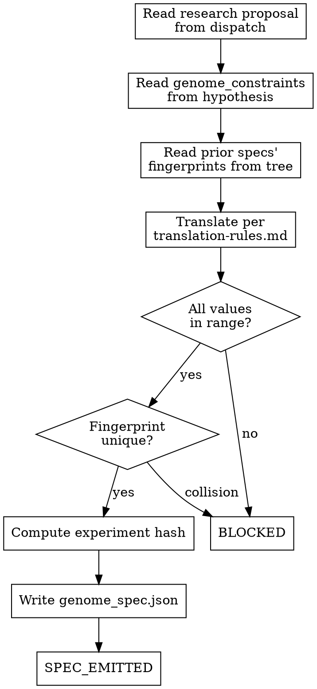

<!-- design-region-clean-of-hard-gates -->

# Propose Spec

## Contract

- **Reads**: Research proposal (schema: `references/../explore/references/proposal-schema.md`), `genome_constraints` from hypothesis
- **Writes**: `.auto-discover/experiments/<hash>/genome_spec.json` (schema: `references/genome-spec-schema.md`)
- **References**: `references/genome-spec-schema.md`, `references/translation-rules.md`
- **Verdicts**: SPEC_EMITTED, BLOCKED

<HARD-GATE>
Do NOT translate without a research proposal from explore. STOP and emit BLOCKED.
</HARD-GATE>

<HARD-GATE>
Do NOT add or omit operations unless the proposal's `required_operations` names them. STOP and map only what the proposal declares.
</HARD-GATE>

<HARD-GATE>
Do NOT emit a spec without verifying its full fingerprint differs from all prior specs. STOP and emit BLOCKED on collision.
</HARD-GATE>

<HARD-GATE>
Do NOT name the architecture unless the name derives from the structural basis and primary operation. STOP and rename if it recalls a known architecture.
</HARD-GATE>

<HARD-GATE>
Do NOT proceed if any value falls outside its genome_constraints range. STOP and emit BLOCKED naming the field and its bounds.
</HARD-GATE>

## Anti-Pattern

**"The proposal's operations are vague, let me fill in something that fits."** propose-spec does not invent. explore already identified what operations the problem requires and what composition implements them. A translation that fills gaps is redoing explore's structural analysis without the grounding.

## Core Principle

The spec is the proposal made concrete — propose-spec translates, it does not invent.

## Process Flow



## Checklist

1. Read the research proposal from the dispatch prompt
2. Read genome_constraints from the locked hypothesis
3. Read prior specs' fingerprints from the experiment tree
4. Translate the proposal per `references/translation-rules.md`
5. Validate all values against genome_constraints
6. Verify the full fingerprint differs from every prior spec
7. Compute the experiment hash and write genome_spec.json
8. Emit verdict

## Step Details

### 1. Read the research proposal from the dispatch prompt

Read the full proposal: `structural_basis`, `source_direction`, `required_operations`, `composition_strategy`, `expected_behavior`, `falsification`. If the dispatch carries no proposal or `required_operations` is empty, emit BLOCKED.

### 2. Read genome_constraints from the locked hypothesis

Read `genome_constraints` from `.auto-discover/hypothesis.yaml`: `max_parameters`, `embedding_dim_range`, and any other declared bounds. These constrain the scale of the translation — parameter count and dimension ranges.

### 3. Read prior specs' fingerprints from the experiment tree

Read every existing `genome_spec.json` under `.auto-discover/experiments/*/`. For each, compute its full fingerprint per `references/genome-spec-schema.md` § Fingerprint Computation: `(sorted novel_component.ops_used, composition.strategy, composition.layer_arrangement)`.

### 4. Translate the proposal per `references/translation-rules.md`

Read `references/translation-rules.md`. Map each proposal field to the corresponding genome-spec field per the mapping table. Map `required_operations` to `novel_component.ops_used` per the Op Naming rules — names describe computation, not origin. Map `composition_strategy` to `composition.strategy` verbatim. Produce `composition.layer_arrangement` by ordering the translated ops per layer as the strategy dictates. Derive `architecture_name` per the Naming Conventions table. Validate against `references/genome-spec-schema.md`.

### 5. Validate all values against genome_constraints

Read `references/translation-rules.md` § Constraint Validation. Check every numeric value in `composition` and `hyperparameters` against its declared range. Out-of-range: emit BLOCKED naming the field and its bounds. Never clamp.

### 6. Verify the full fingerprint differs from every prior spec

Compute the draft spec's full fingerprint per `references/genome-spec-schema.md` § Fingerprint Computation. Compare against every prior spec's fingerprint. On exact match: emit BLOCKED naming the colliding spec. Do not rename ops or reshuffle the arrangement to force a mismatch.

### 7. Compute the experiment hash and write genome_spec.json

Compute SHA-256 over the canonical JSON serialization of the verified spec. Create `.auto-discover/experiments/<hash>/`. Write `genome_spec.json` inside it.

### 8. Emit verdict

- **SPEC_EMITTED** — genome spec written, all values within constraints, fingerprint unique.
- **BLOCKED** — no proposal, value out of range, or fingerprint collision.

## Gate Functions

- BEFORE translating: "Is every operation I am about to write traceable to the proposal's `required_operations`?"
- BEFORE emitting the draft: "Does the spec contain only the schema fields plus `structural_basis` — no prose, no code, no borrowed architecture name?"
- BEFORE writing genome_spec.json: "Did every value pass its range check and does the fingerprint differ from every prior spec?"

## Rationalization Table

| You think... | Reality |
|---|---|
| "The proposal's operations were vague, I'll add something standard" | Emit BLOCKED. Return the problem to explore for re-investigation. |
| "I'll clamp this value to the nearest bound" | Reject the spec. Emit BLOCKED naming the field and its bounds. |
| "The fingerprint matches a prior spec but the structural basis is different" | Reject the spec. A different motivation that lands on the same fingerprint is the same architecture with a new story. |
| "This architecture is basically a [known pattern], let me name it that" | Rename from the structural basis per `references/translation-rules.md` § Naming Conventions. |
| "The proposal didn't specify this, I'll use a standard approach" | Emit BLOCKED. A gap in the proposal is explore's problem to fix. |

## Red Flags

- "This is basically equivalent to a [known architecture]"
- "I'll fill in the gaps with something reasonable"
- "Let me clamp the value and move on"
- "The proposal didn't specify this, I'll use a standard approach"

## Key Principles

- The spec is typed JSON with a structural_basis audit trail, nothing else.
- Every operation traces to the proposal's required_operations via `references/translation-rules.md`.
- Out-of-range values and fingerprint collisions emit BLOCKED, never silently corrected.
- propose-spec has no structural analysis gates — explore and analyze-problem already ran them.

## The Bottom Line

```bash
#!/usr/bin/env bash
set -euo pipefail
STATUS=$(python3 -c "
import json, glob
files = glob.glob('.auto-discover/experiments/*/genome_spec.json')
if not files:
    print('FAIL'); exit()
spec = json.load(open(sorted(files)[-1]))
required = ['spec_version', 'architecture_name', 'novel_component', 'composition', 'hyperparameters', 'structural_basis']
print('PASS' if all(k in spec for k in required) else 'FAIL')
")
echo "VERDICT: $STATUS"
```

## Status Vocabulary

- **SPEC_EMITTED** -- genome spec written, translated from the proposal, all values within constraints, fingerprint unique
- **BLOCKED** -- no proposal, value out of range, or fingerprint collision
