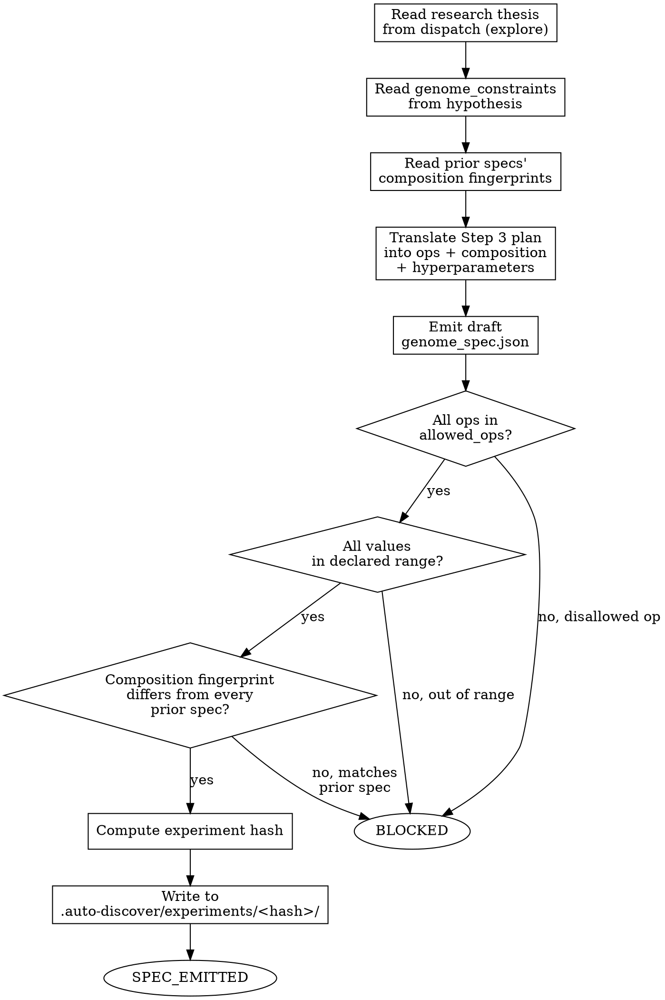

<!-- design-region-clean-of-hard-gates -->

# Propose Spec

<HARD-GATE>
Do NOT propose a spec without a research thesis from explore. STOP and wait for explore to dispatch.
</HARD-GATE>

<HARD-GATE>
Do NOT propose ops outside the allowed_ops set. STOP and name the disallowed op — never substitute the nearest allowed one.
</HARD-GATE>

<HARD-GATE>
Do NOT translate without following the thesis's analogy. STOP and map Polya Step 3 directly into the spec.
</HARD-GATE>

<HARD-GATE>
Do NOT propose a spec without verifying its composition fingerprint differs from all prior specs. STOP and enforce divergence.
</HARD-GATE>

## Anti-Pattern

**"The thesis's plan was a bit vague on ops, let me fill in something that fits the spirit of the analogy."** propose-spec does not invent. explore already did the creative work — problem reframing, analogy selection, plan devising — under seven anti-consensus HARD-GATEs specifically built to keep that reasoning out of Claude's training-data defaults. A propose-spec that fills gaps "in the spirit of" the analogy is doing explore's job over again, with none of explore's guardrails and no subagent isolation to catch a retrieved pattern before it becomes a spec.

## Core Principle

The spec is the thesis made concrete. propose-spec translates, it does not invent. It has no anti-consensus gates of its own because it isn't supposed to need them — it is a compiler from a Polya-method thesis to typed JSON, not a second author. Where v1's propose-spec generated a spec from scratch within bare constraints, v2's propose-spec receives a thesis and translates it; the creative work already happened upstream.

## Process Flow



## Checklist

1. Read the research thesis from the dispatch prompt
2. Read genome_constraints from the locked hypothesis
3. Read prior specs' composition fingerprints from the experiment tree
4. Translate the thesis's Polya Step 3 plan into ops, composition, and hyperparameters
5. Emit the draft genome_spec.json fields
6. Verify every op is in allowed_ops
7. Verify every numeric value is within its declared range
8. Verify the draft spec's composition fingerprint differs from every prior spec in the tree
9. Compute the experiment hash and write genome_spec.json
10. Emit SPEC_EMITTED or BLOCKED

## Step Details

### 1. Read the Research Thesis

Read the full thesis object from the dispatch prompt, in the shape explore's own Step 5 produces: `problem_restatements`, `analogy_domain`, `analogy`, `plan`, `expected_outcome`, `falsification`, `look_back`. If the dispatch carries no thesis, or the `plan` field is missing or empty, STOP and emit BLOCKED — there is nothing to translate.

### 2. Read Genome Constraints

Read `genome_constraints` from the locked hypothesis: `allowed_ops`, `embedding_dim_range`, `num_heads_range`, `hybrid_ratio_range`, `modulus_range`, and any other declared bounds. These constraints bound the translation — they do not dictate what to translate.

### 3. Read Prior Specs

Read every existing `genome_spec.json` under `.auto-discover/experiments/*/`. For each, extract its composition fingerprint: sorted `novel_component.ops_used`, `composition.strategy`, and the layer arrangement (the ordered sequence of ops per layer/block and the graph topology connecting them -- where skip/residual connections attach, where a bottleneck narrows the path, where branches split and merge) — the identical fingerprint definition explore and converge both use, so the comparison in Step 8 is measuring the same thing those two skills measure.

### 4. Translate the Plan

This is the whole of propose-spec's job. The thesis's plan (Polya Step 3) names what ops are needed, what composition strategy connects them, and why that follows from the analogy. Map it directly:

- `novel_component.ops_used` — exactly the ops the plan's reasoning calls for, restricted to what the novel computation requires. Add nothing the plan does not name; omit nothing the plan does name.
- `composition.strategy` — the composition strategy the plan describes (sequential, parallel, branching, residual, or whatever structure the plan's reasoning produces).
- `hyperparameters` — sized from the plan's reasoning and the thesis's `expected_outcome`, clamped to genome_constraints' declared ranges.

A spec that is thinner or richer than what the plan describes is not a translation of it — it is propose-spec quietly re-authoring the thesis.

### 5. Emit the Draft Spec

Emit a JSON object with exactly these top-level fields, unchanged from the spec schema isolate-component and build-variant both consume: `spec_version`, `architecture_name`, `novel_component` (`type`, `class`, `ops_used`), `composition` (`strategy`, `hybrid_ratio`, `num_layers`), `hyperparameters`. Derive `architecture_name` from the thesis's `analogy_domain` and its own reasoning, never from a name borrowed from a known architecture or paper title — a retrieved name is exactly the retrieval explore's HARD-GATEs exist to prevent, and it would smuggle that failure mode back in at the naming step.

### 6. Verify Ops

Check every entry in `novel_component.ops_used` against `allowed_ops`. If any op is outside the set, STOP — do not substitute the nearest allowed op silently. Emit BLOCKED naming the disallowed op and the thesis field it came from.

### 7. Verify Ranges

Check every numeric value in `composition` and `hyperparameters` against its declared range. If any value falls outside its range, STOP — do not silently clamp to the nearest bound and proceed as if it were the original translation. Emit BLOCKED naming the out-of-range field and its declared bounds.

### 8. Verify Fingerprint

Compute the draft spec's composition fingerprint (sorted `ops_used`, `composition.strategy`, and layer arrangement) and compare it against every prior spec's fingerprint from Step 3 for exact equality. If the draft's fingerprint exactly matches any prior spec's fingerprint, STOP and emit BLOCKED, naming the colliding prior spec and the matching fingerprint. This check is independent of explore's own thesis-level divergence check — filling in composability details during translation (a required residual connection, a normalization op the plan implied but didn't name) can land a spec on the same ops and strategy as a prior spec even when the thesis alone looked distinct; the arrangement is what still has to differ. Do not rename ops or reshuffle the arrangement to force a mismatch; that is inventing a different spec, not correcting a translation.

### 9. Compute Hash and Write

Compute a hash over the canonical serialization of the verified genome spec. Create `.auto-discover/experiments/<hash>/` and write `genome_spec.json` inside it.

### 10. Emit Verdict

Emit SPEC_EMITTED with the experiment hash, or BLOCKED with the specific failure: no thesis, disallowed op, out-of-range value, or ops-overlap violation. A BLOCKED here is explore's signal to re-run Polya Step 2 with a sharper analogy before propose-spec is re-invoked for that thread — it is not a signal to loosen propose-spec's checks.

## Gate Functions

- BEFORE translating: "Is every field I am about to write in Step 4 traceable to an explicit line in the thesis's plan, not to my own sense of what would fit?"
- BEFORE emitting the draft: "Does the output contain only spec_version, architecture_name, novel_component, composition, and hyperparameters — no prose, no code, no borrowed architecture name?"
- BEFORE writing genome_spec.json: "Did every op pass the allowed_ops check, every value pass its range check, and the composition fingerprint differ from every prior spec, not just the most recent one?"
- BEFORE emitting SPEC_EMITTED: "Is the experiment hash computed from the final, fully-verified spec?"

## Rationalization Table

| You think... | Reality |
|---|---|
| "The thesis's plan was vague here, I'll use my judgment" | Return BLOCKED. A vague plan is explore's problem to fix by re-running Polya Step 2/3 with a sharper analogy. |
| "This op is close enough to an allowed one" | Reject the op and emit BLOCKED. Only ops literally in allowed_ops are valid. |
| "I'll clamp this value to the nearest bound and keep going" | STOP and emit BLOCKED. A silently clamped value is a different proposal than the one the thesis actually reasoned about. |
| "The ops overlap with a prior spec but the framing is different so it is fine" | Run the fingerprint check on ops, strategy, and arrangement, not on framing. A different analogy that lands on the same composition fingerprint is the same spec with a new story attached. |
| "I already translated a similar thesis, I can reuse most of that spec" | Create each dispatch fresh from its own thesis. Reusing structure from another spec defeats explore's isolated subagent analogies. |
| "A short prose description helps explain the translation" | Emit the typed JSON spec only. Explanation belongs in the thesis, never inside the spec itself. |

## Red Flags

- "This op is basically equivalent to an allowed one"
- "I'll just clamp the value and move on"
- "The plan didn't fully specify this, I'll fill it in reasonably"
- "This is close enough to what the analogy requires"
- "I'll reuse most of the last spec since the thesis is similar"
- "Let me add a short description of the architecture in the spec"

## Key Principles

- The spec is typed JSON, nothing else.
- Every op and every value traces to an explicit line in the thesis's plan, never to propose-spec's own judgment.
- Out-of-range, disallowed, or specs whose composition fingerprint matches a prior spec STOP the proposal; they are never silently corrected.
- propose-spec has no anti-consensus gates of its own because explore already ran them on the thesis — its job is fidelity to that thesis, not independent invention.
- The fingerprint check here is a second, spec-level safety net, distinct from explore's own thesis-level check.

## The Bottom Line

```bash
STATUS=$(python3 -c "
import json, glob
files = glob.glob('.auto-discover/experiments/*/genome_spec.json')
if not files:
    print('FAIL'); exit()
spec = json.load(open(sorted(files)[-1]))
required = ['spec_version', 'architecture_name', 'novel_component', 'composition', 'hyperparameters']
print('PASS' if all(k in spec for k in required) else 'FAIL')
")
echo "VERDICT: $STATUS"
```

## Status Vocabulary

- **SPEC_EMITTED** -- genome spec written, translated from the thesis's plan, all ops and values within declared constraints, composition fingerprint differs from every prior spec
- **BLOCKED** -- no thesis provided, a proposed op outside allowed_ops, a value outside a declared range, or composition fingerprint matches a prior spec
