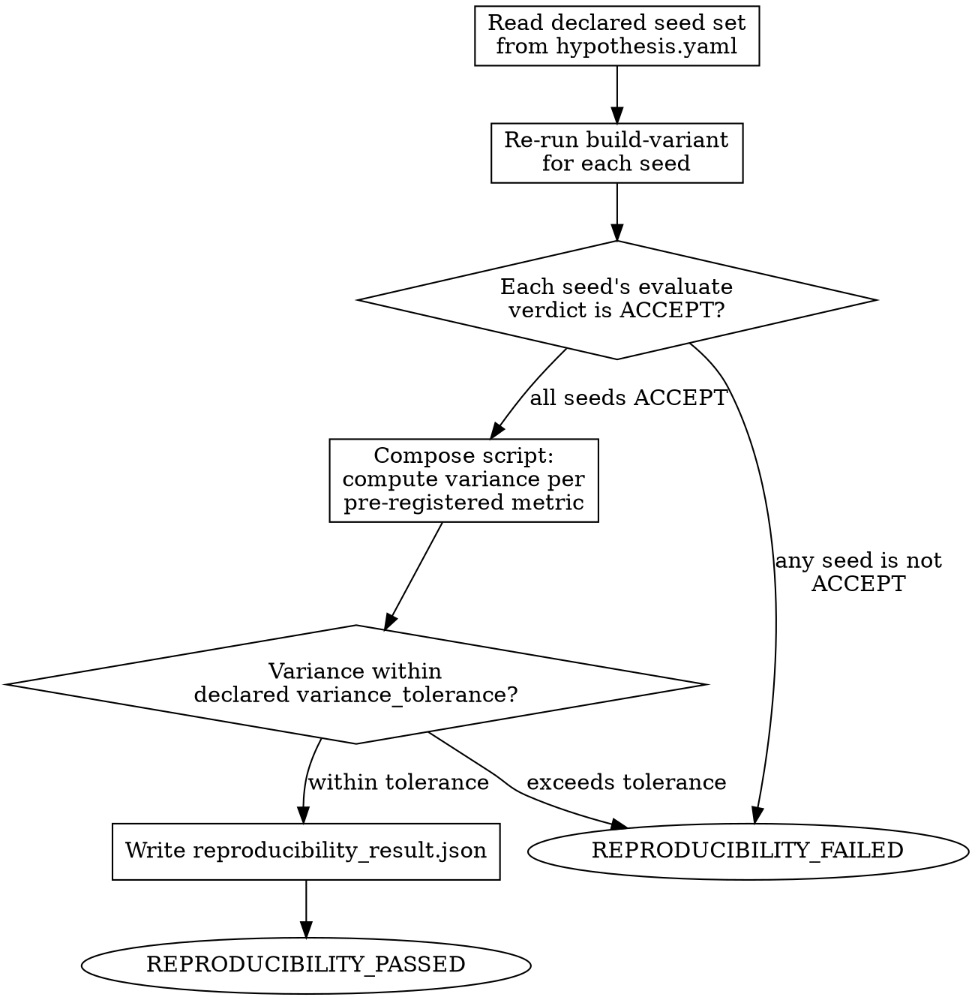

<!-- design-region-clean-of-hard-gates -->

# Reproducibility Gate

<HARD-GATE>
Do NOT declare reproducible without running every declared seed. STOP and run the full set.
</HARD-GATE>

<HARD-GATE>
Do NOT accept variance outside the declared variance_tolerance. STOP and fail the gate.
</HARD-GATE>

<HARD-GATE>
Do NOT proceed without running ALL declared seeds. STOP and run every seed in the hypothesis.
</HARD-GATE>

## Anti-Pattern

**"The first three seeds all converged, that's a strong pattern, skip the rest."** A pattern across three seeds is not the declared seed set — it is a stopping point chosen because the run so far looked good. The seed set is fixed at pre-registration precisely so no one, including the orchestrator itself, gets to decide mid-run that enough evidence has accumulated. Stopping early is how a single favorable run gets mistaken for reproducibility.

## Core Principle

Single-seed results are noise, not evidence. Run the declared seed set. Compute variance. Evidence requires reproducibility.

## Process Flow



## Checklist

1. Read the full declared seed set from hypothesis.yaml — no subset, no early stop
2. Re-run build-variant (and evaluate) for every seed in the set
3. Verify every seed's evaluate verdict is ACCEPT
4. Compose a script to compute variance across seeds for each pre-registered metric
5. Compare computed variance against the declared variance_tolerance
6. Write reproducibility_result.json with per-seed results and variance table
7. Emit REPRODUCIBILITY_PASSED only if every seed's evaluate verdict is ACCEPT AND variance is within tolerance

## Step Details

### 1. Read the Declared Seed Set

Read `seeds` (or `seed_count` and a deterministic seed derivation rule) from the locked `hypothesis.yaml`. This list is fixed at pre-registration. There is no notion of "enough seeds" decided during the run — the full declared set is the unit of evidence.

### 2. Re-Run Across All Seeds

For each seed in the declared set, re-invoke `build-variant` with that seed and the same genome spec, architecture composition, and budget already validated for the leading candidate's run. Store each seed's `training_metrics.json` and `final_metrics.json` under `.auto-discover/experiments/<hash>/seeds/<seed>/`.

### 3. Verify Evaluation Per Seed

Invoke `evaluate` for each seed's run. If any seed does not receive an `ACCEPT` verdict — it was REJECTed for diverging, crashing, or producing invalid metrics, or came back INCONCLUSIVE — the gate fails immediately. Do not compute variance over a mix of ACCEPT and non-ACCEPT runs; a non-ACCEPT seed's metrics are not comparable evidence. A seed's diagnostic `accuracy_trajectory` (stable_high, stable_moderate, and so on) is recorded for the record but never substitutes for its evaluate verdict here.

### 4. Compute Variance

Compose a script that, for each metric in `pre_registered_metrics`, collects the value from every seed's `final_metrics.json` and computes the standard deviation (or coefficient of variation, if the hypothesis declares that as the variance measure). Emit structured JSON per metric: `{"metric": "<name>", "values": [...], "mean": <float>, "std": <float>, "cv": <float>}`.

### 5. Compare Against Tolerance

Read `variance_tolerance` from the hypothesis for each metric (a single tolerance applies to all metrics, or per-metric tolerances are declared — follow whichever the hypothesis specifies). PASS per-metric if the computed variance measure is at or below the declared tolerance. The gate as a whole passes only if every pre-registered metric's variance is within tolerance.

### 6. Write Result

Write `reproducibility_result.json`:

```json
{
  "status": "<REPRODUCIBILITY_PASSED|REPRODUCIBILITY_FAILED>",
  "seeds_declared": [<int>, ...],
  "seeds_run": [<int>, ...],
  "seeds_accepted": [<int>, ...],
  "variance_table": [
    {"metric": "<name>", "values": [...], "mean": <float>, "std": <float>, "tolerance": <float>, "within_tolerance": <bool>}
  ],
  "reason": "<one-line explanation naming which seed or metric failed, if any>"
}
```

### 7. Emit Verdict

Emit `REPRODUCIBILITY_PASSED` only if every declared seed's evaluate verdict is ACCEPT and every pre-registered metric's variance is within its declared tolerance. Otherwise emit `REPRODUCIBILITY_FAILED`, naming the failing seed(s) or metric(s) in the reason field.

## Gate Functions

- BEFORE running: "Is this the full declared seed set, or a subset chosen because early results looked good?"
- BEFORE computing variance: "Did every seed's evaluate verdict come back ACCEPT?"
- BEFORE declaring PASSED: "Is variance computed by an executed script against the declared tolerance, not estimated by eye?"
- BEFORE declaring PASSED: "Does every pre-registered metric pass, not just the primary one?"
- BEFORE writing the result: "Does the variance table include every seed's raw value, not just the aggregate?"

## Rationalization Table

| You think... | Reality |
|---|---|
| "The first few seeds converged nicely, that's a strong signal" | Run the full declared set. A pattern in a subset is not the pre-registered evidence unit. |
| "One seed diverged, drop it and average the rest" | Include every seed in the variance computation. A diverging seed fails the gate — never silently exclude it. |
| "The variance is a little over tolerance but the trend is right" | Apply the tolerance as a hard threshold set at pre-registration, not a target to approach. |
| "Seeds are basically interchangeable, one representative run is enough" | Run all declared seeds. Single-seed results are noise — seeds are not interchangeable until proven so. |
| "This secondary metric's variance is high but the primary metric is fine" | Check every pre-registered metric against tolerance, not only the primary one. |

## Red Flags

- "The pattern across the first three seeds is enough"
- "Drop the seed that diverged and average the rest"
- "Variance is close to tolerance, call it a pass"
- "One representative seed captures the behavior"
- "The primary metric passed, the secondary metric's variance doesn't matter"

## Key Principles

- The seed set is fixed at pre-registration; no seed selection happens mid-run.
- Every seed must reach an ACCEPT evaluate verdict before variance is even computed.
- Variance tolerance is a hard threshold, computed by script, checked per metric.
- A single seed's result is never evidence on its own.
- Reproducibility failure routes straight to evidence-report, not to a retry with different seeds.

## The Bottom Line

```bash
#!/usr/bin/env bash
set -euo pipefail
experiment_path="${1:?Usage: reproducibility-gate <experiment_path>}"
result_file="${experiment_path}/reproducibility_result.json"
if [[ ! -f "$result_file" ]]; then
  echo "VERDICT: REPRODUCIBILITY_FAILED"
  exit 1
fi
status=$(python3 -c "import json,sys; print(json.load(open(sys.argv[1]))['status'])" "$result_file")
echo "VERDICT: ${status}"
```

## Status Vocabulary

- **REPRODUCIBILITY_PASSED** -- every seed's evaluate verdict is ACCEPT and variance within declared tolerance for all metrics
- **REPRODUCIBILITY_FAILED** -- a seed did not reach ACCEPT, or variance exceeds declared tolerance
