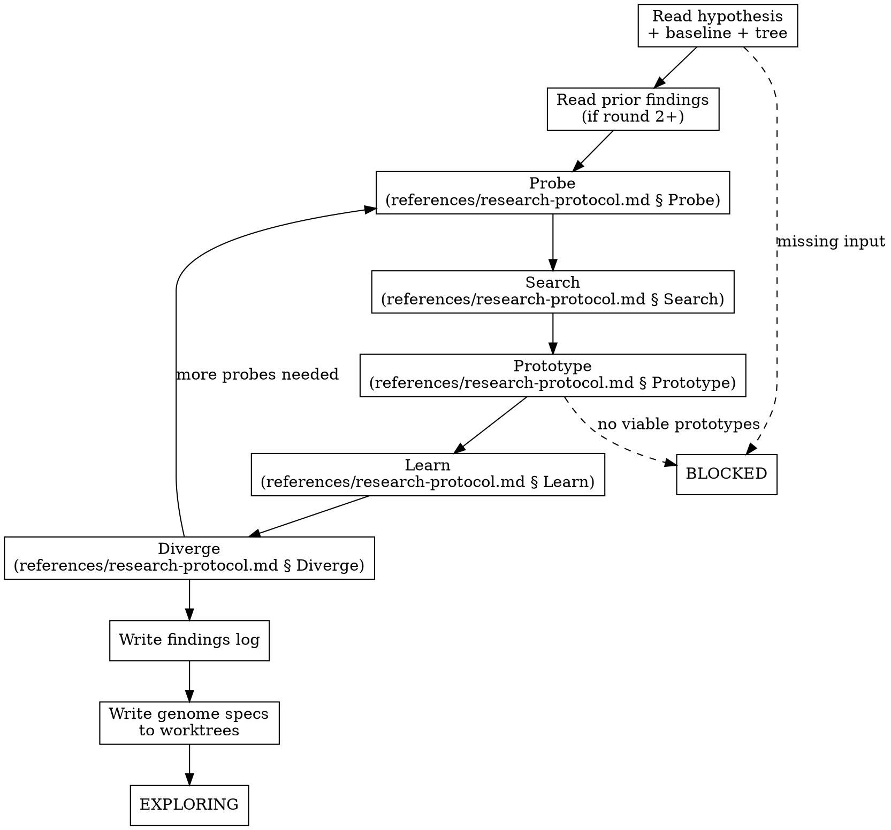

<!-- design-region-clean-of-hard-gates -->

# Research

## Contract

- **Reads**: `.auto-discover/hypothesis.yaml`, `.auto-discover/baselines/baseline_metrics.json`, `.auto-discover/experiment-tree.json` (schema: `../auto-discover/references/experiment-tree-schema.md`), `.auto-discover/research/` (prior round findings), web (via WebSearch/WebFetch)
- **Writes**: `.auto-discover/research/round_N/` (probe scripts, findings log), `.auto-discover/worktrees/<hash>/genome_spec.json` (schema: `references/genome-spec-schema.md`)
- **References**: `references/research-protocol.md`, `references/findings-log-schema.md`, `references/genome-spec-schema.md`
- **Verdicts**: EXPLORING, BLOCKED

<HARD-GATE>
Do NOT produce genome specs without running at least 3 probes first. STOP and probe the problem.
</HARD-GATE>

<HARD-GATE>
Do NOT run web searches without grounding them in probe findings. STOP and derive search terms from results.
</HARD-GATE>

<HARD-GATE>
Do NOT produce fewer than 2 genome specs from different structural bases unless no viable prototypes exist. STOP and diverge.
</HARD-GATE>

<HARD-GATE>
Do NOT name specific mathematical structures to look for outside of recording probe results. STOP and let the probes discover them.
</HARD-GATE>

## Anti-Pattern

**"I already know this is a group theory problem, let me search for group-theoretic architectures."** That is retrieval. Run the probes. Let them tell you what the structure is. Search based on what they find.

## Core Principle

The search space emerges from the interaction between the problem and what the agent discovers through probing and research.

## Process Flow



## Checklist

1. Read hypothesis and baseline metrics
2. Read experiment tree and prior findings log (if round 2+)
3. Run probes per `references/research-protocol.md` § Probe
4. Run web searches per `references/research-protocol.md` § Search
5. Build prototypes per `references/research-protocol.md` § Prototype
6. Record findings per `references/findings-log-schema.md`
7. Write genome specs to worktrees per `references/genome-spec-schema.md`

## Step Details

### 1. Read hypothesis and baseline metrics

Read `.auto-discover/hypothesis.yaml` for the thesis, null hypothesis, genome constraints, and problem description. Read `.auto-discover/baselines/baseline_metrics.json` for the baseline's metric values, training trajectory, and final performance.

### 2. Read experiment tree and prior findings log (if round 2+)

If round 2+, read `references/research-protocol.md` § Round 2+ Protocol. Read `.auto-discover/experiment-tree.json` for prior specs, accuracies, and spec classes. Read `.auto-discover/research/round_N/findings.json` for prior probes, searches, and failure diagnoses. Identify gaps in the search space and failure modes to investigate.

### 3. Run probes

Read `references/research-protocol.md` § Probe. Compose and run self-contained scripts that test properties of the input/output relationship. Each probe is at most 50 lines, prints structured JSON, and tests one property. Run at least 3 probes before proceeding. Record every probe result in the findings log.

### 4. Run web searches

Read `references/research-protocol.md` § Search. Derive search terms from probe findings. Every search query traces to a specific probe result. Record every search query and top-3 results in the findings log.

### 5. Build prototypes

Read `references/research-protocol.md` § Prototype. Build self-contained Python files that test whether the structural insights from probes and searches translate to a working architecture. Each prototype is at most 100 lines, trains for at most 500 epochs on a data subset. Record accuracy, parameter count, and success status.

### 6. Record findings

Write the findings log to `.auto-discover/research/round_N/findings.json` matching `references/findings-log-schema.md`. Every failed prototype gets a `failure_diagnosis` entry stating what went wrong and why. Every search traces to a probe. Every probe records its structured result.

### 7. Write genome specs

Write genome specs to `.auto-discover/worktrees/<hash>/genome_spec.json` matching `references/genome-spec-schema.md`. Produce at least 2 specs from different structural bases when viable prototypes exist. Read `references/research-protocol.md` § Diverge and verify that the specs exploit different structural properties.

## Gate Functions

- BEFORE running any search: "Did I derive this search query from a specific probe result, or am I searching from prior knowledge?"
- BEFORE writing a genome spec: "Did I run at least 3 probes and build at least one prototype that informed this spec?"
- BEFORE writing a second spec: "Does it exploit a different structural basis than the first, or is it a hyperparameter variant?"
- BEFORE concluding the round: "Did I record every probe, search, prototype, and failure in the findings log?"
- BEFORE emitting EXPLORING: "Do I have at least 2 genome specs from different structural bases, or have I documented why fewer exist?"

## Rationalization Table

| You think... | Reality |
|---|---|
| "I know what mathematical structure this problem has, let me search directly" | Run at least 3 probes per `references/research-protocol.md` § Probe. Derive search terms from their results. |
| "One strong prototype is enough, no need to diverge" | Read `references/research-protocol.md` § Diverge. Verify at least 2 specs from different structural bases exist. |
| "The first probe told me everything, I can skip the rest" | Run at least 3 probes. Each tests a different property of the input/output relationship. |
| "This prototype failed but I know how to fix it, no need to log the failure" | Write the failure diagnosis to the findings log per `references/findings-log-schema.md`. The failure mode drives the following probe or search. |
| "I already searched for this in a prior round, no need to search again" | Read the prior findings log. Verify the prior search still applies. Run new probes targeting gaps the prior round missed. |

## Red Flags

- "I know what kind of architecture this problem needs"
- "Let me search for known solutions to this problem type"
- "The structure is obvious from the problem description"
- "One prototype is enough to produce genome specs"
- "I can skip probing and go straight to prototyping"
- "The prior round already covered this structural direction"

## Key Principles

- Probes discover the structure; searches deepen the discovery; prototypes test the translation.
- Every search traces to a probe finding, never to recalled knowledge.
- Every failed prototype produces a diagnosis that drives the following probe or search.
- Divergence is measured by different structural bases, not by different hyperparameters.
- The findings log is the audit trail: every decision traces to recorded evidence.

## The Bottom Line

```bash
#!/usr/bin/env bash
set -euo pipefail
round_dir="${1:-.auto-discover/research/round_1}"
findings="$round_dir/findings.json"
if [[ ! -f "$findings" ]]; then echo "VERDICT: BLOCKED (findings log missing)"; exit 1; fi
python3 -c "
import json, sys
d = json.load(open(sys.argv[1]))
probes = len(d.get('probes', []))
specs = len(d.get('genome_specs_produced', []))
protos = len(d.get('prototypes', []))
if probes < 3:
    print(f'VERDICT: BLOCKED (only {probes} probes, need at least 3)')
    sys.exit(1)
if specs < 1:
    print(f'VERDICT: BLOCKED (no genome specs produced)')
    sys.exit(1)
print(f'VERDICT: EXPLORING ({probes} probes, {protos} prototypes, {specs} specs)')
" "$findings"
```

## Status Vocabulary

- **EXPLORING** -- at least 3 probes ran, at least 1 genome spec produced, findings log written
- **BLOCKED** -- hypothesis or baseline missing, fewer than 3 probes ran, or no viable prototypes found
