<!-- design-region-clean-of-hard-gates -->

# Review Strategy

## Contract

- **Reads**: `evaluation_result` (from EVALUATION.json), `variant_params` (from final_metrics.json), `baseline_params` (from baseline_metrics.json), `baseline_primary` (baseline's primary metric value), `metric_direction` (from experiment-tree.json), `pareto_front` (current front) from dispatch prompt
- **Writes**: `<worktree-path>/REVIEW.json`
- **References**: `references/pareto-computation.md`, `references/efficiency-thresholds.md`
- **Verdicts**: KEEP, DISCARD, KEEP_WITH_CONCERNS

<HARD-GATE>
Do NOT emit KEEP without checking Pareto dominance via an executed script. STOP and run the dominance check.
</HARD-GATE>

<HARD-GATE>
Do NOT discard a variant if its spec class was UNTRIED before this attempt. STOP and floor the verdict at KEEP_WITH_CONCERNS.
</HARD-GATE>

## Anti-Pattern

**"The metric improved, obviously keep it."** Raw improvement ignores what it cost: a variant that gains marginal accuracy at disproportionate parameter cost is not automatically worth keeping, and a variant that ties the front while exploring new territory is worth more than its raw number alone shows. review-strategy scores contribution to the search, not the metric in isolation.

## Core Principle

Score each variant's contribution to the search — not just its absolute metric, but whether it advances the Pareto front, explores new territory, or stalls in a spec class that has stopped paying off.

## Process Flow

```dot
digraph review_strategy {
  rankdir=LR;
  node [shape=box];
  read [label="Read Inline Context"];
  efficiency [label="Compute Param\nEfficiency"];
  classify [label="Classify Change Type"];
  pareto [label="Check Pareto\nDominance"];
  stale [label="Detect Stale\nPathways"];
  decision [label="Apply Decision Matrix"];
  write [label="Write REVIEW.json"];
  read -> efficiency -> classify -> pareto -> stale -> decision -> write;
}
```



## Checklist

1. Read evaluation_result, variant_params, baseline_params, baseline_primary, metric_direction, and pareto_front from the dispatch prompt.
2. Compute param_ratio and efficiency per `references/efficiency-thresholds.md`.
3. Classify this variant's change relative to its parent per `references/efficiency-thresholds.md` § Change Classification.
4. Check Pareto dominance against the inline pareto_front per `references/pareto-computation.md`.
5. Detect stale pathways per `references/efficiency-thresholds.md` § Stale Pathway Detection.
6. Apply the decision matrix per `references/efficiency-thresholds.md` § Decision Matrix.
7. Write REVIEW.json to the variant worktree.

## Step Details

### 1. Read Inline Context

Read from the dispatch prompt:
- `evaluation_result` — the ACCEPT verdict and the primary metric's value from evaluate's EVALUATION.json.
- `variant_params` — trainable parameter count as integer, from final_metrics.json.
- `baseline_params` — baseline trainable parameter count as integer, from baseline_metrics.json.
- `baseline_primary` — baseline's primary metric value, from baseline_metrics.json.
- `metric_direction` — `maximize` or `minimize`, from experiment-tree.json.
- `pareto_front` — the current Pareto front array from the experiment tree.

review-strategy reads only what the dispatch prompt names. It does not open experiment-tree.json to look for more.

### 2. Compute Parameter Efficiency

Read `references/efficiency-thresholds.md` for parameter efficiency computations, threshold sources, and complexity verdict rules. Compute param_ratio, relative_metric_improvement, and efficiency from the inline numbers. Apply the complexity verdict table from the reference doc.

### 3. Classify Change Type

Read `references/efficiency-thresholds.md` § Change Classification for fingerprint rules and change type conditions.

### 4. Check Pareto Dominance

Read `references/pareto-computation.md` for dominance rules, candidate status, and front update logic. Compare (primary_metric, variant_params) against every point on the inline pareto_front via an executed script.

### 5. Detect Stale Pathways

Read `references/efficiency-thresholds.md` § Stale Pathway Detection for counting rules and thresholds.

### 6. Apply Decision Matrix

Read `references/efficiency-thresholds.md` § Decision Matrix. Apply the matrix using the complexity, stale, and Pareto results from Steps 2-5. Read `references/efficiency-thresholds.md` § Untried-Class Floor for the inaugural attempt exception.

### 7. Write REVIEW.json

Write `<worktree-path>/REVIEW.json`: node identity, verdict, the complexity block (variant_params, baseline_params, param_ratio, relative_metric_improvement, efficiency, complexity_verdict), the change classification, the stale-pathway block (spec_class, consecutive_unimproved_refinements, stale), the pareto block (status, front_updated, points_removed), and whether the untried-class exception applied.

## Gate Functions

- BEFORE computing param_ratio: "Am I using variant_params and baseline_params from the dispatch prompt, not estimating from the architecture?"
- BEFORE checking Pareto dominance: "Am I using the inline pareto_front, not recomputing it from a tree I read myself?"
- BEFORE flagging stale: "Did I count consecutive sub-diminishing_returns_threshold refinements per `references/efficiency-thresholds.md`, not from a general impression?"
- BEFORE applying the decision matrix: "Are complexity, staleness, and Pareto status all computed via executed scripts?"
- BEFORE discarding an UNTRIED-class variant: "Was spec_class_status UNTRIED before this variant, requiring a floor of KEEP_WITH_CONCERNS?"

## Rationalization Table

| You think... | Reality |
|---|---|
| "The metric improved so it's worth keeping" | Check efficiency against the declared thresholds per `references/efficiency-thresholds.md`. |
| "This architecture looks complex, it is not worth it" | Read variant_params and baseline_params from the dispatch prompt. Verify complexity via the computed param_ratio, not visual impression. |
| "One more refinement in this class will get us there" | Check consecutive sub-threshold refinements from experiment_history per `references/efficiency-thresholds.md` § Stale Pathway Detection. |
| "This is clearly Pareto-dominant" | Run the dominance check against the inline pareto_front per `references/pareto-computation.md`. |
| "It's the first attempt in this class and the metric is unimpressive, discard it" | Apply the KEEP_WITH_CONCERNS floor per `references/efficiency-thresholds.md` § Untried-Class Floor. One data point cannot establish a trend. |

## Red Flags

- "The metric is better so we keep it"
- "This model looks too complex to be worth it"
- "One more variant in this class will do it"
- "This is obviously Pareto-dominant"
- "The first attempt was weak, drop the class"

## Key Principles

- Performance gain must be proportional to added parameter cost, per `references/efficiency-thresholds.md`.
- A stale pathway exceeds the declared stale_pathway_count consecutive same-class refinements without meaningful improvement — a mechanical count, not a feeling.
- Pareto dominance is computed per `references/pareto-computation.md`, never assessed visually.
- An UNTRIED class's inaugural attempt cannot be judged against a trend it has not had the chance to establish.
- review-strategy is the gate between a raw ACCEPT and the variant's place in the experiment tree.

## The Bottom Line

```bash
WORKTREE="$1"  # pass the variant worktree path as argument
STATUS=$(python3 -c "
import json, os, sys
path = os.path.join(sys.argv[1], 'REVIEW.json')
if not os.path.exists(path):
    print('FAIL: REVIEW.json not found'); sys.exit()
r = json.load(open(path))
valid = {'KEEP', 'DISCARD', 'KEEP_WITH_CONCERNS'}
if r.get('verdict') not in valid:
    print('FAIL: invalid verdict ' + repr(r.get('verdict'))); sys.exit()
need = {'node_hash', 'complexity', 'change_type', 'stale_pathway', 'pareto'}
miss = need - set(r.keys())
if miss:
    print('FAIL: missing fields ' + ', '.join(miss)); sys.exit()
print('PASS: verdict=' + r['verdict'])
" "$WORKTREE")
echo "VERDICT: $STATUS"
```

## Status Vocabulary

- **KEEP** -- variant earns its place on efficiency, staleness, and Pareto position
- **DISCARD** -- variant does not justify its parameter cost or is strategically redundant
- **KEEP_WITH_CONCERNS** -- variant is kept but with flagged issues (stale pathway, diminishing returns, Pareto-dominated)
