<!-- design-region-clean-of-hard-gates -->

# Review Strategy

<HARD-GATE>
Do NOT emit KEEP without checking Pareto dominance via an executed script. STOP and run the dominance check.
</HARD-GATE>

<HARD-GATE>
Do NOT discard a variant if its spec class was UNTRIED before this attempt. STOP and floor the verdict at KEEP_WITH_CONCERNS.
</HARD-GATE>

## Anti-Pattern

**"The metric improved, obviously keep it."** Raw improvement ignores what it cost: a variant that gains marginal accuracy at disproportionate parameter cost is not automatically worth keeping, and a variant that ties the front while exploring genuinely new territory is worth more than its raw number alone shows. review-strategy scores contribution to the search, not the metric in isolation.

## Core Principle

Score each variant's contribution to the search — not just its absolute metric, but whether it advances the Pareto front, explores new territory, or stalls in a spec class that has stopped paying off.

## Process Flow

```dot
digraph review_strategy {
  rankdir=LR;
  node [shape=box];
  read [label="Read Inline Context"];
  efficiency [label="Compute Param\nEfficiency"];
  classify [label="Classify Change Type"];
  pareto [label="Check Pareto\nDominance"];
  stale [label="Detect Stale\nPathways"];
  decision [label="Apply Decision Matrix"];
  write [label="Write REVIEW.json"];
  read -> efficiency -> classify -> pareto -> stale -> decision -> write;
}
```



## Checklist

1. Read evaluation_result, variant_params, baseline_params, spec_class status, experiment_history, and complexity_thresholds from the dispatch prompt.
2. Compute param_ratio and efficiency from the inline numbers.
3. Classify this variant's change relative to its parent in experiment_history.
4. Check Pareto dominance against the inline pareto_front.
5. Detect stale pathways within this variant's spec class.
6. Apply the decision matrix and select the verdict.
7. Write REVIEW.json to the variant worktree.

## Step Details

### 1. Read Inline Context

Read from the dispatch prompt:
- `evaluation_result` — the ACCEPT verdict and the primary metric's value from evaluate's EVALUATION.json.
- `variant_params`, `baseline_params` — trainable parameter counts as integers, from final_metrics.json and the locked baseline respectively.
- `spec_class_status` — this variant's spec-class fingerprint and its status (UNTRIED or EXPLORING) immediately before this variant was added.
- `experiment_history` — the array of prior nodes in this spec class: their config, primary metric, params, and depth.
- `pareto_front` — the current Pareto front array from the experiment tree.
- `complexity_thresholds` — efficiency and param_ratio cutoffs, if the hypothesis declares them; otherwise the defaults in Step 2.

review-strategy only reads what the dispatch prompt names. It does not open experiment-tree.json to look for more.

### 2. Compute Parameter Efficiency

Compute from the inline integers:
- `param_ratio = variant_params / baseline_params`
- `relative_metric_improvement = (variant_primary_metric - baseline_primary_metric) / baseline_primary_metric`
- `efficiency = relative_metric_improvement / param_ratio`

Read the efficiency and param_ratio thresholds from hypothesis.yaml's search_config section (or derive from baseline variance and parameter scale if not declared):

| Efficiency | param_ratio | Verdict |
|---|---|---|
| Above the high efficiency threshold | any | Worth it |
| Between the low and high efficiency thresholds | Below the param_ratio ceiling | Worth it |
| Between the low and high efficiency thresholds | At or above the param_ratio ceiling | Diminishing returns |
| Below the low efficiency threshold | any | Not worth it |

Simplification special case: when the variant uses fewer parameters than the baseline and the primary metric does not degrade beyond the significance threshold, the complexity verdict is Worth it regardless of the computed efficiency.

### 3. Classify Change Type

Compare this variant's ops_used and composition.strategy against its immediate parent in experiment_history:
- **New class**: this variant's fingerprint (sorted ops + composition strategy) does not match any prior node's fingerprint. This is the class's inaugural attempt.
- **Architecture refinement**: same class fingerprint as the parent, but ops_used, composition.strategy, or num_layers differs from the parent.
- **Hyperparameter-only refinement**: same class fingerprint and same ops/composition as the parent — only hyperparameter values differ.

### 4. Check Pareto Dominance

Compare (primary_metric, variant_params) against every point on the inline pareto_front:
- **Dominant**: better on at least one objective and no worse on the other. Add to the front, remove the points it dominates.
- **Dominated**: worse on at least one objective and no better on the other. Does not join the front.
- **Neutral**: ties or trades off across objectives. Joins the front as non-dominated.

### 5. Detect Stale Pathways

Walk experiment_history backward from this variant within the same spec class, counting consecutive refinements where each yielded less than the declared diminishing_returns_threshold in relative primary-metric improvement over its own parent. When that count exceeds the declared stale_pathway_count, flag the pathway stale. A "New class" variant (Step 3) can never be stale — there is no prior refinement within the class to compare against.

### 6. Apply Decision Matrix

| Complexity | Stale | Pareto | Verdict |
|---|---|---|---|
| Worth it | Not stale | Dominant or Neutral | KEEP |
| Worth it | Not stale | Dominated | KEEP_WITH_CONCERNS |
| Worth it | Stale | Dominant | KEEP_WITH_CONCERNS |
| Worth it | Stale | Neutral or Dominated | DISCARD |
| Diminishing returns | Not stale | Dominant | KEEP_WITH_CONCERNS |
| Diminishing returns | any | Neutral or Dominated | DISCARD |
| Not worth it | any | any | DISCARD |

**Exception — inaugural attempt in an UNTRIED class:** if `spec_class_status` was UNTRIED immediately before this variant (Step 3 classified it as "New class"), floor the verdict at KEEP_WITH_CONCERNS regardless of what the matrix above produces. A single data point cannot establish "not worth it" or "diminishing returns" — those require a trend across depth, which an inaugural attempt does not have. A variant evaluate already ACCEPTed does not get discarded here for being the first of its kind.

### 7. Write REVIEW.json

Write `<worktree-path>/REVIEW.json`: node identity, verdict, the complexity block (variant_params, baseline_params, param_ratio, relative_metric_improvement, efficiency, complexity_verdict), the change classification, the stale-pathway block (spec_class, consecutive_unimproved_refinements, stale), the pareto block (status, front_updated, points_removed), and whether the untried-class exception applied.

## Gate Functions

- BEFORE computing param_ratio: "Am I using variant_params and baseline_params from the dispatch prompt, not estimating from the architecture?"
- BEFORE checking Pareto dominance: "Am I using the inline pareto_front, not recomputing it from a tree I read myself?"
- BEFORE flagging stale: "Did I count consecutive sub-diminishing_returns_threshold refinements from the inline experiment_history, not from a general impression?"
- BEFORE applying the decision matrix: "Are complexity, staleness, and Pareto status all computed via executed scripts?"
- BEFORE discarding an UNTRIED-class variant: "Was spec_class_status UNTRIED before this variant, requiring a floor of KEEP_WITH_CONCERNS?"

## Rationalization Table

| You think... | Reality |
|---|---|
| "The metric improved so it's worth keeping" | Check efficiency against the declared thresholds. Raw improvement ignores the parameter cost. |
| "This architecture looks complex, it is not worth it" | Use variant_params and baseline_params from the dispatch prompt. Visual complexity is not a parameter count. |
| "One more refinement in this class will get us there" | Check consecutive sub-threshold refinements from experiment_history. Past the declared stale_pathway_count, mark the pathway stale by definition. |
| "This is clearly Pareto-dominant" | Check dominance against the inline pareto_front with an executed comparison, not a glance at two numbers. |
| "It's the first attempt in this class and the metric is unimpressive, discard it" | Set inaugural attempts to KEEP_WITH_CONCERNS at minimum. One data point cannot establish a trend the class has not had a chance to produce. |

## Red Flags

- "The metric is better so we keep it"
- "This model looks too complex to be worth it"
- "One more variant in this class will do it"
- "This is obviously Pareto-dominant"
- "The first attempt was weak, drop the class"

## Key Principles

- Performance gain must be proportional to added parameter cost.
- A stale pathway is more than the declared stale_pathway_count consecutive same-class refinements without meaningful improvement — a mechanical count, not a feeling.
- Pareto dominance is computed from the inline front, never assessed visually.
- An UNTRIED class's inaugural attempt cannot be judged against a trend it hasn't had the chance to establish.
- review-strategy is the gate between a raw ACCEPT and the variant's place in the experiment tree.

## The Bottom Line

```bash
WORKTREE="$1"  # pass the variant worktree path as argument
STATUS=$(python3 -c "
import json, os, sys
path = os.path.join(sys.argv[1], 'REVIEW.json')
if not os.path.exists(path):
    print('FAIL: REVIEW.json not found'); sys.exit()
r = json.load(open(path))
valid = {'KEEP', 'DISCARD', 'KEEP_WITH_CONCERNS'}
if r.get('verdict') not in valid:
    print('FAIL: invalid verdict ' + repr(r.get('verdict'))); sys.exit()
need = {'node_hash', 'complexity', 'change_type', 'stale_pathway', 'pareto'}
miss = need - set(r.keys())
if miss:
    print('FAIL: missing fields ' + ', '.join(miss)); sys.exit()
print('PASS: verdict=' + r['verdict'])
" "$WORKTREE")
echo "VERDICT: $STATUS"
```

## Status Vocabulary

- **KEEP** -- variant earns its place on efficiency, staleness, and Pareto position
- **DISCARD** -- variant does not justify its parameter cost or is strategically redundant
- **KEEP_WITH_CONCERNS** -- variant is kept but with flagged issues (stale pathway, diminishing returns, Pareto-dominated)
